# Geo Position Workstation · Manual

An offline-first positioning and surveying toolbox. Seven computational kernels are plain local
JavaScript — double-click the page and everything runs. Only panel ⑧ (networking and route
tracing) needs an extra local bridge, and on **Windows that bridge needs nothing installed**
(`bridge-powershell.ps1` runs on the PowerShell 5.1 that ships with the operating system).

- Hosted, no download, same bytes as the repository: **<https://iammezsh.github.io/geo-position-workstation/>**
- Repository: <https://github.com/IAMMEZSH/geo-position-workstation>
- Delivery form: one self-contained folder. No installer, no registration, no cloud account,
  no third-party runtime dependencies.
- Verification status (measured 2026-11-03, all zero failures): browser panel ⑪ **623 gates / 0 failures**
  (71 of them asynchronous); Node `tests/run-all.mjs` **623 gates** — the same files reaching the same
  number in both environments, which is itself part of the check (§8.1); `server.py --selftest` **110 items**
  (1 skipped because this machine forbids the symlink); `bridge-powershell.ps1 -SelfTest` **202 items**;
  `tests/bridge-parity.py` **41 cases**; `tests/check-package.py` **71 items**;
  `工具/pack-platform.py --check` **0 problems**. Composition and commands: §8. Screenshots and
  per-panel numbers: §3 and §9.
- **This file is the only usage document.** Platform boundaries, architecture conventions,
  privacy red lines, self-test verification, offline data and the pitfalls encountered while
  building it all live here, including change notes — there is no separate changelog.
  `README.md` is an index and a picture wall; it deliberately repeats none of this text.
- The application UI is Chinese. Every label this manual quotes is given as
  `中文` → *English gloss*; §3 opens with the full label map, so nothing in the interface
  has to be guessed.

Contents:

| § | Topic | § | Topic |
|---|---|---|---|
| 0 | One-minute start | 7 | Networking and privacy red lines |
| 1 | What is in the package · per-platform packs | 8 | How to re-verify the self-tests (six layers) |
| 2 | Launching on each platform (both bridges, Apple in depth) | 9 | Platform matrix and measured runs |
| 3 | The eleven panels, one by one | 10 | Offline data: source, cropping, rebuild |
| 4 | Sample data that closes on itself | 11 | Pitfalls |
| 5 | Accuracy and honesty | 12 | FAQ |
| 6 | Architecture and implementation conventions | 13 | Data sources and licences |

---

## 0. One-minute start

Ordered by how much you have to install. All four paths open all eleven panels.

| What you want | Do this | ⑧ route tracing |
|---|---|---|
| Nothing installed, just look | Open <https://iammezsh.github.io/geo-position-workstation/> in a browser | Needs a bridge on your own machine (row 3); cross-origin and private-network access are measured in §2.5 and §9.4 |
| Fully offline, no network at all | Download → double-click `index.html` | Unavailable — the panel says `桥接不在线` (*bridge offline*) and the other ten panels are unchanged |
| **Everything on this machine (recommended)** | Download → run the launcher for your platform | Available. On Windows the launcher picks the bridge itself: Python if present, otherwise `bridge-powershell.ps1` (built into Windows, zero install) |
| Phone / tablet | Android: Termux → `sh 启动-Android.sh`. iPhone/iPad: Safari on the hosted URL; for the on-device bridge add iSH and `sh 启动-iSH.sh` | Android yes (the bridge runs on the phone). iOS only through iSH — otherwise ⑧ keeps IP lookup and DoH but gets no hops |

1. **Get it.** Green `Code` → `Download ZIP` on the repository page, or
   `git clone https://github.com/IAMMEZSH/geo-position-workstation`. Both routes give byte-identical
   files; §9.5 has the comparison measured on the day, and §1.1 lists the smaller per-platform
   archives if you do not want everything.
2. **Unpack or copy the whole folder** anywhere you like. Paths containing Chinese characters are fine.
3. **Open panel ⑪ (`内核自检` → `运行全部自检`, *kernel self-test → run all*) first** and confirm
   623 gates / 0 failures before doing anything else. That same screen tells you whether all seven
   kernels loaded, whether the offline land polygons actually reached the map (1374 blocks),
   whether the encrypted store can be opened (§3 ⑩), whether any UI element is missing, and whether
   any label escaped twice.
4. **Not sure what a panel eats?** Every panel has a grey hint line at the top and a button that
   loads a working example. §3 documents inputs, outputs and the numbers measured today.

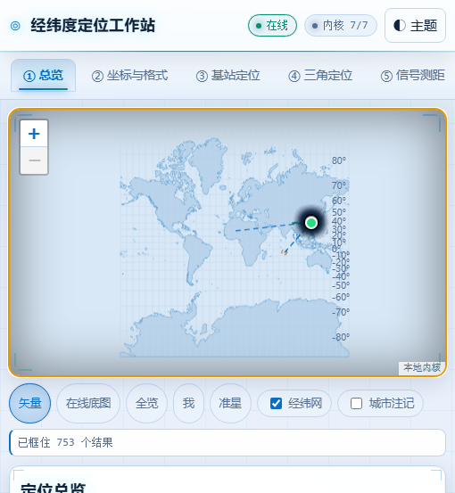

---

## 1. What is in the package

The complete package is **68 files, 10.07 MB (9.60 MiB)** — including 15 real
run screenshots (5.04 MB) and 2.86 MB of offline data, excluding `.git` and the author's development-only
directories. That is exactly what `git ls-files -co --exclude-standard` counts, and
`tests/check-package.py` verifies in reverse that no deliverable file is swallowed by `.gitignore`.

| Path | Purpose |
|---|---|
| `index.html` | The only entry point; eleven panels; references **17 local resources**; no bundler, no CDN |
| `favicon.svg` | The tab icon, **declared** by the entry page. Without a declaration every browser asks the *site root* for `/favicon.ico`, and on GitHub Pages that unasked-for request answers 404 (§11.27). Same palette as the dark skin: deep-space panel, neon crosshair over a meridian ring |
| `app/core-geodetic.js` | GEOGEO (701 lines): ellipsoid, geodesic direct/inverse, ECEF/ENU, area and convex hull, compass |
| `app/core-datums.js` | GEODATUM (1276 lines): projections and encodings, datum transforms, GCJ-02/BD-09, `parseAny` |
| `app/core-cell.js` | GEOCELL (2410 lines): cellular channel ↔ frequency, TA/RSRP ranges, lateration, TDOA, fingerprinting |
| `app/core-gnss.js` | GEOGNSS (3021 lines): NMEA, ephemeris, pseudorange LSQ, DOP, RAIM, atmosphere, PPP messages |
| `app/core-astro.js` | GEOASTRO (2338 lines): sun/moon/star apparent places, sub-points, terminator, Polaris compass |
| `app/core-net.js` | GEONET (2838 lines): network policy, URL audit, multi-source fusion, trace parsing, cache/health |
| `app/core-vault.js` | GEOVAULT (1042 lines): AES-256-GCM envelope, PBKDF2-SHA256 key derivation, auto-lock, wipe (§6.8) |
| `app/ui-app.js` `app/ui-map.js` `app/style.css` | Shell (3498 lines), map wrapper (514 lines, incl. crosshair), skin (678 lines: one variable set, two themes, the sticky chain — §6.9) |
| `app/data/` | Offline data: cities 2.08 MB, land 763 KB, country codes 9.4 KB (source and rebuild: §10) |
| `vendor/` | Third-party: Leaflet 1.9.4 (BSD-2), qrcode.js (MIT). Both shipped, never downloaded |
| `示例数据/` | Ten sample inputs that close on each other — §4 |
| `server.py` | Bridge implementation #1 (2489 lines, Python standard library, binds 127.0.0.1 only, `--selftest` 110 items) |
| `bridge-powershell.ps1` | Bridge implementation #2 (2166 lines, PowerShell 5.1 + .NET, **runs on a stock Windows**, `-SelfTest` 202 items) |
| `启动-Windows.bat` | Windows launcher: Python bridge → PowerShell bridge → open the page, a three-level fallback (pure ASCII console face with the palette as its state lamp, §2.1 and §2.10) |
| `启动-macOS.command` `启动-macOS-Linux.sh` | macOS launchers — double-click and built-in-Terminal (LF endings, §2.7) |
| `启动-Linux.sh` `启动-macOS-Linux.sh` | Linux launchers — the distro's own terminal is the primary path; the two share one bridge engine, so no logic is written twice (LF, §2.7) |
| `启动-Android.sh` | Android Termux launcher: a trampoline that asks the shared engine for the 44-column face (LF, §2.10) |
| `启动-iSH.sh` | iPhone / iPad: runs the Python bridge inside iSH — self-test, start, probe, then print the Safari URL, on the 16-colour ASCII face (§2.8, §2.10) |
| `README.md` | Repository front page: index only (what this is / how to open it / which section answers which question / where the pictures are) |
| `MANUAL.md` | This file |
| `docs/img/` | Five English diagrams: `architecture.svg` (§6.1), `decision-flow.svg` (§5), `privacy-boundary.svg` (§7), `apple-launch-paths.svg` (§2.7–2.8), `platform-packs.svg` (§1.1) |
| `images/` | Fifteen real screenshots (referenced by README and this manual — not decoration) |
| `tests/run-all.mjs` | Runs every kernel gate in Node (623); `--with-server` adds the Python bridge, `--with-bridge` also the PowerShell one |
| `tests/check-package.py` | 71 packaging gates: entry resources, launcher encoding and line endings, both bridges' red lines and contract, the front end's exfiltration-channel scan, broken doc links plus a probe of that link checker itself, ignore-rule swallowing, zero dependencies, English-only GitHub docs, platform manifests, the per-pack size table, the order of the self-test panel's own verdict, and the entry page's icon declaration |
| `tests/bridge-parity.py` | 41 live cases: both bridges started together, the same request sent to each, comparing status, key sets, byte counts, Content-Type and the cross-origin answer |
| `工具/pack-platform.py` | Builds the per-platform archives listed below (`--list`, `--check`, `--all`) |
| `.github/workflows/ci.yml` | Runs the three groups above on Ubuntu and Windows on every push |
| `工具/build-data.mjs` | Offline-data generator (idempotent, §10) |
| `package.json` `LICENSE` `.gitignore` `.gitattributes` | Zero-dependency metadata, MIT plus third-party attribution, ignore rules, line-ending rules (`.sh`=LF, `.bat`/`.ps1`=CRLF, images=binary) |

The only file a run ever adds is the bridge access log in the root
(`桥接服务.log` or `bridge-powershell.log`); deleting it changes nothing. The sample NMEA log
`示例数据/NMEA语句示例.log` **is** a deliverable, which is why `.gitignore` lists the two root
log files by name instead of writing `*.log` (pitfall §11.3). Headless debugging scripts live in
`app/_build/` on the author's machine and are gitignored: after `git clone` that directory does not
exist and nothing is missing — the tree you see in the repository *is* the deliverable.

### 1.1 You do not have to download everything: per-platform packs

The repository carries every platform's launcher, both bridges, 5.04 MB of screenshots and the test
gates. A given device needs none of that except its own. `工具/pack-platform.py` therefore
declares an **explicit manifest per platform** — no wildcards, so a stray file dropped into `app/`
cannot silently ride along into a release — and the manifests are a gate, not prose:
`--check` fails if a listed file is missing, if a pack smuggles in another platform's entry point,
or if a deliverable file belongs to no pack.

| Platform | Archive | Files | Uncompressed | ZIP |
|---|---|---|---|---|
| Any browser, no bridge | `geo-browser.zip` | 36 | 4 589 963 B | 1.62 MB |
| Windows 10/11 | `geo-windows.zip` | 39 | 4 879 046 B | 1.72 MB |
| macOS 12+ | `geo-macos.zip` | 39 | 4 748 572 B | 1.68 MB |
| Linux (any distro) | `geo-linux.zip` | 39 | 4 751 867 B | 1.68 MB |
| Android · Termux | `geo-android.zip` | 38 | 4 734 958 B | 1.67 MB |
| iPhone / iPad · iSH | `geo-ios-ish.zip` | 38 | 4 745 069 B | 1.68 MB |
| Everything (developers) | `geo-full.zip` | 68 | 10 071 933 B | 6.73 MB |

Measured on 2026-11-03 by `python 工具/pack-platform.py --all --json dist/包清单.json`. Two columns
are quoted to the byte and one is not, because of an awkward fact about this table: **the manual
describing the packs is inside every pack it describes**. File counts and uncompressed bytes survive
that — correcting a byte count here replaces digits with digits, so the tree keeps its size and the
figure stays exact. A ZIP size does not survive it: DEFLATE reacts to the very digits written into
the row, so the next `--all` reports a few bytes either way. That column is therefore rounded to two
decimals, which is both stable and still honest — it separates the two packs that really differ by
96 KB (`browser` versus `windows`) while showing that the four Unix-family archives land within
7.4 KB of each other, because the launcher each of them adds costs less than the screenshots all of
them leave out.

What each pack contains, and why:

- **Shared core (every pack)** — `index.html`, the nine `app/*.js` files, the three `app/data/*.js`
  files, the three `vendor/` files, the ten `示例数据/` samples, `LICENSE`, `README.md`, `MANUAL.md`.
  This is the whole application: 2.86 MB of it is the offline city and land data, which is exactly
  the point of offline-first.
- **Figures (every pack)** — `docs/img/*.svg`, 5 files, 58 KB. "Why does the bridge bind
  loopback only?" must be answerable with a diagram on every platform.
- **Platform-specific** — `windows` adds `启动-Windows.bat`, `bridge-powershell.ps1` and `server.py`
  (so a machine that happens to have Python gets that bridge, and one that does not gets PowerShell);
  `macos` adds `启动-macOS.command`, `启动-macOS-Linux.sh`, `server.py`; `linux` adds
  `启动-Linux.sh`, `启动-macOS-Linux.sh`, `server.py`; `android` adds `启动-Android.sh`, `server.py`;
  `ios-ish` adds `启动-iSH.sh`, `server.py`.
- **Left out of every platform pack** — `tests/` (three gate runners), `工具/build-data.mjs`,
  `package.json`, `.github/`, `.gitattributes`, `.gitignore` and `images/*.png`. Those are the
  developer surface: nothing in the running application reads them. Packs other than `geo-full`
  therefore carry no `images/`, and the packager rewrites this manual's `](images/…)` links to the
  identical PNGs on the Pages site — one source of truth, no duplicated document, no 2.79 MB tax on
  a phone.

```bash
python 工具/pack-platform.py --list      # print every manifest, file by file
python 工具/pack-platform.py --check     # fail if a manifest lies (missing file, smuggled entry, orphan)
python 工具/pack-platform.py macos       # -> dist/geo-macos.zip
python 工具/pack-platform.py --all --json dist/包清单.json
```

Two properties the packager keeps on purpose: ZIP entry timestamps are pinned to 1980-01-01, so
repacking identical sources yields identical bytes and the sizes in the table above cannot drift
because someone re-zipped; and shell launchers are stored with mode `0755`, because without the
executable bit neither double-clicking `启动-macOS.command` nor `./启动-Android.sh` works on a
Unix-like system (Windows ignores these bits, so the `.bat` is unaffected).


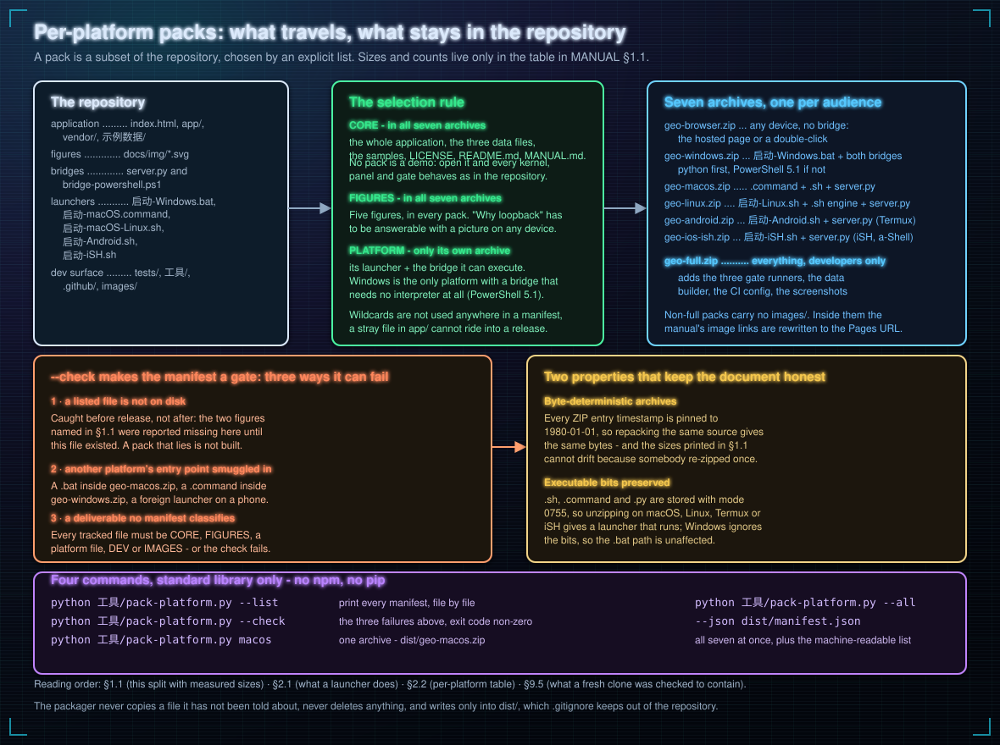

---

## 2. Launching on each platform

### 2.1 What a launcher does, and the three-level fallback

A launcher does three things: **find an interpreter → start the bridge bound to 127.0.0.1 → open the
page in a browser**. The Windows launcher is a three-level fallback, which is why "no Python installed"
stopped being a missing feature:

```
python / py exists and really runs   ->  python server.py --port 8765
        ↓ absent (or just the Microsoft Store stub)
PowerShell 5.1, built into Windows   ->  powershell -NoProfile -ExecutionPolicy Bypass -File bridge-powershell.ps1 -Port 8765
        ↓ neither bridge answers /api/health within 20 s
start "" "index.html"                ->  the page opens anyway; panel ⑧ reports 桥接不在线 (*bridge offline*)
```

Every implementation detail below was forced by a real failure (§11):

- **`where python` is not enough — the launcher also runs `-c "import sys"`.** The Microsoft Store
  placeholder passes `where` and then opens the Store instead of executing anything.
- **Reachability is probed with PowerShell `Invoke-WebRequest`, not Python.** The same test therefore
  validates both bridges, and it works on machines with no Python at all.
- **Delays use `ping -n`, never `timeout`.** Toolchains such as Git Bash put coreutils' `timeout`
  ahead of Windows' in PATH, so inside a batch file `timeout` is not necessarily the command you think.
- **The `.bat` is pure ASCII.** A GBK console on a Chinese Windows reads a UTF-8 batch file as garbage
  and aborts; so instead of embedding Chinese text, the launcher enumerates file names at run time
  (`for %%f in (*.md) do echo %%f`).

What each platform's launcher *looks like* — frame glyphs, colour ramps, column budgets and how the
state is signalled — is a separate layer with its own rules: §2.10.

### 2.2 Platform by platform

| Platform | Action | Notes |
|---|---|---|
| Windows | Double-click `启动-Windows.bat` | The bridge runs in a second, minimised window; close it to stop. **Full functionality without Python** (falls through to the PowerShell bridge) |
| macOS | Terminal: `cd` to the folder, `sh 启动-macOS-Linux.sh` — or double-click `启动-macOS.command` | Terminal is the primary path (§2.7). Double-click needs the executable bit and survives Gatekeeper only once |
| Linux (any distro) | Its own terminal: `cd` to the folder, `sh 启动-Linux.sh` — or double-click `启动-Linux.sh`, which finds the terminal emulator you already have and re-enters it | The same Terminal-first policy as macOS (§2.7). The bridge here is `server.py`, so ⑧'s per-hop tracing needs a `python3` from your distro's own package manager; the other ten panels run without it |
| Android | Termux: `pkg install python` → `sh 启动-Android.sh` | Open the printed `http://127.0.0.1:8765/` in the phone's browser (the bridge runs on the phone, loopback only, so no other device can reach it) |
| iPhone / iPad | **Shortest path: Safari on the hosted URL** — all eleven panels render, ⑪ runs as normal | For per-hop route tracing install iSH and run `sh 启动-iSH.sh` (§2.8). Without it, ⑧ still does IP lookup and DoH but gets no hops |
| Nothing installed | Double-click `index.html` (`file://`) | Seven kernels + map + offline data + ⑪ all run; only the bridge side of ⑧ is missing |

On iOS the Files app's Quick Look *previews* an `.html` but does not execute its scripts, so real use
depends on a local HTTP server or the hosted URL. And because a browser refuses the Geolocation API
in a **non-secure context** (an ordinary LAN `http://192.168.x.x`), a phone can use its own GPS only
through `file://` (some browsers) or HTTPS. Per-platform, per-panel availability: §9.1.

### 2.3 Two bridges, one contract

The same `/api` contract has two implementations, and the page **does not need to know which one it
talked to**:

| | `server.py` | `bridge-powershell.ps1` |
|---|---|---|
| What must be installed | Python 3 (standard library; no pip dependencies) | **Nothing**: PowerShell 5.1 + .NET ship with Windows |
| HTTP serving | `http.server.HTTPServer` | `System.Net.HttpListener` |
| Starting external commands | `subprocess` + argv list + `shell=False` | `ProcessStartInfo` argument array + `UseShellExecute = $false` |
| Self-test | `python server.py --selftest` → 110 items | `powershell -File bridge-powershell.ps1 -SelfTest` → 202 items |
| Port | `--port` (default 8765) | `-Port` (default 8765) |
| Cross-origin allowlist | built-in list + `--allow-origin` (§7.3) | built-in list + `-AllowOrigin` (§7.3) |
| Access log | `桥接服务.log` in the root | `bridge-powershell.log` in the root (`-Quiet` disables it) |

Consistency is held by three gates, not by "they look the same":

1. **Static comparison** (`tests/check-package.py`): the contract literals in both sources
   (`BRIDGE_CONTRACT` / `$script:BridgeContract`) are compared endpoint by endpoint and key by key —
   six endpoints, the thirteen refused coordinate-like parameters, the static Content-Type table, the
   cross-origin allowlist and the switch that lengthens it (`--allow-origin` vs `-AllowOrigin`, which
   deliberately are not the same spelling).
   The `.ps1` UTF-8 BOM and CRLF endings are pinned here too (without the BOM, PS 5.1 reads the
   Chinese comments as GBK and the file stops parsing).
2. **Live comparison** (`tests/bridge-parity.py`, 41 cases): start both bridges, send each request to
   both, compare status, response key sets, byte counts, Content-Type and **the cross-origin answer** —
   an allowed origin must be echoed identically by both, a list-external origin must be refused by both,
   and neither may ever emit a wildcard. This layer is not optional:
   the first `.ps1` named ping's argv `arguments`, gave `iface` an extra `status`, and put `engine` and
   `dotnet` into `health` — none of which its own `-SelfTest` could see, because that only proves the
   file agrees with itself. It only ever touches `127.0.0.1`, and its GeoIP cases use inputs rejected
   at construction time, so the run is identical offline, behind a proxy, or on a corporate LAN.
3. **The UI does not care**: ⑧'s runtime line reads whatever the bridge reports — the Python bridge
   says `Python 3.13.14`, the PowerShell bridge says `PowerShell 5.1.28000.2113，win32` with
   `health.python = null`. The PowerShell implementation **does not pretend to be Python**: the version
   is computed on the host and `platform` is not hard-coded.

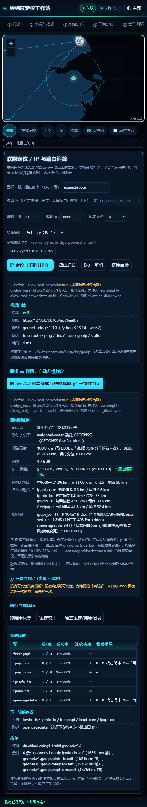

### 2.4 Ports, double starts, changing the port

- Default port 8765. If it is taken: `python server.py --port 9000` /
  `powershell -File bridge-powershell.ps1 -Port 9000` (still loopback only).
- Opening the page as `http://127.0.0.1:9000/` makes panel ⑧ follow that port automatically; you only
  have to type a bridge address by hand when the page was opened as `file://`.
- **Two bridges never run on one port.** On Windows `SO_REUSEADDR` lets a second process bind a port
  that is already *listening* (POSIX returns `EADDRINUSE`), and with two listeners the kernel hands
  connections out at random: you edit `server.py`, restart, and the page still behaves like the old
  process — which reads as "my change had no effect". So `create_server()` and the PowerShell start-up
  block send a loopback connect to the target port first and exit immediately if someone is already
  listening, printing the command that changes the port. Launchers are unaffected: they wait for
  `/api/health`, so a healthy older service simply gets used.
- Self-tests (`python server.py --selftest`, `... bridge-powershell.ps1 -SelfTest`) **listen on no
  port, start no child process, make no external request** — the only socket they touch is that one
  loopback connect probe.

### 2.5 How a hosted https page reaches a bridge on your own machine

The hosted page is `https://iammezsh.github.io/…`, the bridge is `http://127.0.0.1:8765`: different
scheme, different site, and into the loopback range. Two browser policies stand in the way and both are
implemented on both bridges:

- **CORS**: every `/api/*` response echoes **the caller's own origin, and only if that origin is on the
  allowlist** (§7.3): `null` (a `file://` page), the hosted page, any loopback origin, plus whatever the
  operator added at start-up. Anyone else gets `403 origin_not_allowed` with a Chinese reason, and with
  `Vary: Origin` alongside the echo so a shared cache cannot hand someone else's response to you. There
  is no `Access-Control-Allow-Origin: *` anywhere in either bridge — a gate in `tests/bridge-parity.py`
  searches every response header of both bridges for it, and `check-package.py` pins the switch that can
  lengthen the list (`--allow-origin` / `-AllowOrigin`) to start-up time only. Static files get **no**
  CORS header at all, so no other site can read your project files.
- **Private Network Access (PNA)**: before a public https page may request `127.0.0.1`, Chrome and
  Edge send a preflight containing `Access-Control-Request-Private-Network: true`, and the request
  proceeds only if the response echoes that header. `do_OPTIONS` (identical logic in both bridges)
  **echoes it only when the caller asked with it** — it is not broadcast.
- **Default address**: `GEONET.defaultBridgeBase()` follows the page's own port when the page is
  served by the bridge; every other origin (`file://`, hosted https) falls back to
  `http://127.0.0.1:8765`, so the hosted page never asks you to type an address.
- Measured records, including the raw preflight response headers, are in §9.4. Whether PNA is enforced
  depends on **browser version and flags**, which this repository cannot promise away: when a browser
  does block it, ⑧ lands on `bridge_unavailable` and shows the bridge's own explanation verbatim, and
  opening the same-origin page `http://127.0.0.1:8765/` bypasses that layer entirely.

### 2.6 A per-request origin guard (the extra layer the PowerShell bridge needs)

`HttpListener` dispatches prefixes **by the Host header**, and the kernel-mode `http.sys` opens the
listening port on every adapter. That means another machine on the LAN can send
`Host: localhost:8765` and have the request land in your bridge. So the PowerShell bridge, besides
referring non-loopback binds, **validates `RemoteEndPoint` on every request**: a peer that is not
`127.x` / `::1` gets `403 not_loopback`, and if the peer address cannot be read the request is refused
(fail-closed). This check runs before method dispatch and before coordinate-parameter validation — it
is not attached to one endpoint. Eight dedicated gates cover it: loopback peer allowed (`127.0.0.1`,
`::1`, the whole `127/8`); LAN peer refused even when `Host:` says `localhost`; unreadable peer refused;
the loopback *text* judgement pinned over six accepted spellings (including `::ffff:127.0.0.1` and
`[::1]`) and eight rejected ones (including `100.66.176.1`, `169.254.169.254` and `fe80::1%eth0`); no
reliance on the `IsLoopback` instance property that only exists in .NET Core and reads as empty under
PS 5.1; the guard sequenced before method dispatch and before coordinate validation; `403 not_loopback`
rather than a 500 or a silent disconnect. On the `server.py` side the
bind address itself provides the same behaviour.

### 2.7 The terminal that is already installed — macOS and Linux

macOS is supported through **the Terminal app that ships with the system**, and Linux — every distro,
by the same rule — through the terminal its desktop already installed. No Homebrew, no pip, no
Xcode up front, and — importantly — no `chmod` if you use the Terminal path:

```sh
cd "/Downloads/geo-position-workstation"     # the folder you unpacked
sh 启动-macOS-Linux.sh                        # sh, not ./ — no executable bit required
```

`sh 启动-macOS-Linux.sh` prints that exact copy-paste line with the real directory in it, so you never
retype a path. What it then does: locate `python3` (falling back to `python`) → start
`server.py --port 8765` bound to loopback, logging to `桥接服务.log` → poll `/api/health` for up to
10 seconds → `open http://127.0.0.1:8765/index.html`. If no Python is found it still opens
`index.html` offline and prints the three ways to obtain an interpreter:

1. `xcode-select --install` — installs the Command Line Tools, after which `/usr/bin/python3` exists.
   This is the Apple-official route; it needs no Homebrew and no pip.
2. Run `python3 --version` once — on a Mac with no CLT this pops the system dialog offering to install
   the developer tools. Same result, fewer keystrokes.
3. `brew install python` if Homebrew is already there.

Not installing any of them is a legitimate choice: every panel except ⑧'s per-hop tracing works,
and ⑧ states `桥接不可用` (*bridge unavailable*) rather than inventing hops.

**Double-clicking instead of Terminal.** `启动-macOS.command` is only a two-line trampoline that
`cd`s into the folder and hands over to `启动-macOS-Linux.sh`, so the two paths cannot drift apart. It
needs the executable bit (`chmod +x 启动-macOS.command`) and, for anything fetched through a browser,
Gatekeeper quarantine (`xattr -dr com.apple.quarantine .`, or right-click → `打开` / *Open* the first
time). `git clone` does not set the quarantine flag; a ZIP download does. That asymmetry — plus the
fact that Terminal needs no `chmod` at all — is why the manual leads with Terminal.

**Ports.** `PORT=9000 sh 启动-macOS-Linux.sh` overrides the default; open the page on that port and ⑧
follows it without typing. If the bridge does not come up within 10 seconds the launcher says so,
suggests `PORT=9000 …`, kills the half-started process and falls back to the offline page.

**Linux, any distro, the same rule.** `启动-Linux.sh` is Linux's counterpart of
`启动-macOS.command`: it contains no bridge logic at all and hands over to the one shared engine,
`启动-macOS-Linux.sh`, so a fix lands once and both systems get it. What differs is what a
double-click *is*. On macOS a `.command` opens Terminal.app by itself; a Linux file manager may open a
`.sh` in an editor, or run it in a windowless `sh` whose output vanishes the instant it exits — which
looks for all the world like a crash. So the launcher takes the desktop's own terminal as the primary
path and, when it was not started from one, starts it itself:

```sh
cd ~/Downloads/geo-position-workstation
sh 启动-Linux.sh        # 在你自己的终端里跑：直接转交引擎，和 macOS 一模一样
```

The detection order is `$TERMINAL` first — the freedesktop convention, which every desktop honours
once the user names a terminal — then `gnome-terminal`, `mate-terminal`, `konsole`, `yakuake`,
`xfce4-terminal`, `lxterminal`, `qterminal`, `terminator`, `tilix`, `deepin-terminal`, `kitty`,
`alacritty`, `foot`, `xterm`. Those binaries are **not** interchangeable at the command line: GNOME
and MATE take `-- COMMAND`, the rest of that list takes `-e COMMAND`, so the launcher picks the flag
per name instead of guessing a universal spelling that does not exist. Three guards make the re-entry
honest, because "spawn a terminal from a script" is exactly where a silent failure would hide:

- The spawned terminal gets `GEO_LAUNCHER_IN_TERMINAL=1`. A child that sees the marker goes straight
  to the engine, so a terminal that re-execs this script *without* giving it a TTY cannot make it
  spawn itself again and again.
- **No display server** — `$DISPLAY` and `$WAYLAND_DISPLAY` both empty, which is SSH, WSL, a container
  or a virtual console — no window is attempted: the engine runs in the shell you are already in and
  prints the command line to copy.
- **Spawn failed** — unusual argv shape, sandboxed terminal, missing permissions — the launcher says
  which terminal it tried and runs the engine in place. Silence is the one outcome that is never
  allowed, because it is indistinguishable from a broken download.

From there it is the macOS path byte for byte: `python3` → `server.py` bound to 127.0.0.1 → poll
`/api/health` for 10 s → `xdg-open http://127.0.0.1:8765/index.html` (`open` on macOS, `termux-open`
on Android, and if none of the three exist it prints the URL). Without a Python it still opens
`index.html` offline and prints the install line for your family of distros — `sudo apt install
python3`, `sudo dnf install python3`, `sudo pacman -S python`, `sudo zypper install python3`,
`sudo apk add python3` — none of which needs pip, a compiler or a third-party repository.
`PORT=9000 sh 启动-Linux.sh` overrides the port exactly as on macOS, and ⑧ follows the port by itself.

**What is verified where.** Both launchers are POSIX `sh`, syntax-checked with `sh -n`, and CI runs
`sh -n` over every launcher file on a real Ubuntu `/bin/sh` (dash), where LF endings and the shebang
are separately asserted (§8.6, §8.8). The Linux launcher's four branches were additionally exercised
on this machine under a POSIX shell with a stub standing in for the terminal emulator: the
GNOME-shaped stub recorded `argv: -- sh <abs>/启动-Linux.sh` with the recursion marker set, the
Konsole-shaped one recorded `-e sh <abs>/启动-Linux.sh`, a stub exiting non-zero made the launcher
fall back to running the engine in place, and with the display variables cleared it took the
headless branch and said so. What remains documented rather than observed is the part this machine
does not have: Terminal.app's double-click, Gatekeeper and `xattr` on macOS, and a real desktop
session's window manager on Linux. Everything the scripts print at run time — including
`/api/health`'s answer — is measured live on your machine, which either gets a bridge or is told, in
so many words, that it did not. The chrome on these paths — three different frame glyph sets, three
different colour ramps, one shared body of text — is §2.10.

### 2.8 iPhone and iPad in depth

There are two Apple mobile paths, and they are deliberately different products.

**(a) Safari on the hosted URL — zero install, recommended.**
Open <https://iammezsh.github.io/geo-position-workstation/>. Seven kernels, offline data, map, deep
links, QR generation and the 623-gate self-test all run (measured on the hosted URL: §9.4). Panel ⑧
keeps IP geolocation and DoH through browser-direct requests; per-hop tracing needs a bridge and says
so. Nothing is executed on the phone, nothing is installed, and the page keeps working if you lose
connectivity after loading it — the map draws offline vectors and sends no tiles.

**(b) iSH — a real Alpine Linux on the phone, so a real `server.py`.**
iSH is a user-mode x86 emulator plus syscall translation, which means the bridge here is the same
Python file as everywhere else, running on a genuine Linux-ish kernel:

```sh
apk add python3                       # once; the bridge needs no pip packages
cd 你的目录                            # or: apk add git && git clone https://github.com/IAMMEZSH/geo-position-workstation
sh 启动-iSH.sh                        # alternate port:  sh 启动-iSH.sh 9000
```

`启动-iSH.sh` runs four numbered stages and prints the outcome of each, because guessing is not
documentation (the deliberately plainest of the five launcher faces — 16 colours, no box-drawing
glyphs — is §2.10):

1. **Offline self-test** — `python3 server.py --selftest`, full log to `/tmp/geo-selftest.log`. The
   launcher echoes the self-test's own summary line (`自检通过 110 项…` / *110 items passed*), not a
   count of its own, so the number cannot drift from what `server.py` actually asserts. On failure it
   prints the tail of the log so the report is copy-pasteable.
2. **Start the bridge** on `127.0.0.1:$PORT` and poll `/api/health` once a second for up to 15 s. If the
   process exits early, the log tail is printed; if nothing answers in 15 s, the port-override command
   is printed. Both cases are exits, not silent half-starts.
3. **Real numbers, not just green checks** — it fetches `/api/health`, `/api/iface` and
   `/api/dns?host=127.0.0.1` and prints the bridge name and version, the runtime string, the bound
   address with `bind.loopback_only`, the capability list, the interface count together with the field
   names that were deliberately withheld (`hostname, mac, interface_names, lan_addresses`), and what the
   local resolver made of the loopback literal. That is the difference between "the gates passed" and
   "this machine answered".
4. **The Safari hand-off**, with the missing-tool hint if `traceroute`/`ping` are not installed
   (`apk add iputils traceroute` — ⑧ degrades honestly to `command_missing` and never invents hops).

**The honest boundary.** Whether Safari can connect to a port that iSH is listening on depends on the
iSH version and on whether it hands that listener to iOS at all; iSH's TCP/IP stack lives in user
mode. This is not something a page can control, and **the repository author has no iOS device to
promise it from**. So the script prints the exact three-step diagnosis instead:

```sh
apk add curl && curl -s http://127.0.0.1:8765/api/health   # answers -> the bridge is fine, iOS did not hand over the port
sh 启动-iSH.sh 9000                                        # second: a different port
# third: type `echo hi` in iSH — if it is slow, iOS suspended iSH, and the bridge went with it
```

If all three behave and Safari still cannot connect, the listener belongs to iSH's stack only. Two
documented exits, differing in exactly one feature (per-hop tracing): use the hosted URL, or run the
same `server.py` inside a Python environment on iOS that can serve HTTP itself (A-Shell / Pyto / Texta
class apps) and point ⑧'s bridge address at it — it will still only ever talk to `127.0.0.1`.

**Keep iSH alive.** iOS suspends background apps. On an **iPad**, put iSH and Safari in Split View or
Slide Over so the bridge keeps serving while the page loads and while ⑧ runs. On an **iPhone** there is
no Split View, so either accept that ⑧ works only while iSH is in the foreground, or use the hosted
URL for everything else — the seven kernels, offline data, map and ⑪ are unaffected either way.

**Do not** try to run the app from the Files app: Quick Look renders a preview and never executes the
page's scripts. And note that the bridge refuses LAN targets *for itself* — binding `0.0.0.0` is
rejected at start-up on every platform (red line §7.2.1), so a phone is never meant to be reached from
another device, and a Mac is never meant to serve one.

### 2.9 What you lose without a bridge

Exactly two things: ⑧'s **per-hop route tracing** and the **bridge-side ping/DNS**. The panel says
`bridge_unavailable` and names the reason. Everything else — ten panels, seven kernels, the map, the
offline data, ⑪'s 623 gates — is unchanged, and ⑧'s own IP lookup and DoH still run through the
browser directly.

### 2.10 Five faces, one contract: what each launcher looks like

Five platforms, five terminal drivers, and **exactly one of them cannot be trusted with escape bytes**.
What a launcher *says*, and the order it says it in, is one contract already documented above (§2.1 for the
three-level fallback, §2.7 for the terminal that is already installed, §2.8 for iSH's four stages).
What differs per platform is the chrome: which glyphs draw the frame, which colours carry state, how
wide a line may get. Keeping the two apart is what makes "restyle the launcher" a non-event — in
`启动-macOS-Linux.sh` the decoration layer is a set of `hud_*` printers and nothing else, so deleting
them and swapping every `printf` for `echo` leaves the run word for word identical.

| Face | File | Frame | Ramp / accent | Markers | Column budget |
|---|---|---|---|---|---|
| Windows `cmd` | `启动-Windows.bat` | ASCII `=` and `-` rules | no SGR at all; the **whole-window palette** is the state | `color 0E` / `0A` / `0C` | 80 (widest printed line: measured below) |
| macOS | engine, `GEO_FACE=macos` | `╭─╮` hairline | cyan → violet → pink, 6 stops, 24-bit | `⌘` heading, `◉` state | 72 |
| Linux | engine, `GEO_FACE=linux` | `╔═╗` double line | cyan → indigo → magenta, 6 stops, 24-bit | `◆` heading and state | 72 |
| Android / Termux | engine, `GEO_FACE=android` | `┌┐└┘` single, narrow | spring green → amber, 6 stops | `▴` heading, `▸` state, `▮` separator | 44 |
| iPhone / iPad (iSH) | `启动-iSH.sh` | ASCII rules + a 4-space `|` rail | **16 colours only** | `[*]` / `[x]` | 44 (clamped to 30–60) |

**Why the `cmd` face owns no escape bytes.** Whether SGR sequences are honoured there depends on the
console host and on an "improved color" flag a batch file cannot set without touching the registry —
so the only two things this face uses are the ones `cmd.exe` has had since NT: `color` and ASCII. The
palette is therefore a **state readout, not decoration**: `color 0E` (amber) while probing, `color 0A`
(green) once `/api/health` answered, `color 0C` (red) if neither bridge did. The banner prints that
mapping itself (`[LEG] amber = probing   green = bridge online   red = no bridge`), so the window's
colour is a documented signal you can read from across the room. The assertions on this face are static:
the file stays pure ASCII, carries zero ESC bytes, and its widest printed line must fit 80 columns —
measured with an upper-bound expansion (`%VAR%` counts as 8 characters, `%%f` as 12), because a wrapped
frame is worse than a plain one (§8.6).

**Why the Unix faces use colour, and exactly when they stop.** Three inputs, one order:
`[ -t 1 ]` first (stdout is a pipe when you grep it, when CI captures it, when you redirect it — then
the face prints plain text and not one escape byte appears), then `NO_COLOR` when non-empty (the
cross-project convention from no-color.org), then `GEO_COLOR=1/0`, which has the last word because the
person debugging over a support chat needs "send me a screenshot" to be possible:
`GEO_COLOR=1 sh 启动-Linux.sh`. The 24-bit ramp is separately gated on the terminal declaring
`COLORTERM=truecolor|24bit`; if it does not, the same six stops collapse into a two-colour 16-SGR
ladder instead of the terminal printing `38;2;…` as visible text. Colour never carries information on
its own — every state row also prints a glyph and a word, so `NO_COLOR=1` loses styling and nothing
else.

**Why iSH gets the plainest face of the five.** iSH ships a 16-colour xterm subset, never reports
`COLORTERM`, and uses a font whose box-drawing coverage nobody in this repository can inspect from the
outside — a `╔` is one tofu box away from being the whole banner. So this face emits **zero** `38;2;`
sequences and **zero** codepoints in U+2500–U+25FF (both are asserted by the package gate, not by
review), draws its rules with `=` and `-`, gets its structure from a 4-space indent plus a `|` rail,
and marks status with `[*]` and `[x]`. Long Chinese prose is deliberately *not* hard-wrapped by the
script: the terminal wraps it, and because nothing in this face depends on columns lining up, one wide
answer row from `/api/iface` degrades into three readable lines rather than a broken frame. What *is*
budgeted is structure: `i_rule` emits exactly `$COLS` characters, counting the leading space and the
first glyph (`$((COLS - 2))` of filler) — it did not used to, which is how the frame came out two
columns wider than its own budget, and the arithmetic is now pinned by the gate instead of remembered
(§11.22).

**The column budget, and the two lines allowed to break it.** Width comes from `GEO_WIDTH` if set, else
`tput cols` when stdout is a TTY, else 72. Below 24 columns it becomes 72 — a 10-column window is a
misdetection, not a design target — and above the face's ceiling it clamps (72, or 44 on the android
face, because portrait Termux really is about 40 columns and a frame wider than its content is the
ugliest available failure). Two optional telemetry rows (`24-bit 阶梯 · 72 列 · COLORTERM=…` and the
window-title explanation) print only at `COLS ≥ 56`: they are debugging aids, and on a phone they cost
more than they tell. The only lines allowed to exceed the budget are literal copy-paste targets — the
`cd "<directory>" && sh <entry>` line and, when no opener exists, `请手动用浏览器打开：<url>` — whose
length depends on where your folder lives and which must not be folded.

**The same three states, expressed with different organs.** `cmd` repaints the whole window; a Unix
terminal cannot be repainted per-glyph from a script but does honour OSC 2, so the **window title is
the readout**: `Geo Position Workstation · BOOTING` → `READY` / `DEGRADED`. It is emitted only when
stdout is a TTY, which is why every piped run in the measurements below contains 0 title sequences: a
log file cannot be polluted by chrome.

**Which hints you get follows the face, not `uname`.** Termux reports `Linux`, so the only honest
signal is `PREFIX` (`*termux*|*Termux*`). From machine *or* requested face the engine derives
`FAMILY=termux|macos|linux`, and the interpreter-install hints follow that: previewing
`GEO_FACE=android` prints `pkg install python`, never five `sudo …` lines that could not work on a
phone and would not fit in 44 columns anyway. Machine facts stay machine facts — `[SYS] 平台 …` and
`[RUN] 入口 …` report what the box actually is, not what face it was asked to wear.

**What is machine-checked rather than reviewed** (all inside the package gate, §8.6, without changing
its item count): the three Unix frame glyph sets must all be present in the engine and mutually
distinct, which is the executable version of "five platforms, five faces"; the iSH file may contain no
24-bit sequence and no box-drawing character; `NO_COLOR` and `GEO_COLOR` must both be honoured in every
colour-aware file; the rule arithmetic must survive; each entry file must name its own face
(`GEO_FACE=macos|android|linux`) and `启动-Linux.sh` must additionally pass `GEO_TERM_LABEL`, so the
window that opens says which terminal it came from; and the `.bat` must stay ASCII-only with a
≤80-column widest line.

**Measured on this machine for this section.** Every number below came from running the real launcher
files in a throw-away directory, not from reading them. `ESC` counts escape bytes actually emitted;
`tc` counts `38;2;` sequences; `max` is the widest printed line after stripping colour, with the
sandbox path normalised to `~/dir` (the `cd` line is the one row whose width is a property of your
folder, not of the design); `over` counts lines over the face's own ceiling.

| Face / branch | colour policy | ESC | tc | max cols | over ceiling |
|---|---|---|---|---|---|
| macOS, bridge online | forced on, `COLORTERM=truecolor` | 74 | 28 | 72 | 0 |
| macOS, bridge online | forced on, no `COLORTERM` | 74 | 0 | 72 | 0 |
| macOS, bridge never answered | forced on | 70 | 28 | 72 | 0 |
| macOS, no interpreter | forced on | 79 | 21 | 72 | 0 |
| Linux, same four branches | as above | 74 / 74 / 70 / 81 | 28 / 0 / 28 / 21 | 72 | 0 |
| Android, no interpreter (`pkg install python` path) | forced on | 69 | 21 | 44 | 0 |
| Android, bridge never answered | forced on | 66 | 28 | 44 | 0 |
| Android, bridge online | forced on | 70 | 28 | 54 | 1 — the `请手动用浏览器打开：<url>` fallback, which Termux never prints because `termux-open` exists there |
| every Unix face | `GEO_COLOR=0` | **0** | 0 | unchanged | unchanged |
| every Unix face | `NO_COLOR=1`, stdout piped | **0** | 0 | unchanged | unchanged |
| iSH, all four stages against a live bridge | forced on | 109 | **0** | 106 | 30 prose lines at 44 cols (23 at 60) — all terminal-wrapped; 0 rule lines over, because a rule is exactly `$COLS` |
| iSH, no interpreter | forced on | 32 | 0 | 54 | 3 prose lines |
| iSH | `GEO_COLOR=0` | **0** | 0 | 106 | unchanged |
| Windows `cmd`, bridge online / neither bridge answered | no SGR exists on this face | **0** | 0 | 77 (gate's static upper bound 78) | 0 |

The last Windows row is the same in both branches, and both branches were run for real: the online one
prints `[OK ] bridge online` after the first probe, the other exhausts all ten probes against the
Python bridge, all ten against the PowerShell bridge, then repaints the window red and opens
`index.html` — with the Chinese file-name enumeration printing nothing, because that test copy sat in
a directory holding no `.md`, which is exactly what "listed at run time" means.

What this machine cannot observe stays documented rather than implied: colour on a real iPhone iSH
terminal, Terminal.app's own rendering of OSC 2 titles, and each desktop terminal's truecolor support.
The audit above proves the *bytes emitted* — that a face asks for 24-bit only when the terminal claims
it, and asks for nothing at all when its output is a pipe. How a given terminal paints those bytes is
the next step, and `NO_COLOR=1` / `GEO_COLOR=1` are the two switches that make that step debuggable by
the person sitting in front of the screen.

---

## 3. The eleven panels

Each entry below states what the panel eats, what it gives back, and what was measured today.
"Measured 2026-11-03" numbers come from real button clicks on this machine (Windows, PowerShell bridge
running, page served at `http://127.0.0.1:8765/`) — they are not design values. On another machine or
minute the last digits move; the magnitude and the conclusions do not.

### 3.0 Where every Chinese label comes from

The interface is Chinese by design (the product is written for Chinese surveying and network-optimisation
work). Nothing here has to be guessed:

| On screen | In English | Where |
|---|---|---|
| `经纬度定位工作站` | Geo Position Workstation | header |
| `离线内核 + 联网升级 · 基站 / 三角 / 信号 / GNSS / 天象 / IP 路由` | offline kernels + networked upgrade · cell / triangulation / signal / GNSS / celestial / IP-route | header subtitle |
| `离线` · `内核检测中…` | offline · detecting kernels… | the two badges, top right |
| `◐ 主题` | theme toggle | top right |
| `① 总览` `② 坐标与格式` `③ 基站定位` `④ 三角定位` `⑤ 信号测距` `⑥ GNSS 卫星` `⑦ 天象定位` `⑧ 联网与路由` `⑨ 批处理导出` `⑩ 历史收藏` `⑪ 内核自检` | Overview · Coordinates & formats · Cell stations · Triangulation · Signal ranging · GNSS satellites · Celestial · Networking & routing · Batch & export · History & favourites · Kernel self-test | the eleven tabs |
| `定位总览` | Positioning overview | ① panel heading |
| `矢量` `在线底图` `全览` `我` `准星` `经纬网` `城市注记` | Vector · Online tiles · Fit all · Me · Crosshair · Graticule · City labels | map toolbar chips, left to right |
| `游标：—` | Cursor: — | readout line under the map |
| `运行全部自检` `桥接自检` `桥接服务地址` `升级判定` `用浏览器定位我在这里` | Run all self-tests · Bridge self-test · Bridge service address · Escalation check · Locate me with the browser | buttons in ⑪, ⑧, ① |
| `桥接不在线` / `桥接不可用` | bridge offline / bridge unavailable | ⑧ failure line |
| `你拒绝了定位授权（code=1）` | You declined the location prompt (code=1) | ① after a refusal |
| `算不出` | Cannot be solved | any kernel that returns null |
| `伪造跳数：否` | Fabricated hops: no | ⑧ trace table footer |
| `目标归属` | Target scope (LAN / public) | ⑧ trace and ping rows |
| `解锁` `建锁` `立即上锁` `改口令` `擦除保险柜` `自动上锁` | Unlock · Create the lock · Lock now · Change passphrase · Wipe the vault · Auto-lock | ⑩ storage strip |
| `本机存储` `写盘` `磁盘上的形态` `逻辑键` `还没有信封` | Local storage · Write to disk · Shape on disk · Logical keys · no envelope yet | ⑩ status rows (§3 ⑩) |
| `谁能读这台桥` `名单 … 条` `不是通配 *` | Who can read this bridge · allowlist … entries · not a wildcard | ⑧ bridge rows (§7.3) |

### ① Overview (`① 总览` → heading `定位总览`)

- **`用浏览器定位我在这里` (*locate me with the browser*)** takes the browser's fix and looks it up in
  the offline data first (nearest city, country, land or water), then shows the accuracy circle. If you
  decline, the UI says `你拒绝了定位授权（code=1）` — it **does not** substitute an IP-based result.
- **Paste coordinates / parse**: accepts any notation — `31.2304,121.4737`, `31°13'49"N 121°28'25"E`,
  `50R LM 23456 12345` (MGRS), `ww8p4kj` (Geohash), `8R3C66Q2+66` (Plus Code), merged digits
  `31.2304 121.4737`, map URLs. The kernel picks readings by confidence and says why it cannot read a
  candidate.
- **All solutions in this session**: every fix computed by any panel accumulates in this table (source,
  latitude, longitude, accuracy, basis), comparable with each other and checkable on the map.
- **Two-point measurement**: direct (start + azimuth + distance → end) and inverse (two points →
  distance and both azimuths), with a choice of ellipsoid and algorithm. Measured: Shanghai → Los
  Angeles geodesic `1065846.489 m` (= 1065.846 km / 662.286 mi / 575.511 nmi), initial azimuth
  `335.9309°`, inverse-then-direct round trip closing at `0.000000 m`.
- **Crosshair (`准星`, fifth chip: `矢量 · 在线底图 · 全览 · 我 · 准星 · 经纬网 · 城市注记`)**: a cross
  plus ring pinned to the exact centre of the map container, implemented as a DOM overlay
  (`pointer-events:none`) rather than a map marker — so it is always precisely the map centre and never
  drifts when zooming. With it on, **clicking anywhere on the map** pans that point to the centre (zoom
  unchanged), and when the pan stops the readout line immediately gives the centre's
  `DD (6 dp) | DMS | UTM zone + easting/northing | MGRS | Plus Code | Geohash | nearest city and
  distance | zoom`, with the cursor position beside it so you can confirm you are reading the centre,
  not the pointer. Click `准星` again to go back to cursor-only. Measured (centre
  31.239811, 121.480637, zoom 10):

  ```
  准星：31.239811, 121.480637 ｜ 31° 14' 23.32" N 121° 28' 50.29" E ｜ UTM 51N E355308.7 N3457174.6
      ｜ MGRS 51R VQ 55308 57174 ｜ Plus Code 8Q336FQJ+W77 ｜ Geohash wtw3sr590 ｜ 最近城市 黄浦 0.3 km ｜ 缩放 10
  ```

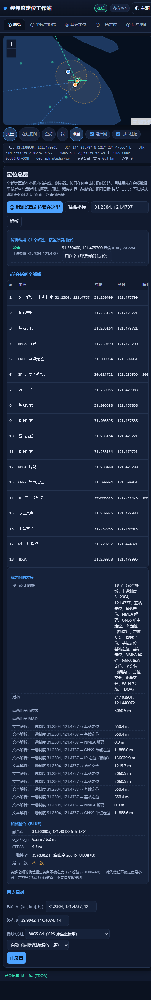

### ② Coordinates and formats (`② 坐标与格式`)

Projections and encodings (UTM / UPS / MGRS / Geohash / Plus Code / Web Mercator / map URLs), Chinese
coordinate offsets (WGS84 ↔ GCJ-02 ↔ BD-09, with the offset magnitude and whether the point falls in an
official deflection zone), datums and ellipsoids (Bursa 7-parameter transforms plus height corrections),
precision and significant digits. Measured:

- `31°13'49.44"N 121°28'25.32"E` → decimal `31.2304, 121.4737`, candidate confidence `0.93`;
- 4 decimal places → ground magnitude `11.09 m` (that is what the panel's digits-to-ground-scale table
  is for);
- WGS84 → GCJ-02 offset magnitude `435.5 m`; iterating back to WGS84 differs from the original by
  `0.0000 m`.

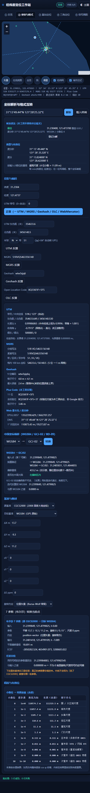

### ③ Cell-station positioning (`③ 基站定位`)

Eats JSON or CSV with MCC/MNC/TAC(LAC)/CI/ARFCN/PCI/RSSI/RSRP/TA/RAT/lat/lon/azimuth/beam-width fields.

- Range priority: explicit `range_m` → timing advance (GSM 554.69 m per bit, LTE/NR 78.17 m per bit) →
  RSSI/RSRP propagation models.
- Sites missing from your table can be pasted in by hand, and then participate in the intersection with
  their sectors drawn.
- Output: position, sites used / rejected, residual RMS, error ellipse, GDOP, and the basis of every
  per-site range.
- The three sample buttons load internally consistent data (one LTE, one GSM, one NR set).
- When ranges and site positions contradict each other (residual far larger than a single site's σ),
  the panel states the solution is unusable instead of emitting a fix with a several-thousand-kilometre
  confidence radius.

Measured (`示例数据/基站观测示例.json`, 3 LTE sites): `31.240108, 121.480783`, residual RMS `21.5 m`,
uncertainty radius `102.2 m`, GDOP `1.20`; per-bit TA conversions `16→1251 m`, `29→2267 m`, `3→1664 m`
are printed in the basis column; the solution is `75.5 m` from the sample's hidden point Q.

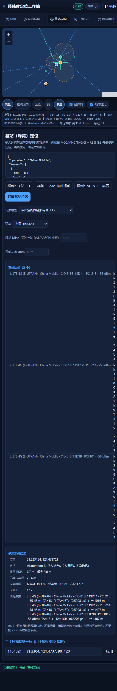

### ④ Triangulation (`④ 三角定位`)

A bearing intersection (two bearings suffice; a third acts as a redundant check), B range intersection
(circle pairs, with the second branch resolved by the remaining circles), C reverse computation from an
unknown point to the references — which produces exactly the numbers to feed back into A/B as a closure
check. Measured: 3-bearing intersection → `31.239985, 121.479983`, angular residual equivalent `0.5 m`,
uncertainty `52.3 m`, GDOP `1.19`; range intersection → `31.239988, 121.480015`, RMS `2.9 m`, radius
`25.1 m`.

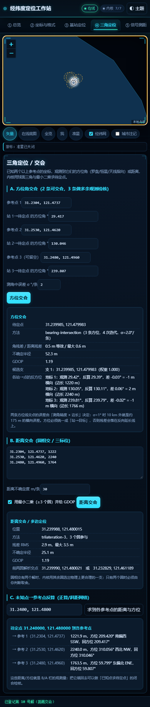

### ⑤ Signal ranging (`⑤ 信号测距`)

- A RSSI ↔ distance: free-space path loss plus log-distance model with exponent n, environment presets
  dense_urban/urban/suburban/rural/outdoor/indoor, optional transmit power and 1 m reference loss for a
  full link budget; the reverse direction (distance → RSSI) is provided for checking.
- B Wi-Fi/Bluetooth fingerprint matching: reference library + live scan, methods including cosine and
  euclidean with a configurable K; confidence derives from the actual spacing between matched points,
  not from RSSI precision.
- C TDOA: reference station plus per-station time differences (ns or `tdoa_s`), sign convention
  `tdoa = (this range − reference range)/c`, positive = farther. At least two TDOA observations (three
  stations including the reference) are needed for a unique solution, and the stations must be
  clock-synchronised (nanosecond-level error ≈ 0.3 m/ns).

Measured: indoor FSPL inversion gives `3098.1 m` with the model's own σ `2853.4 m` — that σ is written
there precisely so nobody reads 3098 m as a promise; RSSI → distance → RSSI closes at `0.000000 dB`.
Every row states its assumptions and magnitude instead of pretending metre-level accuracy.

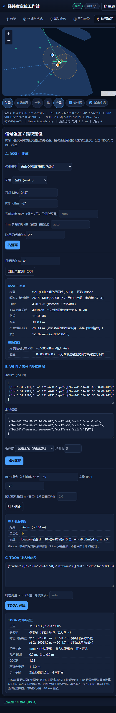

### ⑥ GNSS satellites (`⑥ GNSS 卫星`)

A NMEA decode (GGA/RMC/GSA/GST/GSV/VTG, checksums recomputed byte by byte, strict mode optional);
B ephemeris + pseudorange single-point positioning (Kepler propagation, weighted least squares, optional
noise injection against a known truth); C sky plot and geometry (DOP, satellite tracks); D relative /
differential positioning (ENU baseline); E troposphere (Saastamoinen / Hopfield with mapping functions)
and ionosphere (single-layer shell VTEC slant delay + ionosphere-free double-frequency combination);
F precise-service messages (L6/CLAS frame headers, PPP-B2b bit decoding). Any field the kernel cannot
compute comes back `null` with the reason shown in the UI — no interpolation.

Measured (`示例数据/NMEA语句示例.log` plus the ephemeris scenario): 10 sentences, checksums all ✓;
least-squares fix `31.3099935, 121.3900514, 12.18 m`, differing from the scenario truth by
**`4.94 m` horizontal / 4.95 m 3D** — an independent check that does not rely on the kernel's own σ;
RAIM/FDE drops the injected outlier PRN 16; posterior RMS `3.194 m`, unit-weight σ₀ `0.305 m`,
χ² = 0.37 / dof 4 / p = 9.85e-1; HDOP `1.753`, CEP68 `9.36 m`.

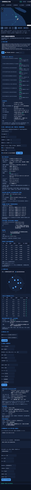

### ⑦ Celestial positioning (`⑦ 天象定位`)

Apparent places of sun, moon and stars (refraction, semidiameter, geocentric → topocentric parallax),
rise/set and twilight, sub-solar and sub-lunar points drawn on the map with the terminator, Polaris
compass (exact inversion plus the two-branch solution), latitude recovered from meridian-altitude
observations. Every block carries an **independent check**: the same quantity recomputed by a different
arithmetic route, with the difference printed.

Measured (observer 31.2304, 121.4737; local 2026-11-02 14:30 / UT 06:30):

- Sun: geometric altitude `28.1518°`, apparent altitude with refraction `28.1832°`, azimuth from true
  north `228.5054°`; subsolar point `-14.76726, 78.39762` (inside the tropics; declination bound for the
  year 23.4358°); GMST `139.050253°`.
- Independent altitude check: `球面大圆高度 28.1518° vs 内核地平解 28.1518°，差 -0.0000°（0.0′）；方位差 0.0000°`
  → the two routes agree within `0.0200°`. The same line also states "the ellipsoidal geodesic gives a
  central angle of 61.6497°, differing from the spherical value by -0.1985° (**oblateness inherent, not
  part of the verdict**)" — that sentence was itself a fix: the check used to compare the ellipsoidal
  number against the spherical solution and reported "disagreement" every day at mid latitudes, where the
  difference is model-inherent (§11.8).
- Moon: geocentric altitude `-16.5322°` → topocentric `-16.3310°`, parallax correction `0.2012°`
  (horizontal parallax 3545.6″); sublunar point `17.34154, -1.07129` at 370649.8 km; same check,
  `-0.0000°`.
- Day length: numerical integration `10.8992 h` vs the analytic cos H₀ formula `10.8960 h`,
  differing by `0.19 min` (self-consistent).

Time-scale limits are printed inside the results, not in a footnote: UT1 = UTC assumed
(|UT1−UTC| ≤ 0.9 s → GMST error ≤ 13.5″ ≈ ±410 m of longitude); ΔT (TT−UT) not applied; leap seconds
not modelled; the lunar position is Meeus chapter 47 with the dominant terms truncated, ecliptic-longitude
accumulation ≤ 0.4° (smaller than the 0.5° apparent diameter), not validated against an external
ephemeris — the sublunar point may be off by roughly 40 km, which is fine for a map and not fine for
lunar occultations or age-of-moon work.

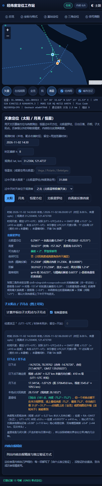

### ⑧ Networking, IP and route tracing (`⑧ 联网与路由`)

- **Three privacy modes**: `只用 IP（默认）` (*IP only, default*) / `IP + 精确 GPS` / `禁用联网`
  (*disable networking*). No coordinate is sent in the default mode.
- **IP lookup (parallel multi-source)**: the browser side knows six sources (ipapi_com / ipinfo_io /
  ipapi_co / ipwho_is / freeipapi / opencagedata), of which opencagedata needs an `api_key` and is
  skipped without one; the two bridges carry the other five. Results are fused by χ² consistency,
  printing the fused point, the sources used and every MAD outlier rejection. Leaving the queried IP
  empty means "look up my own egress address". Measured: 6-source scan → 2 usable (ipinfo_io
  `30.0500,121.1494 ±50.0*` Yuyao/CN 2465 ms; ipwho_is `29.8782,121.5494 ±100.0*` Ningbo 890 ms);
  ipapi_com timed out at 8000 ms, ipapi_co returned 403, freeipapi 307, opencagedata skipped for lack
  of a key, each with its reason printed → fusion `30.015638, 121.229409`, reported accuracy `50.0 km`
  (the larger of BLUE σ 44.72 km and the weighted 75th percentile), χ² = 0.148 / dof 2 / p = 9.29e-1
  (α = 0.0010) → judged "not contradictory"; MAD median deviation 21.51 km, σ̂ 31.89 km, k = 3.5,
  floor 50 km. A `*` in the accuracy column marks **the kernel's deliberate conservative fallback**, not
  a measured accuracy of that source (§5).
- **Route tracing / ping**: dispatched to the local bridge, which runs the system
  `traceroute`/`tracert`/`ping`. The table shows the channel, per-hop IP/hostname/RTT/status,
  `伪造跳数：否` (*fabricated hops: no*), and one `目标归属` line (`内网/本机` with the reason, or
  `公网`). Measured: `github.com` → channel `bridge`, 5 hops (not reached within 20), 2 of them honestly
  marked `无响应（*）`, 8017 ms, scope `公网`; the local gateway `192.168.2.1` → 1 hop, reached,
  39 ms, scope `内网/本机（私有网段 192.168/16）`.
- **DoH resolution**: A / AAAA / CNAME / TXT / MX / NS.
- **`桥接自检` (*bridge self-test*)** probes `/api/health` on whatever the `桥接服务地址` box holds and
  reports version, capabilities, latency and **`谁能读这台桥` (*who can read this bridge*)** — the
  cross-origin allowlist exactly as the bridge declares it in `cors_policy` (§7.3), so the screen answers
  "besides me, who can borrow this machine" instead of leaving it to be inferred. Leaving that box empty
  is automatic — same-origin pages
  follow their own port, `file://` and the hosted page use `127.0.0.1:8765`. Measured: PowerShell bridge
  online in `7 ms`, runtime line `geonet-bridge 1.0.0（PowerShell 5.1.28000.2113，win32）`.
- **`升级判定` (*escalation check*)** compares this session's offline solutions against the networked
  ones with a χ² test and tells you plainly whether the networked evidence is enough to overturn the
  offline conclusion (α, and the HDOP/RMS/satellite-count thresholds, all visible).
- **Cache and health**: source health snapshot, cache statistics, one-click clear. Both paths fill them —
  going through the bridge and going out through the browser directly run the same
  `consumeResponse`/`cacheSet` bookkeeping, so the two tables are not an artefact of one route (§11.20).
  Everything lives in module memory: a cached position is never written to host storage, and the entry
  that clears the cache reports which container it cleared (§7.5).

The red lines (loopback only, coordinate parameters refused, argv never through a shell, no SSRF relay,
LAN targets allowed but always labelled) are §7.

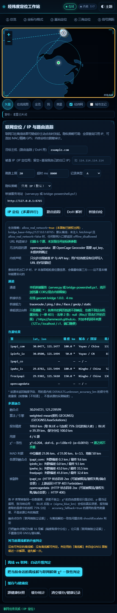
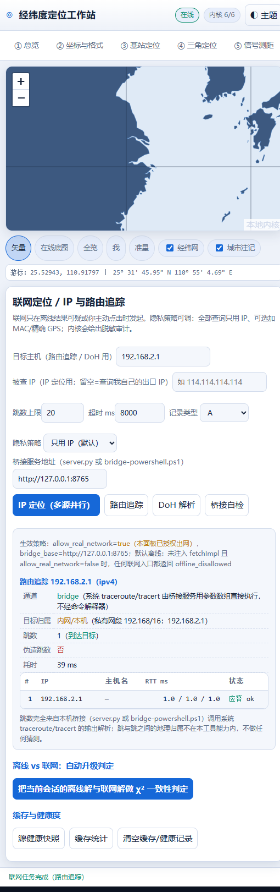

### ⑨ Batch coordinates and export (`⑨ 批处理导出`)

Paste CSV or text, or paste/select GPX, KML, GeoJSON files (one extraction routine, both entry points
equivalent). One pass does parsing, format conversion and measurement (polyline length, area, bounding
box, centroid, convex hull); exports are CSV / GeoJSON / GPX / KML / convex-hull WKT, copyable or
savable; plus share links and QR codes generated locally — a deep link carries only latitude, longitude
and zoom. Measured (`示例数据/坐标批处理示例.csv`): 14 rows, all parsed, 0 failed; polyline
`78418.543 km` (13 legs) with the sum-of-segments recomputation differing by `0.000000000 m`; convex
hull 6 vertices / `113813720.935 km²`, and when hull − polygon > 0 the panel states the ring is
concave; spherical vs planar area differs by 99.972 %, printed as such (planar area is meaningless over
wide longitude spans); spherical centroid `40.171827, 110.046169` vs arithmetic mean
`29.383841, 81.878131`, `2826247.2 m` apart, with the explanation that averaging longitudes across a
wide span or near 180° can fling the "mean" to the other side of the planet. Rows that fail to parse are
echoed **exactly as pasted**, quotes and `&` included — not double-escaped into `&quot;` (§11.7).

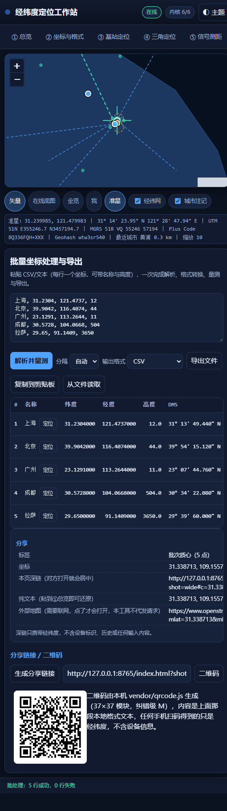

### ⑩ History and favourites (`⑩ 历史收藏`)

Automatic recording of each solution can be turned off, rows can be deleted one by one, and the whole
history clears with one click (favourites are kept). Everything this panel writes stays on this machine —
**and it is written as ciphertext**: the passphrase, the derivation and the auto-lock are GEOVAULT's job
and §6.8 documents the mechanism; §7.5 states where the bytes physically are. What the panel itself shows:

| Row (`histNote`) | In English | Meaning |
|---|---|---|
| `写盘` | write to disk | whether encrypted persistence is possible here at all; if not, the panel says the edits stay in this session only, instead of pretending to have saved |
| `磁盘上的形态` | shape on disk | algorithm, KDF, iteration count and the envelope's byte count — the four numbers that describe what an attacker would actually find |
| `逻辑键` | logical keys | `hist` / `fav` / `prefs`, all three inside one envelope name |
| `条数` | entries | how many rows are visible **to this unlocked session**; capped at 200 each, oldest dropped |
| `旧版明文键` | legacy plaintext keys | whether an older build left unencrypted records on this origin, and what will happen to them (§6.8) |

The strip above the table is `解锁` (*unlock*), `建锁` (*create the lock*, first use), `立即上锁`
(*lock now*), `改口令` (*change passphrase*), `擦除保险柜` (*wipe the vault*) and `自动上锁` (*auto-lock*:
1 / 5 / 10 / 30 minutes, or `只手动` — manual only; the default is 10 minutes). Two behaviours are worth
knowing before you rely on them:

- **Locked means unreadable.** The table empties, the rows report nothing, and a write attempt is refused
  with the reason — the page never caches a plaintext copy "just in case".
- **Walking away locks it for you.** Auto-lock drops the key handle *and* the plaintext mirror and calls
  back so the table repaints. Reading does not count as activity (§6.8), or the panel's own 2-second
  status refresh would keep an unattended page unlocked forever.

Measured on the live page just now: one localStorage key (`llgz.vault.v1`), envelope 583 bytes,
`AES-GCM-256 · PBKDF2-SHA256 250 000` iterations, capability line `WebCrypto ✓ · 安全上下文 ✓（http:）·
可写存储 ✓`, `legacy_plaintext_keys = []` (no plaintext from an older build is left on this profile),
history and favourites both report `0 条` while locked.

The migration path was measured on the other origin, because that is where an upgrade actually lands.
Opening `index.html` by double-clicking gives a `file://` page whose storage the **previous build** had
used in plaintext, so this machine really held `llgz.history.v1`, `llgz.fav.v1` and `llgz.prefs.v1` —
three readable keys, and the panel said so: `旧版明文键 还有 3 个` with the offer to absorb them. Clicking
`建锁` with a passphrase produced, after one PBKDF2 derivation, exactly this state: `localStorage` now
enumerates **one** key (`llgz.vault.v1`, 695 bytes), `旧版明文键` reads `无（磁盘上不存在未加密的旧记录）`, and
the absorbed rows are still there — `收藏 1 条` — because `absorbLegacy()` moves records, it does not
discard them (§6.8). Clicking `立即上锁` then reported `锁着（manual）`, `记录 —（锁着，读不到也不显示）` and
`0 条 / 0 条` on screen while the disk kept the same 695-byte envelope, which is the whole point of the
row labelled `磁盘上的形态`: what survives on disk is the ciphertext, and what the panel shows is what the
unlocked session can see.

### ⑪ Kernel self-test (`⑪ 内核自检`)

Runs each of the seven kernels' `selfTest()` once (plus the asynchronous gates GEONET and GEOVAULT can
only answer with real timers and real WebCrypto), and then an environment table: kernels present /
Leaflet / vendor / offline data / land blocks actually attached to the map / **本机存储** (*local storage*
— whether this browser can encrypt before writing, or refuses to) / protocol / missing UI ids / markup
leaked into rendered text. Composition, pass criteria and how to re-verify: §8.

The asynchronous groups are what spend the seconds, so the panel reports its own progress while they are
in flight (`内核异步闸门进行中：已跑 581 门，还剩 1 组，失败 0`) and is not allowed to print a verdict until
the last group has landed — the sampled timeline behind that rule is §9.3, the defect it closes is §11.26.

Measured: 623 gates / 0 failures / 1.54 s, of which 71 asynchronous (the duration varies with the machine,
the gate count and the failure count do not); 1374 land
blocks attached; 0 missing UI ids; 0 pieces of markup visible in rendered text; environment row
`加密落盘可用（localStorage · 写前 AES-256-GCM）`. The same 623 is what Node reports on the same files,
which is the point: the verdict must not depend on which container ran it (§8.1).

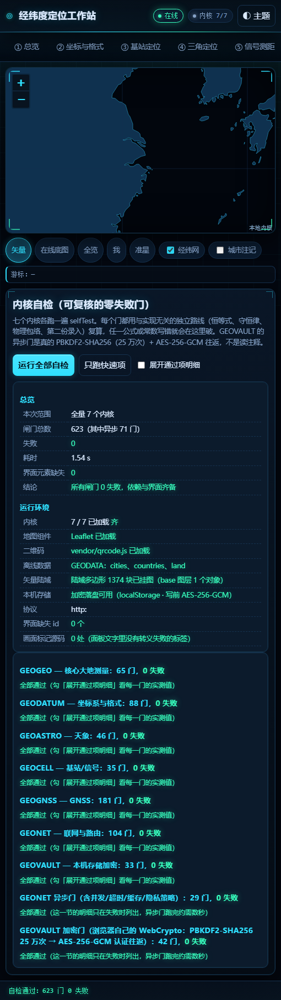

---

## 4. Sample data: one set that closes on itself

The ten files in `示例数据/` are not arbitrary examples. They share one hidden point
**Q = 31.2400, 121.4800**, and every observation in them (TA, RSSI, ranges, bearings, time differences)
was generated by the kernels themselves from Q — which is what makes cross-panel verification possible:

| File | Feeds | Expected result |
|---|---|---|
| `坐标批处理示例.csv` | ⑨ | 14 points all parsed: DMS, deg-min, MGRS, Geohash, Plus Code, merged digits, southern hemisphere, high latitude |
| `航迹示例.gpx` | ⑨ (paste or file picker) | 6 points extracted (1 wpt + 5 trkpt) |
| `基站观测示例.json` | ③ | `31.240108, 121.480783`, residual RMS 21.5 m, uncertainty 102.2 m (75.5 m from Q) |
| `基站观测示例.csv` | ③ | Character-identical to the JSON result; an empty `rsrp` column must not shift the later columns |
| `三角交会示例.txt` | ④ B ranges | `31.239990, 121.480020`, RMS 2.6 m |
| `三角交会示例.txt` | ④ A bearings | Three bearings (29.417° / 130.046° / 239.807°) intersecting back on Q |
| `TDOA时差示例.txt` | ⑤ C | `31.239966, 121.479973` (about 12 m from Q) |
| `指纹库示例.json` + `现场扫描示例.json` | ⑤ B | Weighted KNN landing between library points, confidence at the spacing scale |
| `NMEA语句示例.log` | ⑥ A | 10 sentences, all checksums valid, position 31°13.8240'N 121°28.4220'E |
| `L6-PPP-B2b电文示例.txt` | ⑥ F | PRN 193 / message type 63 (CLAS); PPP-B2b type 3 |

Suggested exercise: run ③ to get an estimate of Q, then ④ and ⑤ C — all three should land inside the
same 100 m circle. That is what "offline evidence supports itself" looks like. Then press
`升级判定` in ⑧ and see whether the networked evidence is consistent with it. Several gates in ⑪ are
exactly this kind of second-entry recomputation using these samples.

---

## 5. Accuracy and honesty: where this tool refuses to guess

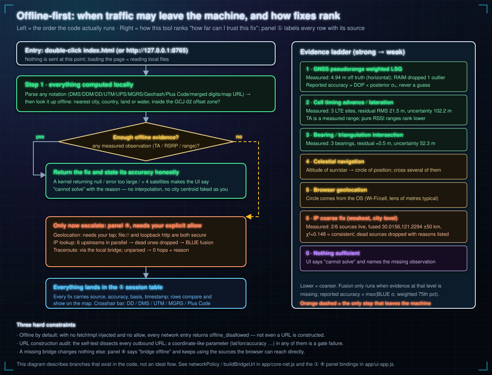

- **Decimal places are accuracy.** `31.2304, 121.4737` is 4 dp ≈ the `11 m` scale; writing eight
  decimals does not make it truer. Panel ② has the digits-to-ground-scale table, and significant digits
  beyond physical capability are flagged `伪造精度` (*fabricated precision*).
- **RSSI → distance is an estimate, not a measurement.** The panel prints the model's own σ (today
  indoor inversion gives 3098.1 m with σ 2853.4 m) and says so, which is the opposite of a promise.
- **Contradictory ranges and site positions get called out.** Least squares will happily emit a
  coordinate even when the residual RMS is far larger than a single site's σ; that is not a position,
  and the kernel marks it unusable.
- **Sites without coordinates do not participate** and are listed under `缺少经纬度`; two intersecting
  circles report both branches and leave the choice to you; one bearing line cannot fix a point, so ④
  and ⑦ give candidates and residuals rather than a single "correct answer".
- **The TDOA sign convention is printed in the result** (positive = farther than the reference), and
  unsynchronised stations make the answer meaningless — which is stated too.
- **GCJ-02 is not invertible in closed form**: the inverse is an iterative approximation and the
  residual is displayed.
- **Celestial time-scale limits are listed item by item**: unknown UT1−UTC → GMST error ≤ 13.5″
  (≈ ±410 m of longitude); leap seconds not modelled; TT ≈ UT. Check lines use only the route that
  shares the implementation's assumptions (spherical); the oblateness difference between ellipsoidal and
  spherical is printed separately as inherent.
- **Zero hops means zero hops.** When the parser cannot read the output, the bridge returns empty
  `hops` plus a reason (permission denied / ICMP blocked / unknown output format) and never pads to an
  expected hop count; the UI's `伪造跳数` field is permanently `否`.
- **Sub-millisecond hops** (Chinese Windows `tracert` prints `<1 毫秒`) are recorded as the upper bound
  `<1 ms` × 3 samples rather than a made-up number, and are not classified as `无响应`.
- **IP lookup is city/district scale**: the reported accuracy takes the **larger** of `BLUE σ` and the
  weighted 75th percentile; when a source sends no accuracy field the kernel's conservative fallback is
  used and marked `*` — deliberately biased toward "unknown", not a measured property of that source.
- **When the browser prompt is declined**, the UI says you declined it. It does not quietly swap in an
  IP result.
- **Ambiguous input** (merged digits like `31.2304 121.4737`) yields several candidate readings with
  confidences; you choose, the tool does not silently pick.
- **Can this be used for engineering surveying?** It computes, but it is not an instrument: no RTK data
  chain, no authoritative geoid model, no certified datum parameters. Reported accuracy is "the floor
  the kernels can demonstrate", not a surveying licence.

---

## 6. Architecture and implementation conventions

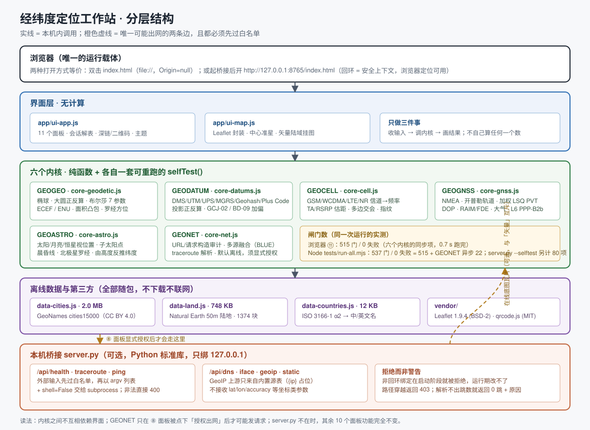

### 6.1 One-paragraph structure

`index.html` is the only entry point and the only assembly list: **17 local `<script>`/`<link>`
references** hang the data, the seven kernels, the map wrapper and the UI shell onto `globalThis`, in
order. There is no bundler, no module loader, no runtime dependency.

```
index.html
 ├─ vendor/leaflet.css  app/style.css
 ├─ vendor/leaflet.js   vendor/qrcode.js
 ├─ app/data/data-countries.js  ┐
 ├─ app/data/data-cities.js     ├─ merged into globalThis.GEODATA (each file does its own Object.assign)
 ├─ app/data/data-land.js       ┘
 ├─ app/core-geodetic.js   → GEOGEO      ellipsoid / direct-inverse / ECEF·ENU / area / hull
 ├─ app/core-datums.js     → GEODATUM    projections / UTM·MGRS·Geohash·OLC / GCJ-02·BD-09 / parseAny
 ├─ app/core-cell.js       → GEOCELL     channel→frequency / TA·RSRP ranges / lateration / fingerprint / TDOA
 ├─ app/core-gnss.js       → GEOGNSS     NMEA / orbits / weighted LSQ PVT / DOP / RAIM / atmosphere / PPP
 ├─ app/core-astro.js      → GEOASTRO    sun·moon·stars / sub-points / terminator / celestial fix
 ├─ app/core-net.js        → GEONET      network policy / URL audit / fusion / trace parsing
 ├─ app/core-vault.js      → GEOVAULT    PBKDF2-SHA256 → AES-256-GCM envelope / auto-lock / wipe
 ├─ app/ui-map.js          → GEOUI_MAP   Leaflet wrapper + crosshair + offline land
 └─ app/ui-app.js          → GEOUI       shell and bindings for the 11 panels
```

Kernels never `import` each other; when one needs another it takes it off `globalThis` (for instance ①
lends `GEOGNSS.fuseSolutions` to `GEONET`). That is what lets every file be loaded and self-tested alone
in Node — `tests/run-all.mjs` runs *the same files*, not a Node-specific copy.

### 6.2 How a kernel is written

- Each kernel is an IIFE `(function (G) { 'use strict'; ... })(globalThis)` exporting one namespace.
- Pure functions first: no DOM reads, no `location`, no requests. The single exception is `GEONET`,
  which reads `location` only to infer the default bridge address (§6.4), and it still cannot go out
  unless a `fetchImpl` is injected or you allow it in ⑧.
- Every kernel exports `selfTest()` returning `[{name, pass, detail}, …]`. `detail` must be **a number
  somebody can check against an answer key**, not `ok`. Pass criteria use a second route independent of
  the implementation: identities, conservation laws, physical envelopes, constants entered a second time
  from an unrelated source, published reference values that have nothing to do with this tool.
- If it cannot compute, it returns `null` plus `note`/`error_kind` — **never a plausible number** — and
  the UI shows that.

### 6.3 The map layer (`app/ui-map.js`)

Leaflet does projection, panning/zooming and layer containers only; the base map **requests nothing by
default**:

- The `base` layer holds the offline land polygons (`GEODATA.land`). The data shape is
  `blocks = [block, …]; block = [outerRing, holeRing, …]; ring = flat [lon,lat,lon,…]` stored
  unclosed, so `buildLand()` must descend two levels before pairing coordinates and append the closing
  point (looping one level too shallow is pitfall §11.1).
- `grid` graticule, `cities` labels, `results` solution points and accuracy circles, `overlay` helpers
  (terminator, sky plot, intersection rays).
- **Centre crosshair**: a `position:absolute; inset:0; pointer-events:none` DOM overlay pinned to the
  container centre; when active, clicking the map calls `map.setView(point, currentZoom)` to bring that
  point to the centre and `moveend` triggers the readout callback.
- **Stacking context**: Leaflet's internal controls carry z-index 400–1000. At the narrow breakpoint
  `.mapwrap` degrades to `position: static` and stops forming a stacking context, so those z-indices
  escape to the front of the whole page and cover the sticky header and the tab strip — the symptom is
  "I can read it but I cannot click it". Fix: `isolation: isolate` on `.mapwrap` (independent of the
  positioning mode) plus `.topbar` / `.tabs` raised to 1300 / 1200 (§11.2).

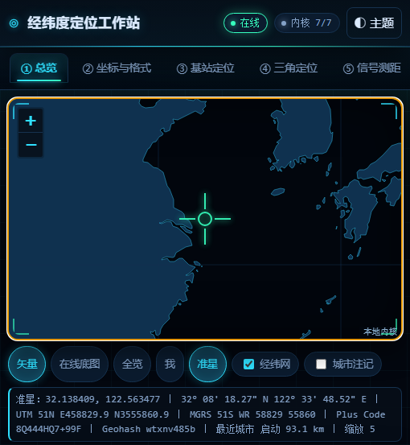

### 6.4 The networking layer (`app/core-net.js`)

Three protections, all required:

1. **Offline by default**: with `allow_real_network=false` and no injected `fetchImpl`, network entry
   points return `offline_disallowed` — not even a URL is constructed, and **the cache is not consulted
   either**: `fetchGeoIpOne` asks `getFetch(o)` *before* `cacheGet`, so a lookup recorded while panel ⑧
   was authorised cannot be handed back after that authorisation is withdrawn. A cached position is
   still a position, so reading it is an exit, not a no-op. One of the 29 async GEONET gates (§8.1)
   pins this: under the default policy all five sources must come back `offline_disallowed` with
   `from_cache` false, while the trap `fetch` counts zero hits — and its measured value prints the
   split (blocked *n*/5, cache-served *m*, which must be 0) rather than asserting success in prose.
2. **URL construction audit**: the self-test disassembles every outbound URL and allows only two kinds
   of placeholder — the queried IP and the API key. A coordinate-like parameter anywhere is a gate
   failure. Upstream addresses come from the built-in source table; a self-hosted `upstream_url` must
   contain `{ip}` and rejects loopback/private/link-local and non-http(s), so the bridge cannot be
   turned into an arbitrary URL relay.
3. **Same-origin bridge address first**: `defaultBridgeBase()` returns the page origin when the page is
   itself served from a loopback http(s) origin, so `http://127.0.0.1:9000/` follows port 9000;
   `file://`, non-loopback origins and `origin=null` fall back to `http://127.0.0.1:8765`. When an
   argument is passed explicitly it **never peeks at the real `location`**, otherwise self-test results
   would drift with the environment.
4. **Host storage is switched off where it ships**: `POLICY.allow_ambient_storage = false`, and
   `rawStore()` returns `{store: null, kind: 'disabled'}` *before* it reads `global.localStorage`. The
   GeoIP cache therefore lives in a module-scoped container that dies with the page — which matters
   because a cached lookup result *is* a record of where you were, and writing it to the browser's own
   storage would leave it on disk in plaintext for any other process on this machine to read. Five gates
   hold this: the shipped default is asserted to be `false` and the handle to be `disabled`; a cache write
   under the policy lands in the module container and still hits on read, so it is not a silent failure; a
   counter of *actual* host-storage reads is asserted to stay flat across
   `cacheSet`/`cacheGet`/`cacheStats`/`clearCache`; authorising explicitly makes the host handle available
   and revoking returns to `disabled` in the same call; and once every cache gate has run, the real
   `localStorage` is scanned for this module's key prefix and must contain nothing (§8.1).

### 6.5 The UI's escaping model (why it deserves its own section)

`app/ui-app.js` has exactly one set of HTML helper rules, and mixing them puts literal tags on screen
(§11.7):

| Helper | Behaviour | What you pass in |
|---|---|---|
| `esc(s)` | escapes | raw text |
| `h4/pre/bad/good/warn` | **already escapes internally** | raw text |
| `kv(rows)` / `note(t)` | does not escape (assumes already safe) | HTML that is already assembled |

So `note(warn(esc(x)))` is wrong (double escape → the screen shows `&quot;` or
`<span class="good">`), and `kv([['k', good(x)]])` is right. One pass removed 67 redundant `esc()` calls
and, because of the `'prefix' + x || ''` precedence trap exposed by that removal, added parentheses in
15 places. Panel ⑪ gained the `画面标记源码` (*markup in rendered text*) row as a consequence: it matches
only the helpers' own fingerprints (`<span class="good|bad|warn|note">`, `</?h4>`, `&lt;/?letter`) and
counts a hit as `bad`, while sanitising `<>&";` in its own report text to `·` so the gate cannot later
report itself.

### 6.6 Bridge implementation conventions

See §2.3 (two implementations, three consistency gates), §2.4 (port pre-probe), §2.6 (per-request
origin guard) and §7 (red lines). Three conventions visible only in the code:

- **Static Content-Type comes from a built-in table, never the platform mime library.** `mimetypes`
  differs across iSH, Termux and macOS, so letting `/etc/mime.types` decide response headers means every
  machine serves different bytes. Both bridges carry the same table, compared key by key by a gate.
- **PowerShell string comparisons are explicitly case-sensitive.** `-eq` is case-insensitive by default,
  which turned an upstream `"status":"Success"` into a different verdict than Python's `!=`; Ordinal
  comparison made the two agree, and both bridges now have a gate for it.
- **No bare `>`/`<` comparisons inside `if (...)` conditions in PowerShell.** In parentheses `>` is a
  redirection, so `$lab.Length > 63` is "always false" and quietly writes a file called `63` into the
  current directory. A gate regex-scans every `if`/`while` condition for this.

### 6.7 Adding a panel or a kernel

1. The kernel file ends by exporting `selfTest`, with gates covering at least: known answers,
   round-trip identities, boundary values, and garbage input that must not throw.
2. Add a `<script>` to `index.html` in dependency order and register the file in `app/ui-app.js`'s
   dependency list (⑪'s `界面缺失 id` row and `tests/check-package.py`'s resource gate will hold you to it).
3. Run `node tests/run-all.mjs --with-server --with-bridge`, `python tests/check-package.py`,
   `python tests/bridge-parity.py`, then press the full run in browser panel ⑪ — and finally
   **look at the screen** (the lesson of §11).

### 6.8 The vault layer (`app/core-vault.js`)

Before this kernel existed, ⑩'s history and favourites were `JSON.stringify`'ed straight into
`localStorage` — the equivalent of leaving the log of where you have been open on the table: any process
on the same machine, any script in another tab, the browser's own sync and backup, and F12's Application
panel could all read it. GEOVAULT replaces that with one authenticated-encryption envelope. The
conventions below are all asserted by its 75 gates (§8.1); the panel's rows are §3 ⑩, and the privacy
claim is §7.5.

- **One disk key, four logical keys.** `llgz.vault.v1` is the only name this kernel writes. `hist`,
  `fav`, `prefs` and `probe` live inside it, so "which key holds my positions" has one answer, and
  `tests/check-package.py` asserts that no other module touches `localStorage` at all.
- **Envelope shape.** `{v, kdf, hash, iters, salt, iv, ct, alg}` — version, `PBKDF2-SHA256`, `SHA-256`,
  the iteration count, a 16-byte salt, a 12-byte GCM nonce, the Base64 ciphertext and `AES-GCM-256`.
  The header text (`v`/`kdf`/`iters`/`salt`) is fed to GCM as **additional authenticated data**, so
  changing one character of the parameters makes the envelope fail to open: the iteration floor cannot be
  quietly downgraded, and a swapped ciphertext cannot be dressed in someone else's parameters.
- **Key derivation, never a stored passphrase.** PBKDF2-SHA256 with a floor of 250 000 iterations
  (only ever raised, never lowered), 8-character minimum / 512 maximum passphrase, and the passphrase is
  not written anywhere — so "forgotten" has exactly one answer, `擦除保险柜` (*wipe*) and start over. The
  wrong-passphrase path returns one indistinguishable "cannot open" and no hint of why, which gives an
  attacker nothing to iterate against.
- **Fresh randomness per write.** New IV on every flush (the salt and iteration count are reused for the
  lifetime of a passphrase, because they *are* the derivation), so writing the same record twice produces
  two different envelopes and nobody can count how often you edited from the disk. Without
  `crypto.getRandomValues` the kernel refuses to write at all: a `Math.random` salt or nonce would be
  predictable, and the whole scheme would be theatre.
- **Fail closed.** `capability()` demands WebCrypto, a secure context and a writable store. Get any of
  those wrong and the page keeps computing but **will not persist** — there is no plaintext fallback path
  to accidentally take, and ⑩ says so in its own words (`改动只留在本次会话` / *edits stay in this
  session only*). `https:`, `file:` and `data:` are secure contexts, and loopback `http://127.0.0.1` /
  `http://localhost` counts as trustworthy in every browser this project was measured on (the live page
  behind the Python bridge reports `secure_context_kind = http:` with the store enabled). Serving the
  folder over a LAN address — `http://192.168.2.140:8765/` — does **not** qualify: the panel then reports
  the store as unavailable instead of writing your positions as readable text.
- **Locking is a state machine, not a flag.** `lockReason` is one of `cold` / `locked` / `auto` / `wiped`
  / `unsupported` / `unlocked`, and `dropSecrets()` discards the key handle, the derivation parameters,
  the plaintext mirror, the dirty bit *and* a pending debounce timer. `lock()` first queues the pending
  write through `captureForWrite()` — which captures the plaintext and the key into a closure *before*
  they are dropped — otherwise "record the last fix, then walk away" would lose exactly that record.
  `wipe()` bumps `writeGen`, the generation token every queued write compares against on the way out, so
  a flush that started before the wipe cancels itself instead of resurrecting the envelope it just deleted.
- **Reads are not activity.** `get()` deliberately does not touch the idle clock: ⑩ repaints its own
  status every 2 seconds, and if a read counted as a hand on the keyboard the auto-lock timer would be
  refreshed forever by the page itself. `activity()` is driven by real input (`pointerdown`, `keydown`,
  `wheel`), and the UI's ticker calls `checkAutoLock()`. Getting this wrong was invisible in every gate
  until a live 70-second observation — pitfall §11.17.
- **The self-test cannot contaminate the session.** `sessionSnapshot()` / `sessionRestore()` let ⑪ build,
  unlock, re-key and wipe a *real* store on a throwaway handle and then hand the user's own unlock state,
  pending write and UI callback back exactly as they were; `isolateSession()` puts the kernel into a true
  cold start before the gates that assert cold-start behaviour, because in a browser the user is usually
  already unlocked and those gates then pass in Node and fail in the page (§11.18).
- **Hand-rolled primitives where the platform differs.** Its own Base64 and UTF-8 codecs (iSH and Termux
  do not guarantee `btoa`/`atob`, and `Buffer` is Node's), so the bytes are identical in the browser, in
  Node and under Alpine.
- **Legacy plaintext is absorbed, not ignored.** `LEGACY_KEYS` lists the five plaintext names an older
  build wrote — `llgz.history.v1`, `llgz.fav.v1`, `llgz.prefs.v1`, `llgz.probe.v1`, `llgz.probe.v2` —
  mapped onto the four logical keys (both probe names fold into `probe`). `absorbLegacy()` moves them
  inside the envelope and **deletes the original keys**; `legacyPlaintextPresent()` re-reads the store and
  reports whether any is still readable, and ⑩'s `旧版明文键` row shows that answer instead of claiming the
  migration happened. The real upgrade case is the `file://` origin, which is where the previous build's
  plaintext actually sat on this machine: three keys present before `建锁`, one 695-byte envelope after,
  `无` in that row, and the moved favourite still counted — measured end to end on screen (§3 ⑩). If the
  store holds plaintext and you never create a lock, the row keeps saying so, because "any program on this
  machine can read it" is the fact worth repeating.
- **The auto-lock window is clamped by the kernel, not by the page.** `AUTO_LOCK_MIN_MS` 30 s and
  `AUTO_LOCK_MAX_MS` 8 h bound any value a caller passes, with 10 minutes as the default; the ⑩ selector
  exposes a deliberately narrower set (1 / 5 / 10 / 30 minutes, plus `只手动` for people who want the page to
  never lock by itself), because the danger being managed is an unattended screen, not a tuning knob.

### 6.9 The skin (`app/style.css`) — one stylesheet, two themes, one sticky chain

678 lines that draw the whole interface: no image, no web font, no `url()` anywhere. Every visual is a
colour, a gradient or a pseudo-element, which is what makes §7.2 item 13's stylesheet rule enforceable —
a stylesheet that fetches a font hands the visitor's IP and `Referer` to a third party on every page
open, and no JS-side scan would ever see it happen.

- **One variable set, two themes.** `:root, body[data-theme="dark"]` and `body[data-theme="light"]`
  define the same names; `#btnTheme` only flips the attribute. The map wrapper then reads *those same
  variables* through `getComputedStyle` (`cssVar('--land')`, `--land-stroke`, `--grid`, `--accent`,
  `--accent-2`, `--warn`, `--bad`, `--line`, `--bg-3`, `--fg-dim`), so the offline land polygons, the
  graticule labels, the city dots, the accuracy rings, the error ellipse and the sky plot all change
  palette with the panels. There is no second palette to keep in sync, which is why a light-theme
  screenshot shows a light *map* and not a dark rectangle inside a white page (§3).
- **The visual language.** Deep-space base `#03070f`; cyan `--accent #2fe0ff` for state and mint
  `--accent-2 #37ffbe` for "this is the solved thing"; translucent sticky bars with
  `backdrop-filter: blur() saturate()`; a body grid that is literally a 46 px graticule, so what shows
  through a translucent panel is coordinate paper; L-shaped corner brackets on the map frame and on each
  panel, drawn as eight `linear-gradient` backgrounds on one pseudo-element; a scan line travelling down
  the map; a light rail running along the top bar; badge status dots painted with `currentColor`, so
  `.badge-ok` / `.badge-bad` / `.badge-off` recolour their own dot without a rule each.
- **Three invariants keep decoration from changing behaviour.**
  1. Every pseudo-element writes `content: ""`. §6.5's on-screen scan reads the `innerText` of `<main>`,
     and generated text would land inside exactly that string — a decorative glyph would be reported as
     leaked markup.
  2. Every overlay is `pointer-events: none`. Panel ①'s crosshair contract ("click anywhere, that point
     becomes the centre") needs the click to reach the map, so the frame brackets (z-index 1100) and the
     scan line (1090) sit above Leaflet's 400–1000 range but never in the way — and they stay inside
     `.mapwrap`'s `isolation: isolate`, which is what §11.2 was about.
  3. Geometry is not a styling surface. The `ch-*` offsets and the map's `62vh / 380px` are asserted
     pixel for pixel, so the skin adds a `drop-shadow()` to the crosshair arms and changes no number; the
     input fields switch to the monospace stack but keep the inherited font size, because a smaller size
     would make the controls shorter and re-flow every `.row`.
- **The sticky chain is derived, not typed.** `--topbar-h` is a *forced* height (`.topbar { height:
  var(--topbar-h) }`, with the brand block's two lines tightened until they fit inside it), `.tabs` sticks
  at `var(--topbar-h)` and `.mapwrap` at `calc(var(--topbar-h) + var(--tabs-h))`. Measured on the running
  page: top bar 58.00 px, tab bar flush at 58.00, map wrap 122 px against a tab-bar bottom of 121.92.
  `--tabs-h` deliberately takes the *taller* of the tab bar's two real heights (54 px with no horizontal
  scrollbar, 64 px with one, and eleven tabs overflow below roughly 1250 px). Too large costs a few
  pixels of air; too small slides Leaflet's zoom control under the tab bar and makes it unclickable —
  the same failure as §11.2. The previous stylesheet hardcoded `top: 57px` / `108px`, and 57 was already
  8 px short at desktop widths: an opaque top bar hid the mistake, a translucent one would have shown it
  as a blurred seam.
- **Motion is three keyframes and one rule.** The rail, the scan line, the logo pulse and a blink for the
  busy status. `@media (prefers-reduced-motion: reduce)` cancels every animation and transition with a
  single `*` rule, and ≤640 px drops the two continuously running ones outright so a phone does not
  repaint a gradient every frame.
- **Print.** Bars, map and chrome are removed; panels print flat, with brackets and scan line suppressed
  so the page is ink, not glow.

Measured with the skin switched on, in the browser: **623 gates / 0 failures** in 1.55 s, 1374 land
polygons on the base layer, crosshair ring centre equal to the map container centre to 0.01 px, zero
missing panel ids, zero leaked markup, console silent, and the same run repeated after toggling to the
light theme and back.

### 6.10 The five mechanism figures — one canvas, colour by role, one measured bound

`docs/img/` holds five hand-written SVGs, and §1's file table says which section each one belongs to.
They are the only part of this repository that is *drawn* rather than written, so they need their own
contract — and the contract is §6.9's, not a new one: deep-space canvas, cyan/mint/amber/violet for
state, no raster asset, no external reference, English like every other file GitHub-facing. What follows
is only what is specific to a static diagram: how a hue is chosen, where a glow is allowed, and what
"nothing runs off the card" means when nobody is watching the page.

- **One `<defs>` block, byte-identical in all five files.** `hudbg` is a three-stop linear gradient
  (`#0c1626` → `#070d18` → `#03060c`) and replaces the single flat rectangle the light version used;
  over it go `hudgrid` (a 26 px `userSpaceOnUse` path at 8.5 % opacity) and `hudscan` (a 4 px horizontal
  rule at 4.5 %), so the sheet is coordinate paper before it is a diagram — the same reasoning as the
  app's 46 px body graticule; `hudbloom` is a radial cyan → violet wash anchored top-left, which is the
  picture's only light source. Four stacked `<rect>`s and four L-shaped corner brackets, then content.
- **The brackets are 12 px in from the edge with 20 px arms.** The first pass used 16/28, and in
  `architecture.svg` the bottom-left arm landed exactly on the footnote baseline (text at `y=846`, canvas
  860): a frame that eats its own caption. 12/20 clears the caption in all five files, measured, not
  assumed.
- **Colour is chosen by what an element *is*, never by its hue.** One token — say `#4a5566` — appears
  both as body text and as the `fill` of an arrowhead, and those two need opposite treatment: text goes
  bright (`#a2b5cb` → `#a2b5cb`-family neon), a *panel* goes dark (`#ffffff` → `#111c2a`), and anything
  else stays neon. The role test is deliberately narrow: a tag carrying `font-size`, or a `<text>`, is
  text; only `<rect>` and `<polygon>` fills are surfaces. That narrowness is the whole lesson — the
  first version treated *every* non-text fill as a surface, and the connector arrowheads (`<path fill>`)
  were painted `#151f2b` on a `#070d18` canvas: present, correct XML, invisible.
- **Glow is a heading policy, not a text policy.** `hudglow` (blur 2.1, two merged blur nodes under the
  source) is attached only to text at `font-size ≥ 16` or `font-weight` bold/≥500 — 19, 24, 19, 16 and
  25 elements across the five files. A 12 px body label with a bloom on it is not a highlight, it is
  soup: the sheet stops being scannable, which is the one thing a mechanism diagram is for.
- **Lift is a panel policy.** `hudlift` (`feDropShadow dy=2`, blur 3.4, 72 % black) goes on rectangles
  at least 200 × 40 — 4, 23, 13, 6 and 3 per file — and skips anything already referencing a paint
  server, so the four canvas layers stay flat against each other while the cards float off them.
- **The bound is measured in a renderer, not counted in characters.** Character-counting cannot work
  here: the same string is a different width in Helvetica at 12 px than in Menlo at 13, and the files
  mix both (the command block in `platform-packs.svg` is monospace). So every `<text>` is asked for its
  `getBoundingClientRect()`, mapped back into user units through the root `getScreenCTM().inverse()`,
  matched to the smallest stroked `<rect>` that contains its start point, and required to clear that
  card's right and bottom edge by 4 px. Run over all five: **0 violations**, after three real defects
  fell out of it — a rotated label in `architecture.svg` that ran 384 px up through three cards because
  its anchor was the curve's midpoint and its length had never been checked (now horizontal, in the
  20 px corridor between the kernels row and the data row, right-anchored so it ends at the arrowhead);
  two lines in `platform-packs.svg` sitting 3 px and 9 px *past* their cards' bottom borders (the two
  middle cards are 244 tall now and the command row moved from 660 to 676); and `decision-flow.svg`'s
  second ladder card, 66 tall against a sibling that needed 72, which pushed its text 3 px over
  (card 2 is 72, card 3 re-anchored at 308 × 54 so the 8 px rhythm down the column survives).
- **Two of these facts are asserted, not remembered.** §8.6's documentation item checks all five files
  for `hudgrid`, for a canvas on `url(#hudbg)`, for the absence of the six light-canvas tokens, and for
  the absence of `filter="#…"`. That last one is not pedantry: `filter="#hudglow"` is *well-formed XML*
  that every renderer treats as a missing reference, so the first "dark" build of these figures passed
  `ET.fromstring`, looked plausible in a diff, and had no glow and no shadow at all — the filters were
  silently absent until a real render was measured. The check lives inside the existing doc-links item
  rather than as a new one, which is why the package gate grew by a single item — the link checker's own probe (§8.6).

Sizes belong to one place only: §1.1 states the figure total (5 files, 58 KB) and `--all` re-measures
it into the pack table, so `platform-packs.svg` deliberately says "Five figures, in every pack" instead
of carrying a number that would drift the moment one of them is redrawn.

---

## 7. Networking and privacy red lines

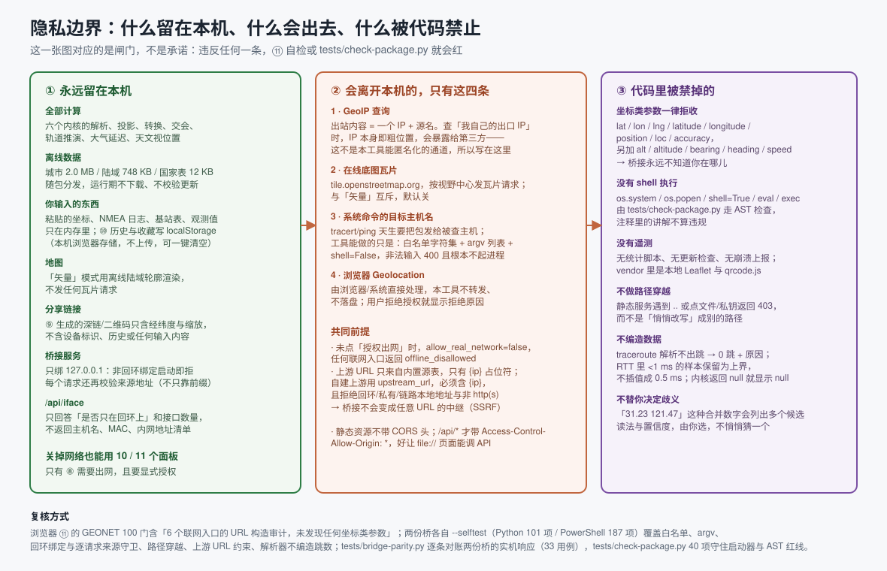

### 7.1 Every request that can leave the machine

Four, and only four. Nothing in this section is a promise — each row is checked by a gate named in §8.

| # | Outbound request | Trigger | What leaves | How to switch it off |
| --- | --- | --- | --- | --- |
| 1 | GeoIP upstreams (six known to the page, five carried by the bridges — §3 ⑧) | panel ⑧ + explicit network authorisation + press the IP-lookup button | one IP address — when you look up your own egress IP, the IP *is* the coarse location, and no tool can anonymise that for you | set the privacy policy to "network disabled" |
| 2 | `tile.openstreetmap.org` tiles | click "online basemap" in the map toolbar | the extent you are looking at, as XYZ tile requests | switch back to "vector" (the default) |
| 3 | The target of a system `tracert` / `ping` | panel ⑧ + a bridge is running | a DNS lookup of the hostname you typed, then ICMP/UDP probes toward it | do not press the button |
| 4 | Browser Geolocation | press the locate button **and** click Allow in the browser's own dialog | whatever the browser/OS decides to use (Wi-Fi, cell, IP); this tool never forwards it and never stores it | deny the prompt |

There is no analytics beacon, no update check, no crash reporter, no CDN: Leaflet and qrcode.js are
vendored in `vendor/` and the three data files ship in the package (§1).

### 7.2 Red lines that are enforced in code

1. **Loopback only, refused at start-up.** `0.0.0.0`, `::`, or any interface address makes the bridge
   exit with an error instead of "warn and continue"; there is no runtime way to widen it. The
   PowerShell bridge adds the per-request source-address check of §2.6.
2. **Never a second listener on one port.** The port is probed before binding (§2.4), because
   Windows `SO_REUSEADDR` would otherwise let two bridges share a port and split connections at random.
3. **Read-only.** Every endpoint is `GET`; `POST` is 405. Nothing writes a file, changes a setting, or
   executes anything beyond the two diagnostic commands.
4. **Arguments go to `argv`, never to a shell.** The host/IP first passes the whitelist
   `[A-Za-z0-9._:-]` plus structural checks and a 253-character cap, then becomes its own `argv`
   element under `shell=False` (PowerShell: `UseShellExecute = $false`). Anything starting with `-`
   — a command option in disguise — is rejected. `os.system`, `os.popen`, `eval(`, `exec(`, `compile(`
   and `shell=True` do not exist in the sources; `tests/check-package.py` proves it with an AST scan on
   the Python side and a comment-stripped line scan on the PowerShell side (§6.6).
5. **Coordinates are never accepted or forwarded.** The thirteen parameter names `lat`, `lon`, `lng`,
   `latitude`, `longitude`, `position`, `loc`, `accuracy`, `alt`, `altitude`, `bearing`, `heading`,
   `speed` return 400 with `privacy_rejected`. The privacy check runs *before* endpoint dispatch, and a
   POST body is never parsed at all. The bridge therefore cannot know where you are — that is the whole
   point of §2.3's "two implementations, one contract": neither of them can see a coordinate.
6. **The bridge is not an SSRF relay.** GeoIP URLs come only from the built-in source table with the
   single replaceable placeholder `{ip}`. A self-hosted `upstream_url` must contain `{ip}`, must be
   `http(s)`, and is rejected if its hostname points at loopback, private, link-local or metadata
   ranges (`127.0.0.1`, `::1`, `192.168.x`, `169.254.169.254`, `localhost`).
7. **The static handler never steps outside its root.** Path traversal, `%2e%2e` encodings, control
   characters, dot-directories (`.git`), private-key extensions, absolute drive letters, UNC paths,
   backslash separators and the bridge's own access log all answer **403 with a Chinese reason string**,
   rather than being silently rewritten into a different path. A URL like `/etc/passwd` resolves to a
   non-existent file *inside* the root (404); system files are never served.
8. **Cross-origin reads require a listed origin, and only `/api/*` answers cross-origin.** Static files
   carry no CORS headers at all, so another site cannot pull your project files. `/api/*` echoes the
   caller's own origin, and only when the built-in list (`null` for a `file://` page, the official hosted
   page, any loopback origin) or a start-up `--allow-origin` / `-AllowOrigin` entry covers it; everyone
   else gets `403 origin_not_allowed` (§7.3). Neither bridge emits a wildcard — a live case in
   `tests/bridge-parity.py` searches **every header of every response of both bridges** for one.
9. **`/api/iface` is redacted.** It answers "is the bind loopback-only" and how many interfaces exist —
   not hostnames, MACs, interface names or LAN address lists. If enumeration fails it says so instead
   of reporting `0`, which would be a lie about your machine.
10. **Log lines are flattened.** Every log record is squeezed onto one line so a crafted hostname cannot
    inject fake entries (CRLF log injection). Access logs stay on your machine and are git-ignored.
11. **Zero third-party dependencies.** Python uses the standard library only; the PowerShell bridge uses
    .NET types that ship with Windows 5.1. `package.json` keeps `dependencies` and `devDependencies`
    empty, and a gate asserts that they stay empty.
12. **Nothing readable about you reaches the disk.** Where a position does get persisted, it goes through
    GEOVAULT and comes out as one `AES-GCM-256` envelope under a single key name (§6.8); the GeoIP cache
    that panel ⑧ fills lives in module memory because the shipped storage policy is off (§6.4). Failing
    either of those conditions, the page refuses to persist and says so — the fallback is "not saved",
    never "saved as plaintext".
13. **The front end has no way out, checked at source level.** Nine constructs are banned across ten
    scanned files (`index.html` plus the nine `.js` files under `app/`) once comments are stripped:
    `navigator.sendBeacon`,
    `XMLHttpRequest`, `new Image(`, `document.cookie`, `WebSocket` / `EventSource` /
    `BroadcastChannel`, `.postMessage(`, `eval` / `new Function`, dynamic `import(`, and
    `sessionStorage` / `indexedDB` / `openDatabase`. `localStorage` is named in exactly two files —
    `app/core-vault.js`, which writes ciphertext, and `app/core-net.js`, which does not read it under the
    shipped policy — and neither `index.html` nor `app/style.css` references anything remote. The
    stylesheet is scanned separately, with a stripper that removes only `/* */`: the JS stripper's `//`
    rule would read a protocol-relative `url(//fonts.example/x)` as a comment and swallow the very thing
    this check is looking for, so in `app/style.css` the failure conditions are `@import`, any `url(` and
    any scheme (§6.9). The scanner carries its own validity
    check: a four-line probe in which it must find **exactly one** `sendBeacon(` (the two mentions inside
    comments must not count, and the `http://127.0.0.1:8765` literal must survive comment-stripping),
    plus one *witness* string per scanned file that only exists in real code
    (`allow_ambient_storage`, `AES-GCM`, `function boot`, `<script`). Without those, "no hits" could
    quietly mean "the scanner swallowed the file" — the same failure class as §11.14.

### 7.3 Who may talk to the bridge: the cross-origin allowlist

A bridge on `127.0.0.1:8765` is reachable from anything running on this machine, and a browser will
make a request *on behalf of a remote page* without asking you. The only thing that stops that page
from reading the answer is the CORS answer, so this section is the security boundary people should
actually care about — and the answer is a name list, not a wildcard.

- **Built-in allowlist** (identical in both bridges): `null` — the origin of a page you opened by
  double-clicking `index.html` under `file://` — the official hosted page
  `https://iammezsh.github.io`, and any loopback origin (`http://127.0.0.1:*`,
  `http://localhost:*`, `http://[::1]:*`, port-agnostic). Requests with **no** `Origin` header at all —
  `curl`, a browser address bar, a same-origin page — are served normally and get no CORS header,
  because there is no browser on the other end to enforce one.
- **Widening it is a start-up decision.** `--allow-origin` (Python) / `-AllowOrigin` (PowerShell)
  appends exact origins to the list when the process starts; there is no endpoint, config file or
  query parameter that can lengthen it later, and no way to pass `*` through either flag.
- **The response is per-origin, not global.** `/api/*` echoes back the caller's own origin (and nothing
  else), together with `Vary: Origin` so a shared cache cannot hand your answer to a different site. A
  listed origin sees its own origin; an unlisted one gets `403 origin_not_allowed` with a Chinese reason
  — the browser also refuses to expose the body, but the 403 is the part you can verify with `curl`.
- **Static files never get a CORS header.** Another site cannot read your project files through a
  browser at all, even for origins that are allowed to call `/api/*` (§7.2 item 8).
- **No wildcard, anywhere, in either bridge.** The live cross-check does not take the doc's word for it:
  it walks **every header of every response** produced by both bridges, including the preflight
  `OPTIONS` answers and the 403 bodies, and fails if it finds `Access-Control-Allow-Origin: *`
  (§8.5). What a wildcard would have meant — "any page open in your browser can read this bridge" — is
  exactly the door this closes.
- **The page surfaces the policy instead of assuming it.** `GET /api/health` returns a `cors_policy`
  object (`wildcard`, `built_in`, `extra`, `loopback_origins_allowed`, `no_origin_clients_allowed`,
  `note`), and panel ⑧ prints it on its own line labelled **谁能读这台桥** ("who can read this bridge"):
  the list length, how many entries were added at start-up, and an explicit "not a wildcard" verdict. A
  bridge too old to report the field makes the UI say so rather than guessing; a bridge that *is*
  emitting `*` makes the UI say "any page open in your browser can read it".

Practical consequence for the two ways people actually use this: a `file://` page and the hosted Pages
page are both already in the list, so "double-click and it works" and "open the GitHub link and it
works" needed no weakening of the boundary.

### 7.4 Private targets are allowed — and the scope is printed on screen

`traceroute` and `ping` in panel ⑧ **can** hit `192.168.1.1`, your gateway, a NAS, or `127.0.0.1`.
That is deliberate: "trace my own router" is the primary use of the feature, and a default-deny gate
would cripple it while leaving behind the classic "forgot to add the switch" bug. So there is no
LAN-option in the command line at all — and a gate asserts the opposite: neither an enforcement function
nor its explanatory text may exist in either bridge.

The boundary of that decision, stated plainly:

- A remote page cannot quietly turn your machine into a probe launcher, because it cannot read the
  endpoint at all: cross-origin `/api/*` needs a listed origin (§7.3). What remains is a program or
  person already on this machine — which is the threat model every loopback tool shares.
- That is why the two command endpoints are **read-only diagnostics**: whitelist plus structural
  validation of the target, arguments as separate `argv` elements, fixed wall-clock and hop ceilings,
  and a concurrency cap that refuses work rather than turning the machine into a `tracert` launcher.
  The worst outcome is "a few extra probe packets to one address", never "code runs on your machine".
- Every successful response carries `target_scope` (`lan` / `public`) and `target_scope_note`, and a
  hostname is classified **after resolution**, so an internal DNS name or a rebinding answer is
  visible. Panel ⑧ shows it on its own line ("target scope"). An older bridge that lacks the field
  makes the UI say "not reported by this bridge" instead of guessing.
- When a name does not resolve, the response is not classified as private — mislabelling is preferred
  over blocking a legitimate trace.

To close this door completely there is exactly one method: **do not start the bridge**. Without it, ⑧
reports `bridge_unavailable` for hop-by-hop tracing and does only the browser-side DoH resolution; the
other ten panels are untouched.

### 7.5 Where your data physically is

- Everything you type lives in memory only while you work, and in exactly one place if you ask it to
  persist. ⑩ history and favourites go through GEOVAULT: the browser's own `localStorage` holds a single
  key, `llgz.vault.v1`, whose value is one `AES-GCM-256` ciphertext envelope — the plaintext never
  touches the disk, and a second process reading that file sees only base64 (§6.8). Nothing is
  uploaded; `擦除保险柜` deletes that one key and bumps the write generation so anything still queued
  behind it discards itself rather than resurrecting what you just erased.
- If the environment cannot offer the capability trio — WebCrypto, a secure context, writable storage —
  the page refuses to persist and says which of the three is missing (§3 ⑩). The fallback is "not
  saved", never "saved as plaintext".
- The GeoIP result cache that panel ⑧ fills never reaches storage at all: the shipped storage policy is
  `allow_ambient_storage = false`, so the cache is a module-scoped container that disappears with the
  page (§6.4).
- The deep links and QR codes ⑨ generates contain latitude, longitude and zoom level. No device
  identifier, no history, none of your other input.
- The bridge does not print request bodies (it only serves `GET`, so parameters are in the query string
  anyway); its logs are written in the project root and listed in `.gitignore` — as exactly two
  root-relative paths, never as `*.log`, because `示例数据/NMEA语句示例.log` is a deliverable (§11.3).

---

## 8. How "all green" is checked: six independent gate layers

"All kernels pass" is worthless unless someone else can re-run it. Six layers, none of which
substitutes for another; if any one is red, do not use the build.

| Layer | Command / entry point | Measured 2026-11-03 | What it owns |
| --- | --- | --- | --- |
| Browser kernel gates | panel ⑪ → run the full self-test | **623 gates / 0 failures** in 1.49 s, **71 of them asynchronous** | the seven kernels inside a real DOM + Leaflet environment, including the PBKDF2/AES round trip and the network-layer promises |
| Node kernel gates | `node tests/run-all.mjs` | **623 gates / 0 failures** | the same kernel files in a DOM-less sandbox — the identical total is the point: the verdict must not depend on which container ran it (§8.1) |
| Python bridge gates | `python server.py --selftest` | **110 items / 0 failures + 1 skipped locally, 111 on CI** (§8.8) | whitelist, origin allowlist, loopback bind, port pre-probe, path traversal, upstream URL rules, contract keys, parsers that cannot invent hops |
| PowerShell bridge gates | `powershell -NoProfile -ExecutionPolicy Bypass -File bridge-powershell.ps1 -SelfTest` | **202 items / 0 failures** | the same list, plus PS-specific evaluation, redirection, `-eq` casing, source guard, cross-origin allowlist, concurrency |
| Live cross-check | `python tests/bridge-parity.py` | **41 cases / 0 failures** (exit code 3 = honestly skipped on non-Windows) | both bridges started at once and fed identical requests: status, key set, byte count, Content-Type, and the origin allowlist's verdict for five allowed and four hostile origins (§8.5) |
| Package inspection | `python tests/check-package.py` | **71 items / 0 failures** | the 17 local resources the entry page needs, launcher encoding and line endings, AST/line red lines in both bridges, the source-level exfiltration scan, contract literals, broken image links in the docs, a synthetic document fed to that link checker to prove it still bites, gitignore collateral damage, zero dependencies, English-only GitHub docs, platform manifests, §1.1's pack sizes rebuilt in a temporary directory, the branch order that keeps ⑪ from announcing a verdict while its async gates are still running (§11.26), and the icon declaration that keeps the hosted page's console clean (§11.27) |

All of it in four commands:

```bash
node tests/run-all.mjs --with-server --with-bridge   # 623 kernel + 110 Python + 202 PowerShell
python tests/bridge-parity.py                        # 41 live cases against both bridges
python tests/check-package.py                        # 71 package checks (Python only)
npm run test:all                                     # kernels + Python bridge only
```

No `npm install`, no `pip install` — the gates themselves are dependency-free, which is also why CI is
cheap (§8.8).

### 8.1 Where the 623 kernel gates come from

| Kernel | Gates | Representative assertions (translated from the strings printed by `selfTest()`) |
| --- | --- | --- |
| GEOGEO | 65 | 1° of longitude on the equator equals a·Δλ (111 319.4908 m); forward/reverse distance symmetric to <1 mm; inverse then forward returns exactly to the start; azimuths are reciprocal (180° apart); convergence near the anti-podal point; two points near the pole give 22.32 km over the pole; all 32 compass points named; inverse solve timing — after warm-up, the mean of 30 runs <40 ms |
| GEODATUM | 88 | meridian arc 1° agrees with GEOGEO's inverse; isometric-latitude round trip closes; transverse Mercator satisfies the Cauchy–Riemann conformal equations; convergence angle is 0 on the central meridian and flips sign between hemispheres; 90° of meridian arc = 10 001 965.7 m; UTM / UPS / MGRS / Geohash / OLC round trips; DMS and DDM parse and format; GCJ-02 and BD-09 obfuscation plus iterative inverse; `parseAny` multi-reading confidence; `outOfChina` |
| GEOCELL | 35 | FSPL reference value and RSSI↔distance round trip to <0.01 dB; seven propagation models round-trip consistently (all 28 points <0.01 dB); Okumura–Hata magnitude sanity; out-of-domain clipping is flagged; `cid_hex` decodes LAC/CI; `parseInput` handles mixed formats and Android `dumpsys` (GSM/LTE + WCDMA) |
| GEOGNSS | 181 | multi-revolution, non-wrapped Kepler `M` still solves (residual <1e-11); two-body (J2 = 0) energy conserved over half and full orbit via RK4; gravity normal at the pole > equator and ≈9.80665 at 45°; the ionosphere-free combination cancels first-order delay exactly; `NORM.inv` and `NORM.cdf` are inverses; RAIM removes the injected outlier satellite; the two-solution χ² matches the analytic d²/(2σ²); pseudorange corrections accumulate by sign and are reproducible item by item |
| GEOASTRO | 46 | JD anchor J2000.0 = 2451545.0; MJD = JD − 2 400 000.5 over three epochs; the 1900 non-leap and 2000 leap boundaries; the same instant under different UTC offsets must yield the same JD; GMST differential identity 1.002737909 revolutions/day; the sub-solar latitude always inside the year's tropics; solstice found by root-solving and agreeing with "ecliptic longitude = 90°" |
| GEONET | 104 + 29 | sources that report no accuracy take an explicit fallback and are flagged `accuracy_fallback`; with no injection and no `localStorage` in the environment, an in-memory Map is used automatically; offline RAIM alert → escalation path; ranging inversion matches the layout truth to <0.2 m; the traceroute payload parser preserves hop order, timed-out hops and partial latencies (it never fills gaps); every public API function × garbage arguments must not throw; URL-construction audit of all six network entry points — a coordinate-shaped parameter in any outbound URL is a gate failure. The **29 async gates** cover concurrency, timeouts, the cache containers, and the storage policy of §6.4 (`allow_ambient_storage = false`, the disabled-store early return, the module-scoped container, the ambient-read counter staying at 0, and the cache read obeying the egress authorisation) |
| GEOVAULT | 33 + 42 | the sync 33 assert the shapes the envelope depends on: the disk key name is exactly `llgz.vault.v1`, the four logical keys are distinct, the header fields (`v`/`kdf`/`iters`/`salt`) survive a round trip, Base64 and UTF-8 helpers match `btoa`/`TextEncoder` byte for byte (the hand-rolled path iSH and Termux need), the capability trio is reported honestly, and the legacy-plaintext key list is empty. The **42 async gates** are the real thing: a genuine `PBKDF2-SHA256` derivation at or above the 250 000-iteration floor, an `AES-256-GCM` encrypt→decrypt round trip, a wrong passphrase producing no plaintext and no oracle, a tampered ciphertext failing authentication, the iteration floor refusing to be downgraded, auto-lock firing on the idle clock but **not** on reads, the queue-before-drop flush, and `wipe()` making an already-queued write discard itself (§6.8) |

552 synchronous gates plus 71 asynchronous ones: `33+65+88+35+181+46+104 = 552`, `42+29 = 71`,
`552+71 = 623`. The two environments reaching that same 623 with the same files is a check on the
harness as well as on the kernels — under Node the async gates resolve through WebCrypto shims and a
DOM stub, in the browser through the real ones, and neither is allowed to skip (§11.18).

### 8.2 What one gate looks like

```js
push('inverse solve time (mean of 30 runs after warm-up < 40 ms)', inv_ms < 40, inv_ms.toFixed(2) + ' ms/run');
```

A gate is a `{name, pass, detail}` triple, and `detail` must be **a number you can argue with**. Panel ⑪
prints `detail` for passing rows too, so "green" is readable rather than a black box — and a timing gate
that a cold JIT could trip is a gate that should not exist (§11.6).

### 8.3 The Python bridge's 110 (+1) items, in eleven groups

The group letters below are literally what `--selftest` prints (`# ---------- G2. 内网目标…`). The
source contains **111 `check()` call sites**; this machine reports **110 items / 0 failures + 1
skipped**, because the skipped one, "a symlink pointing outside the root is caught", needs a privilege
a plain account does not have (developer mode or administrator), so locally it prints `[跳过]` —
"skipped" — with the reason and keeps running instead of quietly counting as a pass. CI's Windows
runner has the privilege, so the same item is genuinely executed there and CI prints 111 (§8.8).

| Group | Items | Representative gates |
| --- | --- | --- |
| A · host whitelist | 6 | valid domains, IPv4 and IPv6 (10 examples) accepted; injection and malformed input rejected (30 examples, from `host;rm -rf /` to a 300-character name); every rejection carries a Chinese reason so it can be shown to you directly; the 253-character cap bites at 253/254; each of 17 shell metacharacters is caught individually; the 9 non-string inputs (`None`, `0`, `[]`, `{}`, `3.14`, `True`, `b"bytes", object()`) are refused without throwing |
| B · position parameters (privacy red line) | 2 | position-shaped names are recognised including mixed case; ordinary parameters (`host`, `count`, `max_hops`, `source`, `ip`) are not collaterally blocked |
| C · static paths and traversal | 6 (5 + 1 skipped) | every legitimate path — including the root-anchored `/x` spelling — lands inside the root; `/server.py` really points at the file, so the static service is usable; traversal, UNC, dot-files and private-key extensions are all blocked; and they are **403-rejected, not silently rewritten** into a different path; a URL that looks absolute like `/etc/passwd` can only map to a non-existent file inside the root; the symlink case (skipped locally) is the second layer — `realpath` + `commonpath` |
| D · argv construction and `shell=False` | 12 | the source, with docstrings and comments stripped, contains no "hand the whole command line to a shell"; `shell=False` is actually written in the `subprocess` dict (a positive assertion, not an absence); standard library only; `DEFAULT_HOST` is literally `127.0.0.1`; `{ip}` is the only replaceable placeholder; traceroute argv is a list with the host as its own final element; `max_hops` clamps to `[1, MAX_HOPS_LIMIT]` and `ping`'s `count` to its own cap; a command string assembled and passed to the execution layer is refused; a semicolon or pipe inside an element is still caught by the second check (defence in depth); a missing executable degrades to `command_missing` instead of throwing; the injection check fires before argv is ever built |
| E · text parsing | 19 | Chinese `tracert` output yields 5 hops including the target-IP header line; three RTT samples per hop kept individually, in order, to the printed precision; "request timed out." means `timed_out` with `ip = null` (no guessed address); the final line's address is distinguished from the header's, which is what the `reached` verdict rests on; "`<1 ms`" is preserved as an upper bound, never as a measurement; a line mixing measured values and bounds keeps them in separate columns; Unix `traceroute` also yields 5 hops; a repeated IP is recorded in `alt_ips` rather than duplicating the hop; `* * *` and "request timed out." collapse to the same conclusion; **unrecognisable output returns zero hops — never an invented count**; empty and garbage input does not throw; Chinese and English Windows `ping` statistic blocks both parse; Linux `rtt min/avg/max/mdev` parses; Linux "100% loss" yields `null` packet loss, not `0`; 100 % loss parses as "0 replies received", not "command failed"; a missing statistic block yields no replies and no guessed average; the macOS/BSD `0 packets received` phrasing parses too (§11.4) |
| F · GeoIP normalisation (pure mock — nothing leaves) | 22 | every sample upstream normalises to the same key set `{ip,lat,lon,accuracy_km,city,country,…}` (11 keys, fixed, and the `.ps1`'s `Get-NormalizedGeoIp` must match); ipinfo's `loc` splits latitude-first — writing the order backwards is exactly the swapped-coordinate bug this gate exists for; a source with no accuracy field returns `accuracy_km = null` **with** `accuracy_fallback = True`; ipapi.co's `accuracy_radius` is recognised as metres; a missing latitude is `field_missing` with `lat`/`lon` null; a `status: fail` upstream returns its message rather than swallowing it; out-of-range lat/lon is `field_invalid`, not "no coordinates"; booleans are not coordinates (`float(True) == 1.0` would fake a 1° latitude, so it is asserted); `status` comparison is case-sensitive — and the gate says why: PowerShell's `-eq` is case-insensitive and this project had that bug in the other bridge; an upstream that returns an array is `json_error` (`isinstance` first); an upstream that returns an empty string is reported as empty output, not as a value; normalising an unknown source does not throw; `_finite` maps NaN/inf/non-number to `None` so NaN never enters JSON; a JSON body containing a `NaN`/`Infinity` **literal** is rejected rather than silently accepted; every `{ip}` template in the built-in source table passes the SSRF-safety check; `build_geoip_url` splices the IP into the **path** (`https://ipapi.co/203.0.113.10/json/`), not into a query; with `ip` empty the bridge looks up its own egress IP, so the URL contains no IP at all; `ip` must be an IP literal (a domain is refused); a custom upstream must contain `{ip}`, whether passed as an argument or via the environment; 8 SSRF-shaped and non-`http(s)` upstreams are all refused |
| G · privacy and CORS | 22 | no outbound URL has a parameter name that encodes position; the only replaceable placeholder in an upstream URL is the IP — never a coordinate; **CORS only on `/api/*`**, static files carry no cross-origin read permission; the allowlist admits `null` (a `file://` page) and the official hosted page, case-insensitively; every loopback origin passes, including any port and the IPv6 bracket spelling; arbitrary web pages and non-loopback internal origins are all rejected, prefix-spoofing spellings included; with no `Origin` header the bridge serves normally (the launcher's own probe and `curl` are unaffected); `--allow-origin` accepts a complete origin only and otherwise **refuses to start**; with the appended list cleared those origins stop passing — proof that the flag is a start-up decision a page cannot widen at runtime; no response carries `Access-Control-Allow-Origin: *`, it echoes the listed origin instead; preflight and the real request run the **same** list, and both have a 403 branch; the health payload's fields match the front end's `bridgeStatus` (`ok`/`server`/`version`/`python`/`platform`/`capabilities`); it serialises under strict JSON, which proves no NaN or Infinity leaked in; it holds no coordinate field; the contract covers six endpoints, each list sorted and duplicate-free; health's key set equals the contract exactly — the same list the `.ps1` uses; `iface`'s success keys equal the contract, plus only the `error`/`error_kind` pair that appears on failure; the contract's endpoint set and `health.endpoints` are the same set, so a bridge that gains an endpoint silently gets caught; `ipv4_loopback_present` is **measured**, not asserted as a fact; when enumeration fails the answer says "cannot obtain" instead of reporting `0` as if the machine had no interfaces; the serialised `iface` answer contains no hostname — a whitelisted page is still somebody else's browser (§7.2 item 9); and health reports its own cross-origin policy truthfully (`wildcard = false`, a non-empty built-in list, `null` among it) (§7.3) |
| G2 · private targets: allowed, but labelled | 7 | private, loopback, link-local, metadata, CGNAT, multicast and this host's own name all classify `lan`; public addresses and empty values classify `public` and are not mislabelled as failures; a name that resolves privately is labelled too, which is what catches internal DNS and rebinding answers; both traceroute and ping success responses carry `target_scope` so the front end never has to guess; **the blocking path is removed** — neither an enforcement gate nor its explanatory text exists; the command line carries no LAN option, so there is no switch to forget; and health states that private targets are permitted and that `target_scope` is a labelling field, not a permission (§7.4) |
| H · bind address (never `0.0.0.0`) | 6 | every non-loopback bind address is refused; every loopback spelling is accepted (4 of them); `create_server` refuses `0.0.0.0` **without ever creating a listening socket**; the refusal explains *why* rather than saying "no"; a port with an existing listener stops a second bridge, again without creating a socket; the pre-probe helper itself swallows nothing but `OSError`, and its return value is only truthy/falsy (§2.4) |
| I · timeouts and degradation | 8 | `run_with_timeout` returns `(True, 42, None)` for a working call; a wall-clock timeout returns a degraded **explanation** — because `getaddrinfo` cannot be interrupted, saying so is the honest answer; an exception inside the worker thread becomes error text rather than a silent miss; an IP literal's DNS step issues no query at all; garbage input to a DNS-shaped endpoint returns `bad_input` instead of throwing; `clamp_int` maps floats and out-of-range values into the bounds without complaint; log fields are flattened onto one line, which is the CRLF log-injection gate (§7.2 item 10); the `iface` endpoint returns only counts and the loopback fact — no hostnames, no MACs, no LAN address list |
| J · illegal input must not crash | 1 | a scan of **every public function × garbage arguments** (hundreds of combinations) finds no escaping exception |

Six of these groups are the reason §7's red lines are claims rather than opinions: A and D are the shell
boundary, B and part of G the coordinate boundary, C the static-file boundary, G and G2 the
cross-origin and target-scope boundaries, H the bind boundary.

### 8.4 The PowerShell bridge's 202 items, in twelve sections

Identical discipline — no network, no subprocess, no port bound during the self-test — in sections
A host whitelist, B coordinate parameters rejected, C target scope allowed but labelled,
D traceroute/ping parsers, E argument clamping and command-argument construction, F GeoIP upstreams,
F2 GeoIP normalisation (fed fixed JSON, nothing leaves), G static paths, H the `/api` contract,
I read-only and safety red lines, **I2 the cross-origin allowlist (stated to be the same set as
`server.py`'s G group, and checked that way)**, J the concurrency cap. The sections that exist only here:

- **Evaluation red lines**: no string evaluation (`Invoke-Expression` / `iex`), no command interpreter
  (`cmd.exe /c`), no shell-going launch path (`Start-Process`), and child processes explicitly
  `UseShellExecute = $false`.
- **No redirection operator used as a comparison inside `if`** — a regex walks the condition text of
  every `if`/`elseif`/`while` (§11.9).
- **Source guard** (§2.6's eight gates): loopback accepted; a LAN source rejected even when `Host:` says
  `localhost`; an unobtainable source address is treated as a denial (fail-closed); non-loopback gets 403
  with `not_loopback`, not a 500; it does not rely on the `IsLoopback` instance property that only exists
  in .NET Core (empty on 5.1); and the guard runs before method dispatch and before coordinate validation.
- **Cross-origin allowlist (I2, nineteen gates)** — the same decisions `server.py`'s G group makes,
  reached by a different language's parser: `null` and the hosted page pass and the match is
  case-insensitive; 7 loopback origin spellings pass (any port, `https`, `http://127.0.0.1` with no port,
  `http://[::1]:8765`, the mapped `::ffff:127.0.0.1` form); **16 hostile spellings are refused**, and
  they are the interesting ones — `http://127.0.0.1.evil.com`, `https://iammezsh.github.io.evil.com`,
  `https://not-iammezsh.github.io`, `null.com`, `//iammezsh.github.io`,
  `http://evil@127.0.0.1:8765`, and an origin with a path or query glued on (`…:8765/api/health`), which
  is not an origin at all; empty, `$null` and whitespace origins mean "no `Origin` header" and are served
  (§7.3). `-AllowOrigin` accepts a complete origin and errors on `maps.example.com`, on a URL with a
  path, and on the empty string — and the gate then **clears** the appended list and asserts the origin
  stops passing, which is the proof that the flag is a start-up decision. Two gates dig at the parsing
  rather than the verdict: `Test-LoopbackOriginHost` must not be fooled by `127.1` or `127.0.0.1.evil.com`
  while still accepting `127.5.6.7`, and `Split-OriginAuthority` must return nothing for
  `iammezsh.github.io:443.evil.cn` and for unbalanced brackets, because a port has to be all digits.
  Four gates are source-text assertions with the same self-blindness problem §11.14 and §8.6 discuss, so
  the needles are **built by concatenation** (`"Access-Control-Allow-" + "Origin"`): writing the banned
  line literally into its own check would make the check hit itself. They assert that no wildcard is
  emitted anywhere, that both response paths echo the listed origin (real request and preflight), that
  every echo is accompanied by `AddHeader('Vary', 'Origin')` (at least two occurrences), that the 403
  `origin_not_allowed` branch exists in both paths, that the origin gate sits **after** the coordinate
  gate and **before** endpoint dispatch, and that the worker thread is handed the same list via
  dot-sourcing with `-AllowOrigin` — otherwise the main thread would allow and the thread would 403,
  which is a split-brain bug only a source scan can see.
- **Health tells the truth**: no `python` version field (a PowerShell implementation must not impersonate
  Python); `platform` is computed, not hard-coded; the capability list contains nothing unimplemented;
  `limits.shell` is always `false`; `privacy.position_params_accepted` is always `false`.
- **JSON shape**: `ConvertTo-Json` depth is sufficient (a third-level array does not collapse into a
  string); zero hops still serialise as an empty array and null fields survive intact; a hop object keeps
  `rtts_ms` an array after a round trip; `iface` returns only whitelisted keys and its JSON contains no
  local hostname.
- **Runtime hygiene**: the self-test spawns no process and opens no socket; worker-thread enum names are
  assigned by name (5.1 and 7 differ); if thread setup fails at start-up the bridge refuses to start
  instead of leaving an empty shell that answers nothing; the concurrency cap turns work away.

### 8.5 Live cross-check: two bridges at once, 41 cases

Both offline self-tests are allowed to be alone with their own decision functions. This layer is not:
`tests/bridge-parity.py` **starts `server.py` and `bridge-powershell.ps1 at the same time** on two
random free loopback ports (probed, never assumed — §2.4), waits for each to answer `/api/health`, feeds
both the *same* byte-for-byte requests, and only then stops them. It exists because the page does not
know which implementation it reached (§2.3), so a behavioural difference between them is a defect even
when each one is individually green. Measured 2026-11-03: **41 cases / 0 failures**; on a non-Windows
machine it exits with code **3** and says why rather than pretending (§8.8).

The four case families, with what each one actually asserts:

| Family | Cases | What is compared |
| --- | --- | --- |
| Endpoint shapes | 11 | `health` (17 keys), `iface` (9), `dns` on a loopback literal (10), `ping` 2 packets (18), `traceroute` 3 hops (24), and four refusal paths — unknown GeoIP source, a domain passed as `ip`, a coordinate parameter, a garbage hostname — each of which must reach the *same* 400/403 status **and the same key set and the same `error_kind`** on both bridges. `index.html` is served identically (35 662 bytes, `text/html; charset=utf-8`), and the bridge's own access log must not be downloadable (403 on both) |
| Static assets | 16 | every local file `index.html` references, fetched from both bridges: status, **byte count**, and `Content-Type` must match — 2 084 466 bytes of `data-cities.js` and 224 661 of `ui-app.js` included. A Content-Type table that drifted between the two implementations would silently hand the browser a `text/plain` module and the page would die at `import` time on one channel only |
| Traversal attempts | 5 | `/%2e%2e/%2e%2e/C:/Windows/win.ini`, `/..%5cwindows%5cwin.ini`, `/app/../server.py`, `/%2e%2e/app/data/data-countries.js`, `/%c0%af%x`. Deliberately **not** a same-status assertion: `http.sys` normalises `/app/../server.py` before the handler ever sees it, so the PowerShell bridge answers 200 with a file *inside the root* while `server.py` answers 403. The case is "refused, or served from inside the root — and never the contents of `win.ini`", which is the property that matters; the previous version asserted equal status and was wrong about the platform (§11.11) |
| `health` semantics + origin policy | 9 | 14 semantic fields must be identical (server name, version, capability list, endpoint list, GeoIP source list — the bridge's **five**, the sixth being browser-only (§3 ⑧) — banned parameter list, the three "always false" privacy booleans, the hop/ping ceilings, `bind.loopback_only`, the bind address), while `python` and `runtime` are asserted to be **honestly different** (`'3.13.14'` vs `null`, `Python 3.13.14` vs `PowerShell 5.1.28000.2113`). Then the origin allowlist (§7.3) is replayed over real HTTP: 5 listed origins (the `file://` `null`, the hosted page, both bridges' own loopback origins, `http://localhost:1`) get 200 with their own origin echoed on both bridges; 4 hostile origins get `403 origin_not_allowed` with **no** `Access-Control-Allow-Origin` header at all — a silent "no header" instead of a 403 would be invisible to `curl` and is treated as a failure; `OPTIONS` preflight runs the same list (204 + PNA echo for listed, 403 for unlisted); a request with **no** `Origin` header gets 200 and no CORS headers and no `Vary`; a static file gets no CORS header even for a listed origin; and a wildcard collector inspects **every header of every response this run produced** and asserts the list stayed empty — which is the claim §7.3 rests on, verified by observation rather than by grep |

One subtlety kept visible: for `ping`/`traceroute` on `127.0.0.1`, the two bridges can legitimately
disagree about whether the *operating system's* parser succeeded, and that is not a contract breach. The
case still passes on key-set equality and prints the differing `ok` flag as reference information instead
of hiding it — a parity test that reports "identical" about things that are not identical is worse than no
test.

### 8.6 Package inspection: 71 items, and how a scanner proves it is not blind

`tests/check-package.py` is the layer that looks at the **files**, not at the running code. Pure Python,
no browser, no network, no subprocess: 71 items over the entry page's 17 local resources (§1), the
launchers' encoding, line endings and skin invariants (`.bat` pure ASCII + CRLF + zero ESC bytes + a
widest-line bound + no `timeout`, `.sh`/`.command` LF, `.ps1` BOM + CRLF, and each face's own colour
discipline — the rules are in §2.10, the assertions that they did not drift are here), both bridges' red
lines, and the docs themselves.

- **Bridge red lines, two languages, two techniques.** `server.py` is parsed with `ast`, so the scan
  cannot be fooled by a string that merely mentions `os.system`; the PowerShell file is scanned line by
  line **after comment stripping**, because there is no usable PowerShell parser in the standard library.
  Contract literals are then compared across the two files: the same 13 banned parameter names, the same
  `/api` endpoint list, the same static `Content-Type` table key for key, the same built-in origin
  allowlist literal, the refusal to serve `*.log`, the two differently-spelled start-up flags
  (`--allow-origin` / `-AllowOrigin`), and — the part that only a source scan can see — **no wildcard
  `Access-Control-Allow-Origin: *` emission and two `origin_not_allowed` branches in each file**
  (preflight and real request). Each bridge's contract literals must be parseable by the other's regex,
  which is what catches "the pattern silently matched nothing" (§11.14).
- **The front-end exfiltration scan** (§7.2 item 13) bans nine constructs across ten files and asserts
  `localStorage` is named by exactly two keepers. Two of the 71 items exist to keep that scan honest:
  a four-line `_probe` in which it must find **exactly one** `sendBeacon(` — the two mentions inside
  comments must not count, and `http://127.0.0.1:8765` must survive comment-stripping — and a *witness*
  string per scanned file that exists only in real code (`allow_ambient_storage`, `AES-GCM`,
  `function boot`, `<script`). Without them, "0 hits" would be indistinguishable from "the scanner read
  nothing", and this project has already been hit by exactly that class of bug (§11.14).
- **Geolocation stays where the user can see it.** `navigator.geolocation` may appear only in the UI
  layer; a kernel that reaches for it would be a silent privacy path with no button behind it (§6.2).
- **Nothing remote in the entry page or in the stylesheet**, and zero npm dependencies. The stylesheet is
  scanned by a stripper of its own that removes only `/* */` — the JS stripper's `//` rule would read a
  protocol-relative `url(//fonts.example/x)` as a comment and hide the violation — and its failure
  conditions are `@import`, any `url(` and any scheme, all three of which would leak the visitor's IP and
  `Referer` on every page open (§6.9, §7.2 item 13).
- **Documentation and packaging**: every local link in the markdown resolves to a real file, with two
  exclusions and one override that the first CI run on this build found the hard way (§11.24). Excluded:
  fenced code blocks and code spans — GitHub shows those literally, so `` written as an
  illustration is not a link, and counting it as one turns a red gate into a reason to weaken a gate.
  Overridden: a target that is empty or nothing but dots is a placeholder, and it is failed **before**
  the filesystem is consulted, because `os.path.exists("...")` returns true on Windows (trailing dots are
  eaten) and false on Linux — the same defective document was green here and red there. The next item is
  the probe that keeps that rule from rotting: a seven-line synthetic document holding five link-shaped
  tokens is fed to the same
  `md_link_targets()`, and the item asserts it comes back with exactly three links — `...` and the empty
  target both flagged as placeholders, the real path not, and the two links hidden in a code span and a
  fenced block dropped. The same doc-links item also asserts the five mechanism figures
  are present and still carry one skin — `hudgrid` in the `<defs>`, a canvas on `url(#hudbg)`, none of
  the six light-canvas tokens, no `filter="#…"` reference (§6.10). Then `.gitignore` ignores exactly the
  two bridge logs and is checked against the deliverable list so it cannot swallow
  `示例数据/NMEA语句示例.log` (§11.3), and `.gitattributes` pins the launcher line endings and declares
  images binary (§9.5).
- **The gate that counts the gates reports four numbers, not one.** An earlier version of "the count in
  the documents equals the count actually run" printed `declared 67 == ran 67`, where both sides came from
  the same variable — pass and fail were the same string, which is the §11.23 defect in a new costume. It
  now reads the four places that state the total (§1's file table, §8's run table, §8.6's heading,
  README's command comment), prints what each of them says, and fails if any of them disagrees with the
  run.
- **The manual is treated as an artefact, not trusted as one.** Six items read the documents:
  README.md and MANUAL.md must be English **outside** quoted on-screen literals — a code span,
  `<code>` or bold counts as a quotation, and a quotation may not cross a blank line, because one
  missing backtick would otherwise hide an entire Chinese paragraph from the check; exactly two `.md`
  files may sit at the repository root, so the retired Chinese manual cannot come back and start
  disagreeing with this one; every `§x.y` reference in either file must name a heading that exists
  (renumbering §8 halfway through an edit is precisely how a plausible-looking dead reference is born
  — the run prints how many references it matched against how many headings); and two items compare
  numbers the documents state against numbers this run produces. The first compares the package-gate
  count stated in four places (this section's heading, §8's table, §1's file table, README's command
  comment) with the
  count actually executed, **including itself**, so adding a gate without updating the manual turns
  the manual's own number red instead of quietly leaving it wrong (§11.21); its failure line prints
  what each of the four places says, because it used to print the same variable twice (§11.24). The second rebuilds all
  seven archives in a temporary directory and compares them with §1.1's table — file counts and
  uncompressed bytes to the byte, the ZIP column only to 0.01 MB, because of the self-reference
  explained there. A manifest edit that changes what a phone has to download therefore cannot land
  without the table changing with it. That rebuild writes into the system temporary directory, and the
  Windows runner keeps the checkout on `D:` while `%TEMP%` sits on `C:` — `os.path.relpath` across drive
  letters raises `ValueError` instead of returning a path, so the packing helper's *display* string took
  the whole gate down (§11.25). The 69th item exists so it cannot come back: it calls the helper with a
  same-drive and a different-drive path and requires plain strings out of both.
- **⑪ cannot announce its verdict before the async gates have landed.** The UI layer is normally out of
  this file's reach — it needs a browser, and CI has none — but §11.26's defect has a shape a text scan
  can hold: in `app/ui-app.js`, the branch that prints `自检通过：…` must sit **behind** the guard on
  `pendingAsync`, that guard must be fed by an assignment that precedes its decrement, and the `结论` row
  must consult the same counter. The 70th item slices `finalStatus()` out of the file between two anchors,
  compares those offsets, and prints each one so a vanished anchor reads as `-1` instead of as a pass.
  What it deliberately cannot do is prove behaviour: that is §9.3's sampled timeline, and it is why the
  item asserts an **order** rather than the presence of a word — a gate that only greps for `pendingAsync`
  would still be green after someone moved the verdict back above the guard, which is the bug itself.
- **The entry page declares its own icon, and the extension scan had to be widened to notice.** The 71st
  item requires a `<link rel="icon">` whose target is a local file that exists on disk. Two things came out
  of adding it. The visible one: with no declaration a browser does not give up, it asks the **site root**
  for `/favicon.ico`, which on GitHub Pages is a 404 nobody requested (§11.27). The quieter one: the gate
  that already checks "every local extension the entry page uses is in the bridge's `Content-Type` table"
  collected its references from five directory prefixes (`app/`, `vendor/`, `images/`, `docs/`,
  `示例数据/`) — a file sitting at the repository root was invisible to it, so `.svg` would have joined the
  list without ever being looked up. The prefix filter is gone; the scan now takes every non-remote,
  non-anchor reference, which is what the sentence in that item has always claimed. Both bridges already
  served `.svg` as `image/svg+xml`, so the widened scan found nothing broken — it found a checker that had
  stopped looking.

### 8.7 UI-level verification — the class kernels cannot see

Green kernels do not imply a usable page; this project has been burnt four times by "all green, screen
broken" (§11). Panel ⑪'s environment table therefore carries three UI assertions: **vector land**
(the number of polygons actually attached to the map versus the `base` layer's object count — 1 374 on a
healthy build), **missing ids**, and **markup leaked into text** (§6.5). Any hit counts as a failure.
For stacking problems, ask the DOM directly with `document.elementFromPoint()` — after the fix it should
answer `HEADER.topbar` / `BUTTON.tab`, never `CANVAS.leaflet-zoom-animated`. The PNA preflight echo is
deliberately **not** a gate: only a real browser can prove it works, so its evidence lives in §9.4.

### 8.8 CI

`.github/workflows/ci.yml` runs `node tests/run-all.mjs --with-server --with-bridge`,
`python tests/bridge-parity.py` and `python tests/check-package.py` on `ubuntu-latest` **and**
`windows-latest`. The difference between the two jobs is written down, not hoped for:

| | ubuntu-latest | windows-latest |
| --- | --- | --- |
| kernel gates | 623 / 0 failed | 623 / 0 failed |
| `server.py --selftest` | **111 items / 0 failed** (the symlink gate executes there) | **111 items / 0 failed** |
| `bridge-powershell.ps1 -SelfTest` | skipped, with one explanatory line from the workflow (this bridge needs PowerShell 5.1 + `http.sys`) | **202 items / 0 failed** |
| `bridge-parity.py` | exit code **3**, which the workflow turns into a `::notice::` skip — **not a fake pass** | 41 cases / 0 failed |
| `check-package.py` | 71 items / 0 failed | 71 items / 0 failed |

The counts in that table are what **this** tree produces locally, and CI is what promotes them from
"my machine" to "verified" — and the promotion has teeth. The first run of this build (`00895aa`, run
41539621409) came back **red on both runners** while every executable step above it stayed green: 623
kernel gates on each, `server.py --selftest` 111 items on each, the PowerShell bridge 202 items on
Windows and its documented platform skip on Ubuntu, parity printing `用例 41 / 失败 0` on Windows and
`::notice::skipped` on Ubuntu. The one failing step was the documentation layer, in two ways neither of
which this machine could see: Ubuntu read §8.6's illustrative `` as a broken link (§11.24), and
Windows died inside §1.1's pack rebuild on a drive letter (§11.25). Both fixes live in
`tests/check-package.py` — the link checker skips code, judges placeholders before consulting the
filesystem and then probes itself (item 68), and item 69 requires the packing helper's display path to
survive two volumes (`ValueError: path is on mount 'C:', start on mount 'D:'` was the whole error).
The run for the fix commit, including the hosted Pages numbers that can only be
measured against the live URL, is recorded in §9.4.

Two further CI findings are not in this section's narrative on purpose because they belong to the pitfall
list: **a gate that crashes while printing looks exactly like a broken product** (§11.15, the cp1252
`UnicodeEncodeError` on the Windows runner) and **a gate that runs where it cannot work must skip, not
fail** (§11.16, the Ubuntu `pwsh` 7 case and the `bash -e` / `rc=$?` trap). Both now have the encoding
fallback and the exit-code-3 contract in the files themselves, so CI's shape — two runners, a
`::notice::` skip line instead of a fake pass, and one genuinely skipped item locally versus 111
executed there — is the part that stays in this section.

---

---

## 9. Platform matrix and measured runs

Everything below was run, not reasoned about. Unless a row says otherwise, the run happened on the
author's Windows machine with the PowerShell bridge and Chrome, and the 2026-11-02 / 11-03 logs are the
source of the numbers. Panel counts: **623 browser gates, 623 Node gates, 1 374 land polygons** recur in
almost every row because they are the same code path. Rows that still carry 515 / 541 are the previous
build's measurements, kept because they were actually observed; the 2026-11-03 rows are the current build.

### 9.1 One table for every platform

| Platform | How you open it | Kernels / offline data | ⑪ self-test | Browser geolocation | ⑧ route tracing |
| --- | --- | --- | --- | --- | --- |
| Any platform, nothing downloaded | open the hosted URL in a browser | ✅ | ✅ green over https — §9.4 has the measured number for the deployed build | ✅ https is a secure context | ⚠️ needs a bridge on your own machine; cross-origin is proven to work (§9.4) |
| Windows | double-click `启动-Windows.bat` | ✅ | ✅ | ✅ Chrome/Edge show the permission prompt | ✅ with Python it uses `server.py`, without it the PowerShell bridge — **full function with nothing installed** |
| Windows, no launcher | double-click `index.html` | ✅ | ✅ | ✅ `file://` counts as a secure context in Chrome/Edge/Firefox | ⚠️ no bridge → ⑧ says "bridge offline"; the direct-from-browser sources still work |
| macOS | double-click `启动-macOS.command` (first time: `chmod +x`) | ✅ | ✅ | ✅ | ✅ (needs Python — §2.7) |
| macOS / Linux | the distro's own terminal: `sh 启动-macOS-Linux.sh` on macOS, `sh 启动-Linux.sh` on Linux (§2.7) | ✅ | ✅ | ✅ | ✅ (needs Python) |
| Linux, no terminal typed | double-click `启动-Linux.sh` | ✅ | ✅ | ✅ | ✅ — it finds the terminal emulator your desktop ships and runs there; headless (SSH / WSL / container) it runs in place and prints the URL. Opening `index.html` with no bridge at all leaves ⑧ offline until you start `python3 server.py` yourself |
| Android phone / tablet | Termux: `pkg install python` → `sh 启动-Android.sh` | ✅ | ✅ | ✅ `http://127.0.0.1:8765/` in Chrome is a secure context | ✅ the bridge runs on the phone itself (loopback-only, so no other device can reach it) |
| Android, no Termux | open the hosted URL | ✅ | ✅ | ✅ | ❌ no Python on the device → GeoIP sources and DoH only |
| iPhone / iPad | ① the hosted URL (recommended, zero install); ② iSH running `启动-iSH.sh` | ✅ | ✅ | ✅ https and loopback are both secure contexts | ⚠️ needs iSH (§2.8); without it you still get GeoIP and DoH |
| iPhone / iPad, opened from the Files app | **do not do this** | ❌ Quick Look does not execute scripts, so nothing runs | — | — | — |

### 9.2 Three things this tool will not do — by design, not by omission

1. **The bridge never listens on a LAN interface.** A non-loopback bind is refused at start-up (§7.2.1).
   "Run the service on the laptop, open `http://192.168.x.x:8765` on the phone" therefore cannot work and
   is not meant to: an HTTP service that can run `tracert`/`ping` on your behalf, exposed to a subnet, is
   a command door for everyone on it. On a phone, run it on the phone (Termux or iSH).
2. **The bridge never accepts a coordinate.** Thirteen parameter names are rejected before any endpoint
   logic runs (§7.2.5).
3. **No secure context, no geolocation.** Open the page over `http://` on a LAN address and the browser
   itself refuses `Geolocation`. No page-level code can override that. The seven offline kernels are
   unaffected, because they are arithmetic on data you already have.

### 9.3 Panel-by-panel measurements on one machine

| Scenario | Result |
| --- | --- |
| `http://127.0.0.1:8765/index.html` with a bridge behind it | all seven namespaces loaded, Leaflet ready, 1 374 land polygons attached, ⑪ **623 gates / 0 failures** in 1.54 s (71 of them asynchronous), missing ids 0, leaked markup 0, protocol row `http:`, and the storage row reads `加密落盘可用（localStorage · 写前 AES-256-GCM）` — the loopback `http:` origin counts as a secure context (§6.8), so this is the path where ⑩ is fully functional. The same run sampled every 200 ms is what §11.26 was written from: `552 门，还剩 2 组` at 0.67 s, `581 门（其中异步 29），还剩 1 组` at 0.88 s, and only at 1.70 s does the panel dare to say `自检通过：623 门 0 失败`. Measured 2026-11-03 with `server.py`; the same page against the PowerShell bridge on the previous build measured 515 gates in 0.69 s |
| `file://…/index.html` (double-click, no bridge started) | `isSecureContext = true`, seven namespaces, map ready, 1 374 polygons; the bridge health check from `Origin: null` returns "online" in 11 ms when the PowerShell bridge happens to be running |
| ⑧ bridge health | channel `bridge`, `bridge_base=http://127.0.0.1:8765`, `geonet-bridge 1.0.0 (PowerShell 5.1.28000.2113, win32)`, 7 ms |
| ⑧ trace `github.com` | 5 hops (2 honestly marked "no response (`*`)"), did not arrive within 20 hops, 8 017 ms, target scope `public`, "fabricated hops: no" |
| ⑧ trace `192.168.2.1` (this machine's gateway) | 1 hop, target reached, 39 ms, target scope "private/LAN (192.168/16)" |
| ⑧ IP lookup, six sources in parallel | 2 sources usable → fused `30.015638, 121.229409`, reported accuracy `50.0 km`, χ²=0.148 / dof=2 / p=9.29e-1; timed-out, 403, 307 and key-missing sources are dropped and each reason is listed |
| ⑥ GNSS least squares | solution `31.3099935, 121.3900514, 12.18 m`, **4.94 m** from the independent truth position, RAIM discarded PRN 16, HDOP 1.753, σ₀ 0.305 m |
| ③ cell trilateration | `31.240108, 121.480783`, residual RMS 21.5 m, uncertainty radius 102.2 m, GDOP 1.20 |
| ④ bearing intersection | `31.239985, 121.479983`, angular residual 0.5 m equivalent, radius 52.3 m, GDOP 1.19 |
| ⑦ sun | geometric altitude 28.1518°, apparent 28.1832°, azimuth 228.5054°; sub-solar point `-14.76726, 78.39762`; independent check difference `-0.0000°` |
| ② WGS84 → GCJ-02 | offset magnitude 435.5 m; iterative inverse back to WGS84 differs by `0.0000 m` |
| ⑨ batch run | 14 rows succeeded, 0 failed; segment sums differ from the total by `0.000000000 m` |
| crosshair readout | centre `31.239811, 121.480637` → DD / DMS / UTM 51N / MGRS 51R VQ / Plus Code / Geohash / nearest city `黄浦` 0.3 km / zoom, all at once |
| browser geolocation | the controlled test browser here is denied geolocation by automation policy (`code=1` in 1 ms) → the UI says "you denied the permission" and does **not** substitute an IP result or a city centre. This one row can only be verified by you, clicking Allow in your own browser |

### 9.4 A hosted https page driving a bridge on your own machine

The hosted page is `https://iammezsh.github.io/geo-position-workstation/`; the bridge is
`http://127.0.0.1:8765`. Different scheme, different site, and into loopback — so CORS *and* Private
Network Access both have to pass, and both were tested rather than assumed:

| Test | Result |
| --- | --- |
| ⑪ full self-test run on the hosted URL | **623 gates / 0 failures** in 1.54 s (71 of them asynchronous), 1 374 land polygons attached, missing ids 0, leaked markup 0, `isSecureContext=true`, 11 tabs, protocol row `https:` — measured 2026-11-03 against the build Pages is serving. That is the same 623 the offline paths report (§9.3, §9.5): the hosted page differs only in where the files came from |
| the whole hosted session's console and its resource ledger | before this build: **one** error line, `Failed to load resource: 404`, and Resource-Timing named the URL as `https://iammezsh.github.io/favicon.ico` — the browser's own fallback for a document that declares no icon, aimed at the site root and asked for by nobody in the repository (§11.27). The entry page now declares `favicon.svg`; the re-measured run reports **0** console errors and 200 for all 17 declared resources, and `GET /favicon.svg` answers `image/svg+xml` from both bridges — the extension the widened §8.6 scan now checks |
| ⑧ `traceroute 192.168.1.1` from the hosted URL, **browser defaults** | channel `browser-fallback`, `bridge_unavailable：Failed to fetch` — and the bridge's own access log proves why: the request never arrived. This is Chromium's client-side local-network policy (Edge/Chromium 156 here), not the bridge refusing: the same bridge answers ⑧'s health call from that very machine in 7 ms when the page is opened from `http://127.0.0.1:8765/` (§9.3's ⑧ row) |
| the same click with that policy switched off (`--disable-features=LocalNetworkAccessChecks,LocalNetworkAccess,BlockInsecurePrivateNetworkRequests`) | channel `bridge`, `bridge_base=http://127.0.0.1:8765`, **3 hops, all honestly `*`**, not reached within 20 hops, 8 010 ms, `伪造跳数：否` — this is the row that proves the https→loopback path itself works once the browser lets the request leave |
| same-origin control: `traceroute 192.168.2.1` on `http://127.0.0.1:8765/` | channel `bridge`, 1 hop, target reached, 24 ms, scope "private/LAN (192.168.2.1)" |
| `OPTIONS` preflight with `Access-Control-Request-Private-Network: true` and `Origin: https://iammezsh.github.io` | `204 No Content` + **`Access-Control-Allow-Origin: https://iammezsh.github.io`** (the caller's own origin, echoed because it is listed — not `*`, §7.3) + `Vary: Origin` + `Access-Control-Allow-Private-Network: true` + `Access-Control-Max-Age: 600`. Re-measured on this machine with both bridges running: it is one of the 41 parity cases (§8.5), and the same case sends `Origin: https://evil.example` and expects `403 origin_not_allowed` with **no** `Access-Control-Allow-Origin` header at all |
| the same `OPTIONS` **without** the PNA header | `Access-Control-Allow-Private-Network` appears **0 times** — echoed on demand, never broadcast |
| static file (`GET /index.html` with an external `Origin`) | **0** `access-control-*` headers in the response, even when that origin is on the allowlist for `/api/*` — a cross-site page cannot read project files (§8.5's static case) |

Read the middle two rows together, because they are the whole story of this section: the bridge does
everything the protocol asks (the preflight answers, the origin is echoed, the private-network grant is
granted), and the browser still decides for itself whether a public page may open a socket into your own
machine. Which side of that line a build lands on is a browser setting, not something this repository can
sign you up for — so the hosted page is documented as *best effort*, and `http://127.0.0.1:8765/` is the
row that is guaranteed: same files, same kernels, same bridge, and no cross-site decision left for the
browser to make.

What the UI guarantees in both cases is the failure shape. When the browser blocks the request, ⑧ prints
the bridge's own reason and falls back; it does not invent hops, does not substitute a city, and does not
report a position it did not obtain. That is why the `browser-fallback` row is printed as a measurement
instead of being fixed by weakening the bridge: a red row here is the privacy boundary working.

### 9.5 After you get it from GitHub

| How you get it | Result |
| --- | --- |
| `git clone --depth 1` | **68 files, every one byte-identical (SHA-256) to the working tree — 0 differences**; §8's five command-line layers then re-run *inside that clone* came back with exactly the working tree's numbers — 623 kernel / Python 110 (+1 skipped) / PowerShell 202 / cross-bridge parity 41 / package 71, every one with 0 failures. Nothing in the green state depends on my working directory: CI runs the same commands inside its own fresh checkout on every push (§8.8), so you are reproducing a check that already runs on two other machines. In the clone, `启动-macOS.command`, `启动-macOS-Linux.sh`, `启动-Linux.sh`, `启动-Android.sh` and `启动-iSH.sh` all have **0 CRLF bytes** and a `#!/bin/sh` first line; `启动-Windows.bat` is pure ASCII (0 non-ASCII bytes) with CRLF; `bridge-powershell.ps1` is BOM + CRLF — pinned by `.gitattributes`, not left to each person's `core.autocrlf` |
| **double-click `index.html`** (`file://`, no bridge) | `isSecureContext=true`, all 11 tabs present, the map canvas has real pixels, ⑪ **623 gates / 0 failures** (1.53 s), 1 374 polygons, missing ids 0, leaked markup 0, console silent, and ⑩'s capability row reads `WebCrypto ✓ · 安全上下文 ✓（file:）· 可写存储 ✓` — measured 2026-11-03 on this machine, after §11.26's guard landed; sampled every 200 ms this page shows the same three states the loopback origin does (§9.3): two progress lines, then one verdict. The previous build measured 515 gates / 0.80 s here. If a PowerShell bridge is running, the page gets `ok=true`, `python=null` in 8 ms — full function without Python. The same page is also where the migration from the older build was verified end to end (§3 ⑩) |
| bridge started from the clone (`--port 8799` / `-Port 8799`) | `/api/health` `ok=true` with `bind.loopback_only=true`; the bytes served at `/index.html` have the **same SHA-256** (`1df29aaa…`) as the file on disk |
| GitHub "Download ZIP" | byte-identical to the repository; inside the zip `.bat`/`.ps1` carry CRLF and `.command`/`.sh`/`.js` carry LF |
| per-platform pack (§1.1) | `geo-windows.zip`, `geo-macos.zip`, … each opens the same way as the full repository, with only that platform's launcher and the files it needs |

What cannot be reproduced on the author's machine but will happen to you: a browser-downloaded ZIP gets
the Windows "downloaded from the internet" mark (MOTW, which Explorer passes to the extracted files), so
double-clicking `启动-Windows.bat` may be stopped by SmartScreen once — "Windows protected your PC → More
info → Run anyway". macOS Gatekeeper does the same to a `.command` (right-click → Open, or
`xattr -d com.apple.quarantine 启动-macOS.command`). Files obtained by `git clone` carry no such mark. The
cheapest workaround is to skip the launcher entirely and **double-click `index.html`**: web pages and data
files need no execute permission, all seven kernels run, and only ⑧'s hop-by-hop trace is missing.

### 9.6 What "how accurate is one device" actually means

Browser geolocation is the operating system's hybrid fix (Wi-Fi / cell / IP): tens to hundreds of metres
is normal, and this tool only relays the accuracy circle the browser reports — it never improves the
number. For metres, use ⑥ GNSS with your own NMEA or observations; for tens of metres, use ③ cell timing
advance. ⑧'s IP lookup is city/province level, and the reported accuracy is deliberately conservative.

---

## 10. Offline data: where it comes from, how it is cut, how to rebuild it

All three data files are plain browser scripts — an IIFE that attaches to `globalThis.GEODATA`, with no
`import`, `export` or `require`. That is why `<script>`, Node's `vm` and the 623-gate Node run all load
the same bytes.

| File | Size | Content | Source | Licence |
| --- | --- | --- | --- | --- |
| `app/data/data-cities.js` | 2 084 466 B | world cities: name, country code, lat/lon at 4 decimals, population | GeoNames `cities15000.txt` | CC BY 4.0 (attribution required) |
| `app/data/data-land.js` | 763 002 B | land polygons, **1 374 of them** | Natural Earth `ne_50m_land` | public domain |
| `app/data/data-countries.js` | 9 395 B | ISO 3166-1 α-2 → Chinese and English names | ISO code list | factual data |

Sizes are exact bytes on the tree you are reading, measured with `stat`; MB and KB elsewhere in this
manual are decimal (1 KB = 1 000 B, 1 MB = 1 000 000 B), and the one MiB figure in §1 is the binary
counterpart of the decimal total next to it.

### 10.1 The trimming constants (all written at the top of `工具/build-data.mjs`)

- `CITY_MIN_POP = 10000` — the same order as the source file's own name, `cities15000`.
- `CN_CITY_MIN_POP = 4000` — small Chinese cities are what domestic users actually search for, so this one
  group is widened; that is why Chinese rows look denser in every map of the data.
- `LAND_COORD_DP = 2` — land coordinates keep 2 decimals ≈ 1.1 km. Enough for a **coarse land/water call**
  and a minimal basemap; nowhere near navigation-grade. That is the trade that buys 763 KB instead of 40 MB.
- `LAND_MIN_AREA_DEG2 = 0.0025` — a ≈30 km² fragment threshold. At a 1.1 km grid, smaller polygons degrade
  into noise, while the smallest land mass the self-test and the land/water check care about (Oahu ≈
  1 545 km²) is orders of magnitude above it.

### 10.2 Idempotency and dirty-data handling

- Output depends **only on input** — no timestamps — so the same input reproduces byte-identical files; if
  an input is missing the builder keeps the old file and exits non-zero.
- Raw input paths can be overridden with `GEO_RAW_CITIES`, `GEO_RAW_LAND`, `GEO_OUT_DIR`.
- Before writing, the structure is scanned recursively: `NaN`, `Infinity`, `undefined` and `null` count as
  dirty, and **the build fails rather than land bad bytes**.
- The generated file is then executed once inside Node exactly the way a browser would (relying on the
  global side effect) to prove it really loads.

### 10.3 The exact inputs used (measured 2026-11-02)

| Input | URL | Bytes | SHA-256 |
| --- | --- | --- | --- |
| GeoNames zip | `https://download.geonames.org/export/dump/cities15000.zip` | 3,365,609 | `c7b7482b115463874798824f76381f84103233c0a9db9d43efe8501719200dc9` |
| the member extracted | `cities15000.txt` (the only member) | 8,546,918 | `15c40acb067f02528249715f42c21feb3769192debd79b73d6479a1f980b69ae` |
| Natural Earth | `https://raw.githubusercontent.com/nvkelso/natural-earth-vector/master/geojson/ne_50m_land.geojson` | 1,636,166 | `e874b27a51d146452be360cafb3cc50c86001074a67d534113e6534682f9826b` |

`naturalearthdata.com`'s own `ne_50m_land.zip` returned HTTP 500 at the time, so the GeoJSON derived from
Natural Earth's official vector repository is used instead — same data, same licence. Do not "fix" this
back to the zip URL or the build will stall.

Rebuild check against the bytes shipped in the package:

- `data-land.js` and `data-countries.js`: **byte-identical** (763,002 B / 9,395 B; 1 374 blocks, 195
  countries unchanged).
- `data-cities.js`: 68 bytes different — GeoNames re-publishes its dump daily, and this pull had four
  cities changed (Luján de Cuyo gained a `PPLA2` role; Bad Friedrichshall, Umluj and Göködepe updated
  population or category). Not builder nondeterminism. So the precise claim is **byte-identical for the
  same input**, not "byte-identical forever".

```bash
# 1. fetch the two raw inputs from the table above (extract cities15000.txt from the zip)
# 2. point at them; GEO_OUT_DIR omitted writes straight into app/data/
GEO_RAW_CITIES=/path/cities15000.txt GEO_RAW_LAND=/path/ne_land.geojson \
  node 工具/build-data.mjs
```

### 10.4 What the kernels use the data for

- **Nearest-city lookup** — coordinates → distance-sorted top N (`GEOUI_MAP.nearestCity`). The crosshair
  readout, ①'s geolocation result and ⑧'s fused IP point all use it to answer "does this coordinate look
  like a place?".
- **Coarse land/water** — a point outside the land polygons is reported as water, and no city is invented
  for it.
- **Country naming** — `countryName(cc)` turns an ISO code into a Chinese name, so the UI never shows a
  bare two-letter code.
- **Obfuscation-zone decisions** — together with `GEODATUM`, `outOfChina` tells you when a GCJ-02 / BD-09
  conversion does not apply.

### 10.5 What must survive if you redistribute

GeoNames is CC BY 4.0: **redistribution must keep the attribution** — that is why §13 and the third-party
note at the end of `LICENSE` exist; do not delete them. Leaflet 1.9.4 (BSD-2-Clause) and qrcode.js (MIT,
Kazuhiko Arase) work the same way. Online tile copyright (© OpenStreetMap contributors, ODbL) only matters
when you switch the "online basemap" on; the tiles are not part of this package.

---

## 11. Pitfalls actually hit — the class the kernels cannot see

This section exists for one reason: **"every gate green" and "the thing is correct" are separated by
several gaps.** Each item was really encountered, and each now has a gate or a changed implementation.

1. **The offline land layer drew nothing at all.** The data shape is
   `block = [outer ring, hole ring, …]`; the loop was one level short, so every block looked like a flat
   array, the `length < 6` guard skipped all of them, the MultiPolygon came out empty and the canvas was
   blank — **while every kernel gate stayed green.** Defence: ⑪'s land row asserts the attached polygon
   count against the layer's object count.
2. **The title bar and the tabs stopped responding to clicks.** On narrow breakpoints `.mapwrap` falls
   back to `position: static`, so Leaflet's z-index 400–1000 escaped into the root stacking context and
   sat above the whole page: text visible, clicks swallowed. Defence: `isolation: isolate` plus explicit
   layering on `.topbar` / `.tabs`; the diagnostic move is `document.elementFromPoint()`.
3. **`.gitignore` silently ate a deliverable.** A helpful-looking `*.log` (meant for the bridge log) also
   excluded `示例数据/NMEA语句示例.log`. The page ran, the gates passed, and only after someone
   `git clone`d did a file turn out to be missing — at which point nobody could tell what was missing.
   Fixed by ignoring exactly two root paths (`/桥接服务.log`, `/bridge-powershell.log`) and by making
   `tests/check-package.py` apply the ignore rules *backwards* to every deliverable: any hit fails.
4. **An `rm -rf` deleted the parent directory.** The intent was to remove a temporary clone
   (`_build/clone-test`); the command was `rm -rf _build`, which also deleted the only copy of the two
   raw offline-data inputs in that tree. They live in gitignored development directories, so they are in
   no repository and invisible to `git status`: no self-test and no CI job could have reported it. It
   surfaced only when the builder was re-run. Both inputs were restored and re-verified (§10.3), and now
   have pinned URLs and checksums, so losing them is recoverable. Lesson: **`ls` the directory before you
   delete it**, and keep scratch output out of the same tree as irreplaceable inputs.
5. **Two bridges were listening on one port.** `netstat` showed two PIDs LISTENING on `127.0.0.1:8765`,
   because `HTTPServer.allow_reuse_address = 1` and Windows' `SO_REUSEADDR` permits a duplicate bind
   (POSIX would fail with `EADDRINUSE`, so this is a Windows-only trap). The result is not an error:
   connections are split at random, so you edit `server.py`, restart, and the page still talks to the old
   process — which looks exactly like "my change had no effect". Fixed by probing the port before binding
   and exiting with the command that changes the port.
6. **A timing gate was tripped by its own environment.** GEOGEO had "single inverse solve < 12 ms" —
   5 iterations, cold, and **measured twice**: once for the verdict, once for the display. In the browser
   it was always green; in the Node sandbox it failed on the first run with `13.00 ms/run`, which was JIT
   warm-up noise, and the number shown was not even the number tested. Fixed: warm up 30 times, average
   30 timed runs, measure once so the verdict and the display share the sample, threshold 40 ms.
   Lesson: **a gate that environment noise can trip should not exist**; its job is "the algorithm was not
   broken", not benchmarking.
7. **The UI printed its own markup as body text (double escaping).** `h4()` / `bad()` / `good()` already
   escaped internally, and callers wrapped another `esc()` around the result, so ⑪'s heading showed the
   literal `<span class="good">0 failures</span>` and ⑨'s error rows showed `&quot;`. That pass removed
   67 redundant `esc()` calls, 15 of which needed added parentheses because of the
   `'prefix' + x || ''` precedence trap. Defence: ⑪'s "markup leaked into text" row matches only the
   helper functions' own fingerprints, and the report text is sanitised first, so it cannot report itself.
8. **⑦'s independent check compared an ellipsoid to a sphere.** It used GEOGEO's ellipsoidal centre angle
   from `inverse()` against the kernel's spherical horizon trigonometry. Mid-latitude pairs differ by the
   flattening alone (measured 0.1985°), so **a perfectly normal solution reported "difference exceeds
   tolerance" every single day**. Fixed: the verdict uses only the spherical path (same assumption as the
   kernel — measured difference `-0.0000°`); the ellipsoid-minus-sphere difference is printed separately
   and marked as inherent flattening, not a failure; the lunar row states clearly that it compares
   geocentric height and lists geocentric parallax above it.
9. **PowerShell's `>` inside `if (...)` is a redirection.** `$lab.Length > 63` can never be true, and
   quietly writes a file named `63` into the current directory. A gate regex-scans every
   `if`/`elseif`/`while` condition for it.
10. **PowerShell's `-eq` is case-insensitive.** An upstream `"status":"Success"` was judged a failure by
    the Python bridge (`!=` is case-sensitive) and a success by the PowerShell one — two bridges, two
    verdicts. Ordinal comparison fixed it, and each bridge now has a gate named "status comparison is
    case-sensitive".
11. **`http.sys` normalises the URL before your handler sees it.** `/app/../server.py` arrives as
    `/server.py`, so the PowerShell bridge answers 200 (a real file inside the root) and `server.py`
    answers 403. **Neither of them handed out a file outside the root** — that is the property that
    matters, which is why `tests/bridge-parity.py` asserts "refused, or resolves inside the root" for the
    traversal cases rather than "identical status code". The same layering produced §2.6: `HttpListener`
    dispatches prefixes by the `Host:` header, and `http.sys` opens the port on every adapter, which is
    what forced the per-request source guard.
12. **Static Content-Type must not fall back to the platform's MIME database.** `mimetypes` differs on
    iSH, Termux and macOS, so the same file would carry different headers on different machines — and the
    PowerShell side has no such library at all. Both bridges now embed the same table, compared key by key
    inside the 67-item package gate (§8.6), and a gate asserts that `server.py` no longer mentions
    `mimetypes`.
13. **`__pycache__` was being treated as a deliverable.** Importing the gate script as a module grew a
    `.pyc` under `tests/`, and the package check then reported "ignore rules ate a deliverable". Fixed by
    ignoring a `__pycache__/` path segment at any depth instead of a hard-coded prefix.
14. **A comment saying "never use `shell=True`" was being flagged as a violation.** That is why the Python
    side parses an AST and drops docstrings, while the PowerShell side (no AST available) scans lines but
    strips comment blocks first. Write it backwards and the gate catches itself.
15. **A gate crashed while printing, which looked like a broken product.** In CI's Windows job stdout is a
    pipe, Python fell back to cp1252, and `bridge-parity.py`'s first Chinese `print` raised
    `UnicodeEncodeError`; `check-package.py` already had the fallback and the newer file missed it, so CI
    reported a traceback unrelated to either bridge. Defence: both Python gates try
    `"中文".encode(sys.stdout.encoding)` at import and `reconfigure(encoding="utf-8")` if that fails.
    Re-verified with `PYTHONIOENCODING=cp1252 python tests/bridge-parity.py`: 41 cases / 0 failures.
16. **A non-target environment must be stopped by the gate itself, not turned into a fake failure.** The
    parity gate's first condition was "skip if non-Windows **and** no `pwsh`", but Ubuntu runners ship
    pwsh 7 — so it really launched the bridge, really could not connect, and threw. Now any non-Windows run
    exits 3, and "cannot connect" is recorded as a FAIL line with status 0 instead of a traceback. The
    same job also taught that a workflow `shell: bash` runs with `-e`, so `python x.py` followed by
    `rc=$?` aborts at the non-zero exit and the skip branch never executes (Ubuntu went red for exactly
    that reason once); it has to be written `rc=0; python x.py || rc=$?`.
17. **The auto-lock never fired, because reading counted as activity.** GEOVAULT's idle clock was refreshed
    by the same `get()` that the panel calls on every redraw to paint the "entries: N" row, so an untouched
    machine left the vault open indefinitely — and the gate that checked "locks after N ms" passed, because
    it measured `Date.now()` arithmetic and not the caller's behaviour. Fixed: `get()` does not touch
    `lastTouch` at all; only `pointerdown`, `keydown` and `wheel` do, and a ticker calls `checkAutoLock()`
    independently of user events (§6.8). Defence: an async gate that performs reads, advances the clock, and
    asserts the lock still arrives — plus the mirror gate asserting that a keystroke postpones it. This is
    the security property of §3 ⑩ ("reading does not count as activity") failing in exactly the way a
    self-test cannot see: the mechanism worked, the *policy* did not.
18. **The same kernel reached a different total in the browser than under Node.** 71 of today's gates are
    asynchronous, and the first version of the vault self-test only awaited them on one path, so Node
    reported 541 and the browser 515 — both "0 failures", both incomplete, and the discrepancy looked like a
    property of the environment rather than a bug in the harness. Fixed by making both runners await the same
    promise list and pinning the equality (§8.1). The second half of the same trap: the vault gates wrote to
    the *real* `localStorage`, so in the browser they appended test history rows to your own ⑩ list and
    then "passed" — under Node the injected store made the identical code harmless. Defence: `isolateSession()`
    swaps in an injected container for the duration of the self-test and restores the previous session with
    `sessionSnapshot()` / `sessionRestore()` afterwards (§6.8), and ⑩'s row count is asserted unchanged after
    a full 623-gate run. Lesson: **an equal number is itself a gate** — two environments agreeing is
    evidence, two environments each being green is not.
19. **Panel ⑧ blamed the bridge for our own plumbing.** After the origin allowlist landed, the row
    **谁能读这台桥** printed "this bridge does not declare `cors_policy` (version too old)" against a
    bridge that *did* declare it: `bridgeStatus()` copied a fixed field list out of the health payload and
    `cors_policy` had not been added to that list, so the value was dropped in transit and the UI's honest
    "not reported" branch fired. Defence: the field list now mirrors the contract, `tests/bridge-parity.py`
    compares `cors_policy` between both bridges on live requests (§8.5), and the UI wording distinguishes
    "the bridge did not send it" from "we did not forward it" — a message that accuses the other side has to
    be sure which side broke.
20. **⑧'s cache and health tables stayed empty on the fast path.** The direct-browser route records results
    through `consumeResponse()` → `cacheSet()`; the bridge route had its own fetcher (`bridgeGeoIpAll`) that
    returned parsed rows without going through that bookkeeping. So the lookup worked, the fused point
    appeared, and the cache table showed nothing — and the "clear cache" entry then reported clearing a
    container that had never been filled. Fixed by routing both channels through the same recorder (§3 ⑧),
    which is why the panel's two tables are now evidence that *both* paths filled them rather than artefacts
    of one. Verification is on screen, not in a gate: the row count after a bridge-backed lookup is the
    number of usable sources, and clearing names the container it emptied (§7.5).
21. **The manual kept describing the door the code had just closed.** §7.3 used to state, correctly at the
    time, that `/api/*` answered with `Access-Control-Allow-Origin: *`. Tightening it to an allowlist made
    that sentence a false claim about your exposure — and prose like that is how a security document becomes
    worse than no document, because it is read as authoritative. Defence: the sentence is gone, the section
    now describes the allowlist, and the claim people should actually rely on is not in the prose at all but
    on the screen (⑧'s **谁能读这台桥**, rendered from the bridge's own `cors_policy`) and in a live case that
    searches every header of every response both bridges produce (§8.5). `tests/check-package.py` additionally
22. **The launcher-skin audit lied twice before it found anything.** Measuring a terminal face means
    stripping the colour before counting columns, and the first harness did it with
    `re.compile(r"\0033\[…")` — inside a *raw* string, `\003` is an octal escape, so the pattern looked for
    ETX followed by `3[` and removed nothing. Every coloured line then appeared 10–20 columns too wide, and
    the report was a wall of false positives; two real defects hid behind them: `i_rule` emitted
    `$COLS + 2` characters (the leading space and the first glyph were never counted), so the iSH frame was
    wider than its own budget, and the android face printed five `sudo … install python3` lines it must not
    print — they cannot work on a phone and they do not fit in 44 columns. The second lie was quieter: the
    harness deleted `PATH` from the child environment to build a "no interpreter" case, then forgot to put
    it back, so all 21 runs — including the rows labelled *bridge online* — had actually taken the
    no-Python branch. Nothing was wrong with the launchers; the instrument had been measuring one branch
    and reporting four. Defences: the harness regex and environment handling are fixed (every number in
    §2.10 comes from a re-run after both), `FAMILY` now decides which install hints a face gets while
    `[SYS]`/`[RUN]` keep reporting the machine, and both rules — `$((COLS - 2))` in the iSH printer,
    `FAMILY=termux|macos` in the engine — are pinned by the package gate (§8.6) rather than remembered in a
    comment. The general lesson is the same one §11.14 records from the other direction: a check that
    silently reads the wrong thing is not a weak check, it is a confident wrong one, and it is worth
    asserting that the instrument saw what it claims to have seen.
23. **⑪ went red only after ⑧ had been used once.** The browser layer is reported as `623 门 0 失败`, and
    every automated layer reproduces that figure — because each starts a fresh process with an empty
    cache. Re-shooting the screenshots in one continuous browser session (⑧ first, ⑪ afterwards) gave
    `自检失败 1 门`, and the failing line was the offline-policy gate inside the async GEONET block. Its
    measured value read `环境 fetch 命中 0 次（必须 0），5 源全部被策略拦住` — a detail that *asserts the
    conclusion in prose*, so nothing on screen distinguished pass from fail. Four of the five sources had
    come back `ok: true, from_cache: true`: the module-scoped GeoIP cache was still serving lookups
    recorded while ⑧ held authorisation, because `fetchGeoIpOne` consulted `cacheGet` before anyone asked
    the policy. One line fixes it (§6.4 item 1) — the cache is read only when `getFetch(o)` says egress is
    authorised — and two defences came with it: the detail now prints `策略拦住 n/5 源，缓存回供 m 源
    （必须 0）`, and the assertion itself requires `from_cache` to be absent, so the same hiding place is
    gone rather than merely un-found. The lesson is not specific to GeoIP: a gate whose measured value
    cannot fail is decoration, and anything that depends on process-fresh state is invisible to a harness
    that reloads the page between modules but obvious to a user who clicks two panels in one sitting.

24. **The doc-link gate was blind on the machine that wrote it.** After the English manual and the re-shot
    screenshots were pushed, the Ubuntu runner failed one item and one only:
    `文档里的本地链接（图/文件）全部指得到实体 … 断链 MANUAL.md → ...`. The same command on this machine
    had printed 67 items / 0 failures minutes earlier. Both readings were correct, and that is the point:
    the link checker scanned the raw file, so the `` written *inside a code span* in §8.6 — an
    illustration of what a broken link looks like — counted as a link. Its target `...` then went to
    `os.path.exists()`, which on Windows answers **true** (the filesystem eats trailing dots and treats
    them as separators) and on Linux answers false. So the item that exists to catch placeholder images
    could not catch them on the author's OS, and only caught them once they were quoted in prose.
    Three changes, all in `tests/check-package.py` (§8.6): scan only what GitHub renders as a link
    (fenced blocks and code spans stripped first); judge a dot-only or empty target as a placeholder
    **before** touching the disk, so the verdict no longer depends on the OS; and add the 68th item — the
    synthetic-document probe §8.6 describes — so neither rule can quietly rot back.
    That probe was
    verified by planting defects in a copy of all 67 deliverables: ``, `` and a link to
    `images/00-nope.png` each turned the item red, while the same three written in a code span, in a fenced
    block, or as a link to a file that exists stayed green. The same run exposed a second, quieter defect —
    the gate that compares the documented gate count with the executed one printed
    `文档声明 67 项 == 实跑 67 项`, both numbers from the same variable, so its failure line was
    character-for-character its success line. It now reads four places (§1's file table had never been
    covered, which is how "67 packaging gates" survived there) and prints what each says — and printing
    each is what found the third defect: the unanchored `\*\*(\d+) items / 0 failures\*\*` it used at first
    matched the **PowerShell bridge's** row two lines above and reported 202. The pattern is now pinned to
    its own table row, because a document reader that reads the wrong line is §11.14's "silently matched
    nothing" again, just in markdown.
    General form: **an assertion whose result depends on the tester's operating system is not a weak
    check, it is a check that reports "clean" while blind**, and the blindness is invisible precisely
    because the machine that cannot see the defect is the machine doing the checking. Two OS-dependent
    reads have now been caught this way — this one, and §11.15's cp1252 console.

25. **The pack gate died on a drive letter, not on a package.** The same push that exposed §11.24 turned
    the Windows runner red as well, and there the failure was not an assertion at all: §1.1's rebuild step
    printed a traceback ending `ValueError: path is on mount 'C:', start on mount 'D:'` inside
    `工具/pack-platform.py`. The runner's checkout lives on `D:` and its `%TEMP%` on `C:`; `os.path.relpath`
    refuses to relate two paths on different drives, and the call existed only to make the *printed* path
    look tidy — the archive itself, its file list and its byte counts were fine. Locally invisible because
    this machine has one drive. The fix is `show_path()`, which falls back to the absolute path when
    `relpath` raises. Verified by recreating the runner's layout here: with the module's `ROOT` pointed at
    `D:` while the files still read from `C:`, bare `relpath` raised exactly that message and `build()`
    then returned normally with the **same 67 files and the same raw byte count as the same-drive run** —
    the claim is that equality, not a figure that moves whenever the manual is edited. §8.6's 69th item pins the shape ("both paths, both must come back
    as strings"), so the next person who reaches for a display path cannot take the gate down again. The
    general form: **a cosmetic code path that can raise is still a code path that can raise** — the crash
    was three characters of `print` formatting away from the real work, and it was the run that failed, not
    the assertion.

26. **⑪ said "passed" while 42 of its gates were still running.** Confirming §9.4 meant driving the hosted
    page in a controlled browser and sampling `#stSummary` every 200 ms, which produced two different
    totals from one click on one build: **581 gates (29 of them asynchronous) at 2.31 s and 623 (71) at
    5.13 s**. The first was not a misreading — it is what the panel itself claimed at that moment, in
    green, with a count: `自检通过：581 门 0 失败`. ⑪'s async half is a promise chain that appends each
    group as it lands (GEONET's 29 first, then GEOVAULT's 42, which really do spend seconds inside
    PBKDF2-SHA256), and every append re-rendered the summary and the status line through the same
    `finalStatus()`. That function knew only `failed == 0`; nothing told it that more gates existed and
    had not come back yet. On `file://` and on the loopback origin the whole run normally finishes inside
    one sample interval, so this machine had never seen the intermediate state — it took an https page and
    an 8-second traceroute in the same session to stretch the gap.
    The fix is a counter, not a longer wait. `pendingAsync` is set to the number of job groups assembled
    and decremented as each lands; while it is non-zero `finalStatus()` prints progress instead of a verdict
    (`内核异步闸门进行中：已跑 581 门，还剩 1 组，失败 0`), the `结论` row refuses to conclude, and the
    `闸门总数` row marks itself provisional (`（异步还剩 1 组在跑，这个数还会涨）`). Re-measured on the
    loopback origin: `552 门，还剩 2 组` at 0.67 s, `581 门，还剩 1 组` at 0.88 s,
    `自检通过：623 门 0 失败` at 1.70 s — and **zero** samples in which a pass was claimed at a partial count.
    §8.6's 70th item pins the shape of that guard, which is a source-order assertion, and the reason it is
    one is stated plainly below.
    Two probe bugs of my own surfaced on the way to this and are worth naming, because each is the kind
    that produces a permanently empty assertion instead of an error: ⑧'s health output is written to
    `#netMisc`, and the sampler was reading `#netResult` — which is why "the ⑧ health box is empty"
    appeared in two consecutive hosted runs and looked like a product defect; and there has never been an
    element with id `envTable` (the environment rows are part of `#stSummary`), so the line printed
    `(no envTable)` — a literal from the probe script — as if it were a measurement.
    General form: **a progress indicator that prints a conclusion is worse than no indicator** — a partial
    number wearing the formatting of a final one is exactly the shape of a false green — and an empty
    result from a probe is a question about the probe before it is a finding about the product.

27. **The hosted page had one console error, and no file in the repository caused it.** The §9.4 run came
    back with ⑪ green and exactly one console line, `Failed to load resource: the server responded with a
    status of 404`. Resource-Timing named it: `https://iammezsh.github.io/favicon.ico` → 404, while all
    **17** resources the page actually declares came back clean. Nothing in this project asks for that
    path — it is the browser's own fallback for a document that declares no icon, and it goes to the
    **site root**, not to `/geo-position-workstation/`, so it isn't even a file Pages could have deployed
    beside the others. Why this survived every earlier "console silent" claim: on `file://` the fallback
    request is never made, and on the loopback origin the answer comes from a bridge the author is
    watching, so a missing root file looks like a local detail rather than a defect. The fix is one line
    in the head — `<link rel="icon" type="image/svg+xml" href="favicon.svg">` — plus the icon itself, drawn
    from the dark skin's own palette (§6.9) so the tab, the launcher faces and the figures are one family.
    Writing the item that pins the declaration (§8.6's 71st) is what exposed a second, quieter thing: the
    neighbouring scan that promises "every local extension the entry page uses is in the bridge's
    `Content-Type` table" gathered its references from five directory prefixes, so a root-level file was
    outside its field of view — the promise was true only for the paths it looked at. Both bridges turned
    out to serve `.svg` correctly, so the widened scan found no broken artefact; it found a checker that
    had stopped looking.
    General form: **a request the browser makes by itself is invisible to every check that walks the page's
    own reference list** — the entry-resource gate can only promise what the HTML declares, and the
    unpromised request is precisely where a green report can still leave a red console.

---

## 12. Questions

**Q: Double-clicking `index.html` works — why does a launcher exist at all?**
A: Under `file://` browser GPS is sometimes refused (Chrome, Edge and Firefox treat it as a secure
context today, but policies change), and hop-by-hop tracing needs a bridge. Everything else is identical.
If you want to install nothing and download nothing: use the hosted URL — it is the same bytes as the
repository, and to give ⑧ a bridge you just start one locally (§2.5).

**Q: I have not installed Python. Is ⑧ still complete?**
A: On Windows, yes: `启动-Windows.bat` falls through to `bridge-powershell.ps1` and PowerShell 5.1 is part
of the system, so ⑧ behaves exactly as it does with the Python bridge — the contract between the two
implementations is held by three gates (§2.3). On macOS, Linux, Android and iSH the bridge is Python, so
`pkg install python` / `apt install python3` / `apk add python3` is the one prerequisite (§2.7, §2.8).

**Q: Panel ⑧ says the bridge is unavailable.**
A: In this order: ① is the bridge running at all (`python server.py --selftest` or
`powershell -File bridge-powershell.ps1 -SelfTest` first, to prove the code itself is fine); ② is the port —
with "bridge address" left empty, a same-origin page follows the page's own port, while `file://` and the
hosted page default to `127.0.0.1:8765`; ③ if the port is taken, pick another (§2.4 — a second bridge
refuses to start and says why); ④ if the page is the https hosted page and the browser refused PNA, the
failure line reads `bridge_unavailable` — open `http://127.0.0.1:8765/` instead and the feature set is the
same.

**Q: Is the map blank?**
A: The default view is offline vector land outlines, not empty space. If you really see no outlines, read
⑪'s land row: it counts polygons actually attached to the map (1 374 when healthy). For streets, click
"online basemap", which sends requests to OpenStreetMap.

**Q: The title bar or tabs do not respond.**
A: Fixed in v1.0.0 (Leaflet's z-index escaped the stacking context on narrow layouts, §11.2). If you are on
an older copy, hard-refresh `app/style.css` with `Ctrl+F5`.

**Q: In ③ every row of my CSV says "no latitude/longitude".**
A: Your header names are probably not in the recognition table. Copy the header from
`示例数据/基站观测示例.csv`, or paste station coordinates manually with the "supplement station coordinates"
box.

**Q: The solution is far from the truth.**
A: Look at residual RMS and the uncertainty radius first. When RMS is much larger than a single station's
σ, the kernel has already declared the position unusable — check the station coordinates before you shrink
σ.

**Q: Will more decimal places make the answer better?**
A: No. ②'s "precision and significant digits" panel tells you which digit is already beyond the physical
capability of the input.

**Q: Where exactly is the crosshair, and can something cover it?**
A: The cross at the exact centre of the map, with a readout strip directly beneath it. It is a DOM overlay
with `pointer-events: none`, so it is always strictly the map centre and never drifts when you zoom. On
narrow layouts the map snaps to the top and the header/tab strip sits above it; ⑪'s missing-ids row checks
the crosshair buttons and the readout together. To confirm pixels really were drawn, look at ⑪'s
"1 374 polygons" line — an overlay only has something to overlay if the data reached the map.

**Q: Can I use it on a phone, a tablet, or an Apple device?**
A: The cheapest answer is the same for all of them: **open the hosted URL in Safari or Chrome** — six
kernels, map, offline data and ⑪'s self-test all run with nothing installed. On desktop you add a launcher
if you want the local bridge in the same click. On iPhone/iPad, hop-by-hop tracing needs
`python3 server.py` on the device, which iSH provides (§2.8 — the author has not verified Safari's reach
into iSH's port on an iOS device; the script prints whether it worked). Without iSH, ⑧ still does IP
lookup and DoH, just no hops. Full matrix: §9.1.

**Q: Is the hosted page a different thing from the downloaded folder?**
A: The same files. GitHub Pages serves the repository root as a static site, so `index.html`, `app/`,
`vendor/` and `app/data/` are byte-for-byte the repository's, and the page makes no call to "the server" —
the only socket it opens is to *your own* `127.0.0.1:8765` from ⑧. The hosted page is therefore usable
offline too: load it, cut the network, and ten panels keep computing (the map is vector land, no tiles).

**Q: Why does ⑧ let me trace 192.168.x.x — is that not an internal probe for any web page?**
A: Allowing it is deliberate: tracing your own router is the feature's main use, default-deny would
cripple it, and it would leave a "forgot the switch" hole (so no such switch exists in the CLI). The
boundary is §7.4: read-only endpoints, whitelist-validated arguments, no shell, hop and wall-clock caps, a
concurrency gate. The damage possible is "a few extra probes to some address". Every response carries
`target_scope`, and the UI shows it, so you can see whether your packets landed in your LAN or on the
public internet. To close it: do not run the bridge.

**Q: If someone clones this from GitHub, does it really work immediately?**
A: Both routes were run on the day, numbers in §9.5. The only heads-up is the download mark: Windows may
show SmartScreen once, macOS may require right-click → Open for a `.command`. Skipping the launcher and
double-clicking `index.html` avoids both.

**Q: How do I check that my copy has not been damaged?**
A: Run §8's six layers — three commands. All exit codes 0. CI runs the same three on Ubuntu and Windows.

**Q: Can the data be updated?**
A: The three files under `app/data/` are rebuilt from GeoNames `cities15000` plus Natural Earth
`ne_50m_land` by `工具/build-data.mjs`, and are byte-identical **for the same input** (URLs, byte counts and
SHA-256 in §10.3). Note that GeoNames re-publishes its dump daily, so a fresh pull can move a few city
fields (measured: 4 cities, 68 bytes). Day-to-day use needs no data maintenance.

**Q: Where is the Chinese manual that used to be here?**
A: This file replaced it. `说明书.md` was removed so the repository has exactly one usage document; Chinese
text still appears in the UI, in the launchers' console output, and inside backticks where a literal
string has to be quoted exactly (§3.0 explains how the labels map to what you see).

**Q: Can I use this for a real survey?**
A: See the last bullet of §5 — it can compute, but do not treat it as an instrument.

---

## 13. Sources and licences

MIT (see `LICENSE` at the repository root).

| Component | Source | Licence |
| --- | --- | --- |
| `app/data/data-cities.js` | GeoNames `cities15000.txt` (population ≥ 10 000; Chinese cities widened to ≥ 4 000; lat/lon at 4 decimals) | CC BY 4.0 (GeoNames) |
| `app/data/data-land.js` | Natural Earth `ne_50m_land` (coordinates at 2 decimals ≈ 1.1 km; fragment threshold ≈ 30 km²) | public domain |
| `app/data/data-countries.js` | ISO 3166-1 α-2 codes → Chinese and English names | code list = factual data |
| `vendor/leaflet.js`, `vendor/leaflet.css` | Leaflet 1.9.4 | BSD-2-Clause |
| `vendor/qrcode.js` | qrcode.js (Kazuhiko Arase) | MIT |
| `server.py`, `bridge-powershell.ps1` | shipped here (Python standard library / PowerShell 5.1 built into Windows) | MIT, as part of this tool |
| seven kernels, UI, documentation | this project | MIT |

`LICENSE` carries, after the MIT text, an attribution note: MIT covers only this project's own code and
documents, while GeoNames (CC BY 4.0), Natural Earth (public domain), Leaflet (BSD-2) and qrcode.js (MIT)
keep their own terms — **so the table above must be redistributed with the data** (CC BY 4.0 requires
attribution).

The online basemap (the toolbar switch, mutually exclusive with "vector") uses OpenStreetMap's public
tiles from `tile.openstreetmap.org`, © OpenStreetMap contributors (ODbL). That switch sends requests to an
external server; it is an optional enhancement and its tiles are not part of this package. Switching back
to "vector" renders the offline land outlines and loses no functionality.
