<p align="center">
  <b>经纬度定位工作站</b> · Geo Position Workstation<br>
  <sub>离线优先的多源定位与测量工作站：双击 <code>index.html</code> 就能用，六个自研内核、540 道自检闸门、零依赖、零遥测。</sub>
</p>

<p align="center">
  <a href="https://github.com/IAMMEZSH/geo-position-workstation/actions/workflows/ci.yml"></a>
  
  
  
  
  
</p>

---

## 这是什么

一个**打开就能算**的定位/测量工具箱。不是「地图应用的网页版」，而是把六条互相独立的定位路线
放在同一张桌子上，让你自己看每个解的来源、精度和依据：

```
坐标格式与投影 · 椭球与坐标系转换 · 基站（蜂窝）· 三角/信号测距 · GNSS 卫星 · 天象 · 联网/IP
```

- **默认离线**：解析、投影、交会、轨道推演、大气延迟、天文视位置全部在本机 JS 里算；
  城市/陆域/国家数据随包（2.8 MB），运行期不下载。断网、飞行模式都能用。
- **只有 ⑧ 面板会出网**，而且要你在面板里显式授权；其余 10 个面板拔网线功能不变。
- **不替你猜**：内核算不出就返回 `null`，界面就显示「算不出」和缺什么观测。
  路由追踪解析不出跳就返回 0 跳 + 原因，绝不编造；IP 定位的报告精度取保守值。
- **可复核**：每个内核带一套能重跑的 `selfTest()`，浏览器 515 门 / Node 540 门 /
  桥接 87 项 / 包完整性 21 项，全部 0 失败。CI 在 Linux 与 Windows 上各跑一遍。

## 30 秒上手

**不想下载、不想装任何东西**：直接打开在线地址 <https://iammezsh.github.io/geo-position-workstation/>
（GitHub Pages 直接把仓库根目录当静态站发布，和你在下面表格里的下载版是同一份文件，逐字节相同）。

| 平台 | 怎么做 |
|---|---|
| **任何设备（含 iPhone / iPad）** | 浏览器打开 <https://iammezsh.github.io/geo-position-workstation/> —— 六个内核、地图、离线数据、⑪ 自检全跑；只有 ⑧ 的逐跳路由追踪需要你本机另起 `python server.py` |
| **Windows** | 双击 `启动-Windows.bat` —— 拉起本地桥接（只绑 127.0.0.1）并打开浏览器；没有 Python 也会退回直接开页面 |
| **macOS** | 双击 `启动-macOS.command`（首次 `chmod +x 启动-macOS.command`） |
| **Linux** | `sh 启动-macOS-Linux.sh` |
| **Android** | Termux 里 `pkg install python`，然后 `sh 启动-Android.sh`，Chrome 开 `http://127.0.0.1:8765/` |
| **iPhone / iPad 要 ⑧ 全功能** | 装 iSH（Alpine 虚拟机）→ `apk add python3` → `sh 启动-iSH.sh`，Safari 开它打印的地址（这一步作者未在 iOS 实机验证，脚本会把成没成打印出来） |
| **什么都不装** | 直接双击 `index.html` —— 只有 ⑧ 面板会提示「桥接不在线」 |

> 完整矩阵、以及「为什么 iPhone 不能像 Android 那样跑桥接」写在
> [docs/platforms.md](docs/platforms.md)。托管 https 页面能连你本机的回环桥接，靠的是
> `/api/*` 的 `Access-Control-Allow-Origin: *` 加上对 **Private Network Access 预检**的回显，
> 两条都在 2026-11-02 用真实浏览器实测过（见 `说明书.md` 第 2 节）。

## 界面长这样

**离线矢量陆域 + 中心准星 + 城市注记 + 经纬网**（不发任何瓦片请求）：

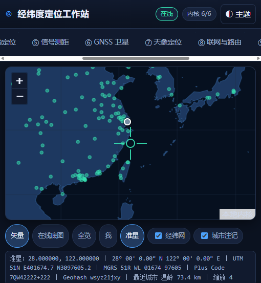

浅色主题、结果点与精度圈：

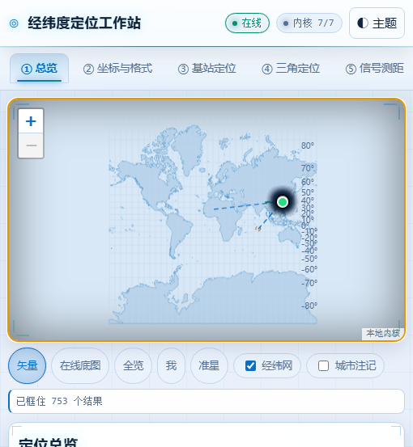

## 准星（专门用来确认「屏幕正中那个点到底是哪儿」）

入口在**地图下方工具条的第 5 个 chip**：`矢量 · 在线底图 · 全览 · 我 · 准星 · 经纬网 · 城市注记`。
快捷键没有，因为它是个开关，点一下亮起就是开了。

- 准星是钉在地图容器**正中**的十字 + 圆环（DOM 覆盖层，不是地图 marker，所以永远不会漂移）。
- 开启后**点地图任意处**，那个点会被平移到正中（缩放级别保持不变）。
- 平移一停，下面的读数条立刻给出中心点的：
  `DD(6 位小数) ｜ DMS ｜ UTM 带号+经纬距 ｜ MGRS ｜ Plus Code ｜ Geohash ｜ 最近城市与距离 ｜ 缩放`
- 读数条同时显示游标位置，两者并排，方便「我要的是正中，不是鼠标碰到的地方」。

今天实测的一次（中心点 28.000000, 122.000000）：

```
准星：28.000000, 122.000000 ｜ 28° 00' 0.00" N 122° 00' 0.00" E ｜ UTM 51N E401674.7 N3097605.2
    ｜ MGRS 51R WL 01674 97605 ｜ Plus Code 7QW42222+222 ｜ Geohash wsyz21jxy
    ｜ 最近城市 温岭 73.4 km ｜ 缩放 4
```

## 十一个面板

| 面板 | 干什么 | 今天实测出来的数 |
|---|---|---|
| **① 总览** | 浏览器定位、任意写法解析、会话全部解的对照表、两点量测（正算/反算） | 会话表累计 40 条解，每条带来源/精度/依据 |
| **② 坐标与格式** | DMS/DDM/DD/UTM/UPS/MGRS/Geohash/Plus Code/WebMercator/地图 URL/合并数字；投影正反算；WGS84↔GCJ-02↔BD-09；布尔莎 7 参数（Bursa–Wolf）高程转换 | `31°13'49.44"N 121°28'25.32"E` 置信 0.93；WGS84→GCJ02 偏移 433.2 m，迭代反算回原值差 **0.0000 m** |
| **③ 基站定位** | 3GPP 信道号↔频率、TA/RSRP 估距、多边定位、指纹匹配、BLE 邻近 | 3 站 LTE → `31.233164, 121.479721`，残差 RMS 7.7 m，不确定半径 **75.4 m**，GDOP 1.17 |
| **④ 三角定位** | 方位交会、距离交会、反方位表 | 3 条方位 → `31.239985, 121.479983`，角残差等效 0.5 m，半径 52.3 m |
| **⑤ 信号测距** | RSSI↔距离双向、指纹、BLE、TDOA | 逐条给出模型假设与量级，不给「精确到米」的错觉 |
| **⑥ GNSS 卫星** | NMEA 逐句解码（含校验和）、开普勒轨道、加权最小二乘 PVT、DOP、RAIM/FDE、大气延迟、ENU 基线、L6/PPP-B2b 电文、天空图 | 解 `31.3099935, 121.3900514, 12.18 m`，与真值差 **4.94 m**（独立检核），RAIM 剔除 PRN 16，HDOP 1.753，χ²=0.37/4/p=0.985 |
| **⑦ 天象定位** | 太阳/月亮/恒星视位置、上/下边缘与折射、子太阳点与晨昏线、北极星罗经、由高度反推纬度 | 2026-11-02 06:30 UT：几何高度 28.1518°、视高度 28.1832°、方位 228.5054°；日下点 `-14.76726, 78.39762`；并明写「未建模 UT1−UTC / ΔT」 |
| **⑧ 联网与路由** | IP 定位（6 源并行 + 融合）、桥接自检、路由追踪、DoH/DNS、接口回环检查 | 融合 `30.008663, 121.256478`，报告精度 **100 km**（BLUE σ 42.86 km 与保守分位取大者），χ²=0.193/dof=4/p=0.996，3/6 源可用；`github.com` 追踪 6 跳（2 跳如实标 timeout），8016 ms；追踪本机网关 `192.168.2.1` 得 1 跳、24 ms，并标注「目标归属：内网/本机」 |
| **⑨ 批处理导出** | 批量坐标解析与量测，导出 CSV/GeoJSON/GPX/KML/WKT，深链与二维码 | 5 行全部成功、0 行失败；深链只带经纬度与缩放，二维码本机生成 |
| **⑩ 历史与收藏** | `localStorage`，不上传，可一键清空 | — |
| **⑪ 内核自检** | 六个内核全量闸门 + 环境表（内核/Leaflet/vendor/离线数据/矢量陆域/localStorage/协议/界面缺失 id） | **515 门 / 0 失败 / 0.70 s**，陆域 1374 块已挂图，界面缺失 id 0 个 |

各面板实拍（整页截图，窄屏响应式布局下地图吸顶、面板在下）：

| ② 解析与投影 | ③ 基站多边定位 | ⑥ GNSS 最小二乘 |
|---|---|---|
| 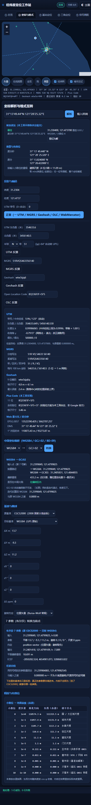 | 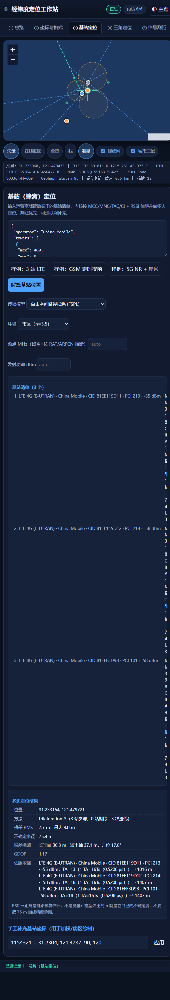 | 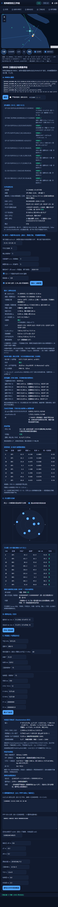 |

| ⑦ 天象 | ⑧ IP 多源 | ⑧ 路由追踪（桥接） |
|---|---|---|
| 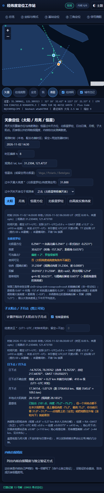 | 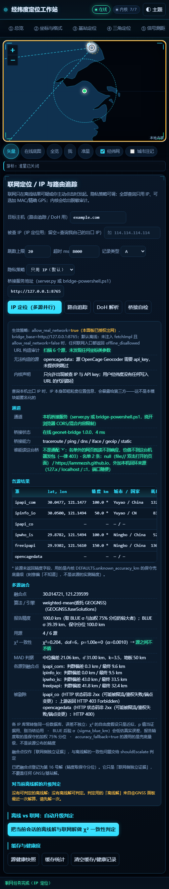 | 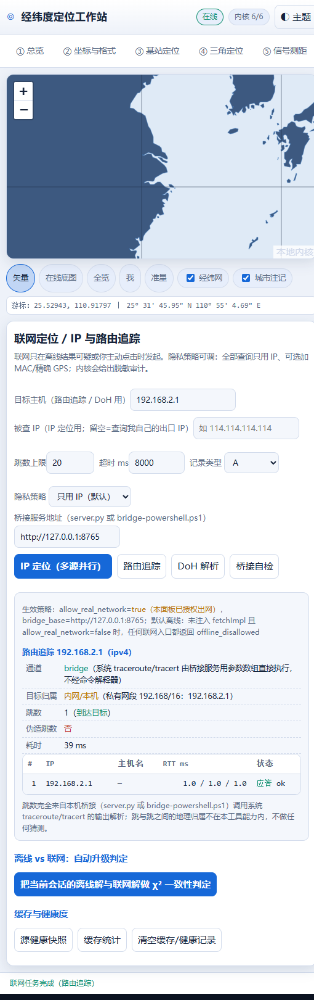 |

| ④ 方位交会 | ⑤ 信号测距 | ⑨ 批处理与二维码 |
|---|---|---|
| 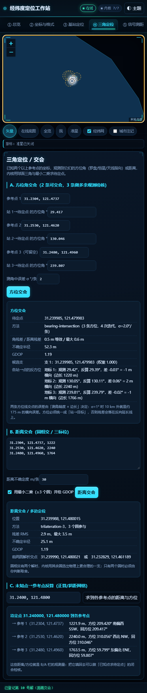 | 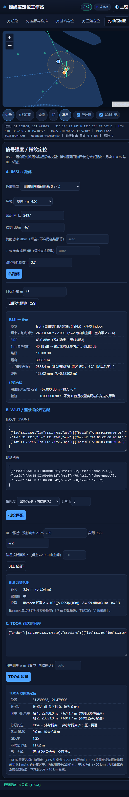 | 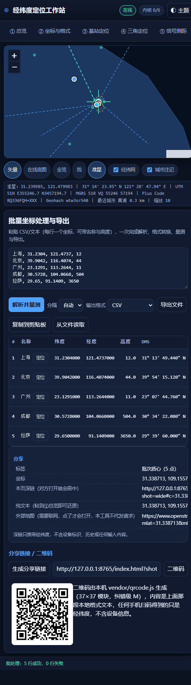 |

| ① 会话全部解 | ⑪ 自检全绿 |
|---|---|
| 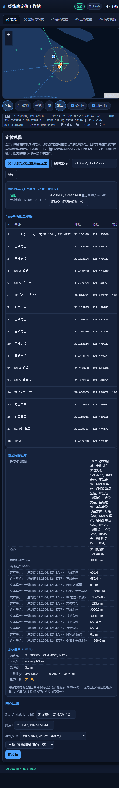 | 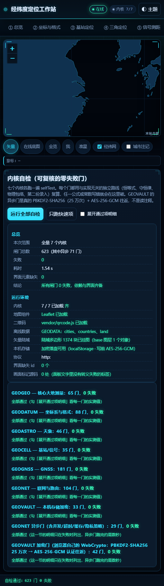 |

## 六个内核与它们的闸门


| 内核 | 门数 | 覆盖 |
|---|---|---|
| `GEOGEO` | 65 | 椭球与大地计算：子午线弧与 1° 量级、正反算往返闭合（残差 <1 mm）、方位互差 180°、近对跖点与过极点、ECEF/ENU、7 参数基准偏移、面积/凸包/质心、16/32 罗经点、小数位→地面量级 |
| `GEODATUM` | 88 | 投影与编码 + 中国偏转坐标系：横轴墨卡托满足 C-C 共形方程、收敛角与等角纬度、UTM/UPS/MGRS/Geohash/Plus Code/WebMercator 往返、DMS/DDM 解析与格式化、GCJ-02/BD-09 加偏与迭代反算、`parseAny` 多读法置信度、`outOfChina` |
| `GEOCELL` | 35 | GSM/WCDMA/LTE/NR 信道↔频率、TA/RSRP 估距、多边交会、指纹、BLE |
| `GEOGNSS` | 181 | NMEA、开普勒轨道、加权 LSQ PVT、DOP、RAIM/FDE、对流层/电离层、ENU 基线、L6 PPP-B2b |
| `GEOASTRO` | 46 | GMST、太阳/月亮/恒星视位置、折射、子太阳点与晨昏线、天文定位 |
| `GEONET` | 100 + 25 | 联网策略、URL 构造审计、多源融合（BLUE/χ²/MAD）、traceroute 解析、异步与垃圾输入（25 道异步门只在 Node 侧跑，所以浏览器 ⑪ 是 515） |

```bash
node tests/run-all.mjs                 # 540 门 / 0 失败
python tests/check-package.py          # 21 项 / 0 失败
python server.py --selftest            # 87 项 / 0 失败（1 项跳过）
```

闸门怎么设计、以及今天被抓出来的一条计时抖动，见 [docs/selftest.md](docs/selftest.md)。

## 默认离线，出网只有四条路


会离开本机的请求只有：① GeoIP 上游（一个 IP）② 在线底图瓦片（你手动打开且与「矢量」互斥）
③ 系统 `tracert`/`ping` 的目标主机 ④ 浏览器 Geolocation（由浏览器处理，本工具不转发）。

代码级红线（都有闸门守着）：桥接**只绑 127.0.0.1**，非回环绑定在启动阶段直接拒绝；
绑定前先探测端口，**已有监听者就拒绝再起一个**（Windows 的 `SO_REUSEADDR` 允许重复绑定，
两个服务并存时请求被随机分走，你会以为「改了代码没生效」）；
桥接**不接收任何坐标类参数**（`lat/lon/accuracy/heading/…` 一律 400）；
没有 `os.system`/`shell=True`/`eval`（AST 检查）；上游 URL 只来自内置源表，不能当 SSRF 中继；
没有统计、没有更新检查、没有 CDN。
⑧ 的 `traceroute`/`ping` **允许**打内网地址（追踪自家路由器就是它的本职，没有开关可忘），
但每次响应都带 `target_scope`（`lan` / `public`，域名还按解析结果判），界面上单独一行「目标归属」——
包到底打在局域网里还是公网上，是写在结果里的，不用你猜。这一条的取舍与边界写在
[docs/privacy.md](docs/privacy.md)。

## 目录结构

```
经纬度定位工作站/
├── index.html                 唯一入口（15 个本地资源，无打包器）
├── server.py                  可选本机桥接（Python 标准库，只绑回环，--selftest 87 项）
├── app/
│   ├── core-{geodetic,datums,cell,gnss,astro,net}.js   六个内核
│   ├── ui-app.js  ui-map.js   界面外壳与地图封装（含准星）
│   ├── style.css              主题、响应式断点、层叠上下文
│   └── data/                  离线数据（城市 2.0 MB / 陆域 748 KB / 国家 12 KB）
├── vendor/                    Leaflet 1.9.4 (BSD-2) · qrcode.js (MIT)
├── 示例数据/                  10 份能互相闭合的样例（NMEA/基站/三角/TDOA/GPX/CSV/电文…）
├── 工具/build-data.mjs        离线数据生成器（幂等）
├── tests/                     run-all.mjs（540 门）· check-package.py（21 项）
├── docs/                      platforms · architecture · privacy · selftest · data · img/
├── images/                    14 张真实界面截图
├── 启动-{Windows.bat,macOS.command,macOS-Linux.sh,Android.sh,iSH.sh}
├── 说明书.md                  中文完整说明书（9 节，含面板逐个说明与 FAQ）
├── LICENSE · package.json · .gitignore · .gitattributes · .github/workflows/ci.yml
```

## 精度与诚实性：这份工具不会替你猜的地方

- **小数位就是精度**：`31.2304, 121.4737` 是 4 位小数 ≈ 11 m 量级；写成 8 位小数不会让它更准。
  ② 面板有一张「小数位 → 地面量级」对照表。
- **GCJ-02 不可逆**：加偏函数没有闭式反解，「反算」是迭代逼近，残差如实显示。
- **IP 定位是城市/区级**：报告精度取 `BLUE σ` 与加权 75% 分位的较大者；源没给精度字段时用
  内核自报的保守兜底量级，并在表里标 `*` 说明「这是刻意偏『不知道』，不是该源的实测精度」。
- **一条方位线定不出一条线**：⑦ 天象、④ 交会都给候选解与残差，不给你唯一的「正确答案」。
- **天文时间尺度**：假定 UT1=UTC（|UT1−UTC|≤0.9 s → GMST 误差 ≤13.5″ ≈ ±410 m 经度），
  未加 ΔT(TT−UT)、未建模闰秒 —— 这些直接写在结果里，不藏在脚注。
- **浏览器定位被拒绝时**：界面显示「你拒绝了定位授权（code=1）」，不会悄悄改用 IP 结果冒充。

## 示例数据

`示例数据/` 里 10 份样例不是装饰：同一套上海/北京基准点贯穿 NMEA、基站观测、三角交会、TDOA、
航迹 GPX 与坐标批处理 CSV，所以你能拿不同面板解同一个位置，看它们的精度圈是否互相咬合。
⑪ 自检里不少闸门就是拿这些样例做「第二份录入」的独立复算。

## 开发

```bash
node tests/run-all.mjs --with-server   # 内核 + 桥接（需要 python）
python tests/check-package.py          # 包完整性
node 工具/build-data.mjs               # 重建离线数据（需自备原始输入，见 docs/data.md）
python server.py --port 9000           # 换端口；页面用 9000 打开时 ⑧ 自动连同源端口
```

零依赖：不需要 `npm install`，不需要 `pip install`。`package.json` 只是脚本入口与元信息。
实现约定与踩过的两个坑（数据嵌套、Leaflet 层叠上下文）见 [docs/architecture.md](docs/architecture.md)。

## 常见问题

- **地图是空白的？** 默认就是离线矢量陆域（只有陆块轮廓）。要街道图请点「在线底图」，那会向 OSM 发请求。
- **标题行/标签页点不动？** 已在 v1.0.0 修好（窄屏下 Leaflet 的 z-index 逃出层叠上下文）。
  如果你看到的是旧版本，`Ctrl+F5` 强刷 `app/style.css`。
- **⑧ 一直说桥接不在线？** 确认 `python server.py` 在跑、端口对（默认 8765），
  ⑧ 面板的「桥接服务地址」留空即自动同源。
- **能不能拿它做工程测量？** 能算，但别把它当仪器。它没有 RTK 数据链、没有权威大地水准面模型、
  没有认证过的坐标系参数；报告精度是「内核能自证的下限」，不是测绘资质。
- **iOS 上能用吗？** Safari 打开在线地址即可，六个内核 + 地图 + ⑪ 自检全跑；⑧ 的逐跳路由追踪需要本机
  `python3 server.py`——iOS 上没有启动器可跑，可行路径是 iSH（见 `说明书.md` 第 2 节，这一步作者未在实机验证），
  或换 A-Shell / Pyto 这类能起本机 HTTP 的 App。没有桥接时 ⑧ 只做 IP 定位与 DoH，并如实说明拿不到跳数。

## 数据来源与许可

MIT（见 [LICENSE](LICENSE)）。第三方不在 MIT 覆盖范围内：
GeoNames `cities15000`（CC BY 4.0，**再分发需保留署名**）、Natural Earth `ne_50m_land`（公有领域）、
Leaflet 1.9.4（BSD-2-Clause）、qrcode.js（MIT, Kazuhiko Arase）。完整表在 `说明书.md` 第 9 节。

在线底图瓦片的 © OpenStreetMap contributors（ODbL）只在你打开「在线底图」时相关，瓦片不属于本包。
