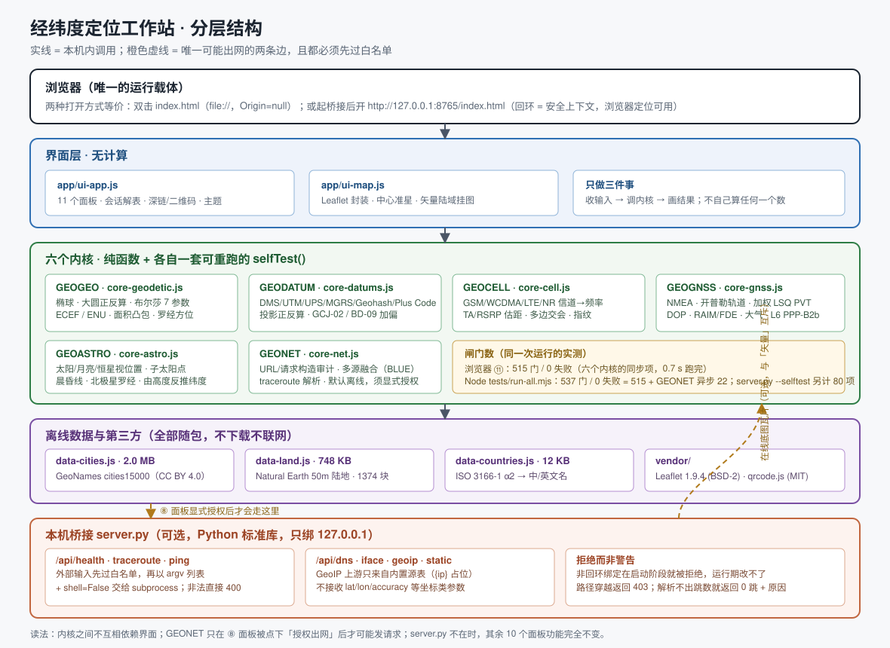

# 架构与实现说明



## 一句话结构

`index.html` 是唯一的入口，也是唯一的「装配表」：15 个本地 `<script>`/`<link>` 按顺序把
数据、六个内核、地图封装和界面外壳挂到 `globalThis` 上，没有任何打包器、模块加载器或运行时依赖。

```
index.html
 ├─ vendor/leaflet.css  app/style.css
 ├─ vendor/leaflet.js   vendor/qrcode.js
 ├─ app/data/data-countries.js  ┐
 ├─ app/data/data-cities.js     ├─ 挂到 globalThis.GEODATA（三个文件各自 Object.assign）
 ├─ app/data/data-land.js       ┘
 ├─ app/core-geodetic.js   → GEOGEO      坐标格式 / 投影 / 正反算
 ├─ app/core-datums.js     → GEODATUM    椭球 / 基准 / 布尔莎 / GCJ-02 / BD-09
 ├─ app/core-cell.js       → GEOCELL     蜂窝信道 / TA / RSRP / 交会 / 指纹
 ├─ app/core-gnss.js       → GEOGNSS     NMEA / 轨道 / LSQ PVT / DOP / RAIM / 大气 / PPP
 ├─ app/core-astro.js      → GEOASTRO    太阳 / 月亮 / 恒星 / 晨昏线 / 天文定位
 ├─ app/core-net.js        → GEONET      联网策略 / URL 审计 / 多源融合 / 追踪解析
 ├─ app/ui-map.js          → GEOUI_MAP   Leaflet 封装 + 准星 + 矢量陆域
 └─ app/ui-app.js          → GEOUI       11 个面板的外壳与绑定
```

内核之间**不互相 import**；需要跨内核时通过 `globalThis` 上的命名空间取（例如 ① 面板把
`GEOGNSS.fuseSolutions` 借给 `GEONET` 做融合）。这样每个文件都能单独在 Node 里加载、单独跑自检。

## 内核的写法约定

- 每个内核是 `(function (G) { 'use strict'; ... })(globalThis)` 的 IIFE，只挂一个命名空间。
- 纯函数优先：不读 DOM、不读 `location`、不发请求。唯一例外是 `GEONET`，它读 `location` 只为了
  推断默认桥接地址（见下），且真实出网必须显式注入 `fetchImpl` 或授权。
- 每个内核导出一个 `selfTest()`，返回 `[{name, pass, detail}, …]`。闸门用**独立路线**复算：
  恒等式、守恒律、物理包络、第二份录入。公式或常数写错就会在这里破，而不是在界面上看着不对。
- 算不出就返回 `null` + `note`/`error_kind`，**不返回一个看起来合理的数**。界面按原样显示。

## 地图层（app/ui-map.js）

Leaflet 只用来做「投影 + 平移缩放 + 图层容器」，底图默认**不发网络请求**：

- `base` 图层放离线矢量陆域（`GEODATA.land`）。数据形状是
  `blocks = [块, …]；块 = [外环, 洞环, …]；环 = 扁平数组 [lon,lat,lon,…]（不闭合存储）`，
  所以 `buildLand()` 必须钻两层再成对取坐标，并在收尾补闭合点。少钻一层的结果是 1374 块全被跳过、
  画布一个像素都不画——内核全绿但界面空白，这类问题看不见，因此 ⑪ 环境表专门加了一行
  「矢量陆域」，直接断言挂图块数与 `base` 图层对象数。
- `grid` 经纬网、`cities` 城市注记、`results` 结果点与精度圈、`overlay` 辅助线（晨昏线、天空图、交会射线）。
- **中心准星**：一个 `position:absolute; inset:0; pointer-events:none` 的 DOM 覆盖层钉在容器正中
  （不是地图 marker，所以永远不会漂移）。开启后点地图任意处 → `map.setView(点, 当前缩放)` 把它转到正中，
  `moveend` 触发读数回调，给出该中心点的 DD / DMS / UTM / MGRS / Plus Code / Geohash / 最近城市 / 缩放。
- **层叠上下文**：Leaflet 内部控件自带 400~1000 的 z-index。窄屏断点下 `.mapwrap` 会退成
  `position: static`（不再形成层叠上下文），于是这些 z-index 跑到整页最前，把吸顶的标题行和标签页
  盖住——表现是「字看得见但点不动」。修法是给 `.mapwrap` 加 `isolation: isolate`（与定位方式无关），
  并把 `.topbar` / `.tabs` 提到 1300 / 1200。

## 联网层（app/core-net.js）

三层防护，缺一不可：

1. **默认离线**：`allow_real_network=false` 且未注入 `fetchImpl` 时，联网入口返回
   `offline_disallowed`，连 URL 都不构造。
2. **URL 构造审计**：自检把每个出站 URL 拆开检查，只允许出现「被查 IP」与「API key」两类占位；
   坐标类参数一旦出现即闸门失败。上游地址来自内置源表，自建上游用 `upstream_url`（必须含 `{ip}`，
   拒绝回环/私有/链路本地与非 http(s)），因此桥接不会变成任意 URL 的中继。
3. **桥接地址同源优先**：`defaultBridgeBase()` 在页面本身就是回环 http(s) 源时返回页面 origin，
   于是 `http://127.0.0.1:9000/` 打开页面时 ⑧ 面板自动连同一个端口；`file://`、非回环源、
   `origin=null` 一律退回默认 `http://127.0.0.1:8765`。显式传参时**绝不回看真实 `location`**，
   否则自检结果会随运行环境漂移。

## 桥接（server.py）

Python 标准库，无第三方依赖。要点都写在代码里并由 `--selftest` 复核：

- 只绑 `127.0.0.1`；非回环绑定在启动阶段直接拒绝。
- **绑定前先探测端口**：`HTTPServer` 开着 `SO_REUSEADDR`，而 Windows 的 `SO_REUSEADDR` 语义与
  POSIX 不同——它允许第二个进程绑到**正在监听**的端口（POSIX 会直接 `EADDRINUSE`）。结果是两个桥接
  同时 LISTENING、连接被随机分走，页面一切正常，但你可能在跟上一版代码起的旧服务说话，改完代码刷新
  页面「不生效」就是这么来的。`create_server()` 因此先对目标端口发一次回环 connect，有人就在就
  直接退出并给出换端口的命令；这条由 `--selftest` 的门复核（该门不依赖真实监听者）。
- 外部输入 → 白名单字符集 `[A-Za-z0-9._:-]` + 结构校验 → 以 **argv 列表 + `shell=False`** 交给
  `subprocess`；非法输入 400 并给中文原因，进程根本不起。
- 坐标类参数一律拒收（桥接永远不知道你在哪儿）。
- `/api/*` 带 `Access-Control-Allow-Origin: *`（`file://` 的 Origin 是 `null`，必须这样才调得通）；
  静态资源不带 CORS 头，避免任意本地页面读取项目文件。
- 解析器诚实：`tracert` 输出解析不出跳就返回 0 跳 + 原因；`<1 ms` 的样本保留为上界，不插值。

## 加一个新面板/新内核要做什么

1. 内核文件末尾导出 `selfTest`，闸门至少覆盖：已知答案、恒等式往返、边界值、垃圾输入不抛异常。
2. `index.html` 里按顺序加 `<script>`，并在 `app/ui-app.js` 的依赖清单里登记（⑪ 的「界面缺失 id」
   与 `tests/check-package.py` 的资源齐备检查会替你把关）。
3. 跑 `node tests/run-all.mjs`（537 门）+ `python tests/check-package.py`（19 项）+
   `python server.py --selftest`（80 项），再在浏览器 ⑪ 点一次全量。
