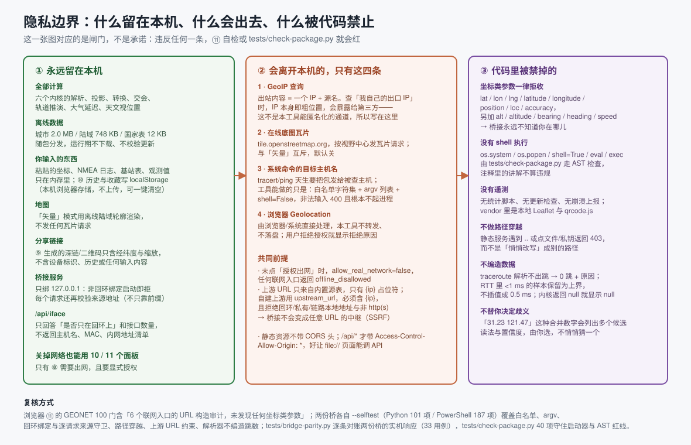

# 隐私与网络边界

## 会离开本机的请求，全部列出来就这四类

| # | 请求 | 触发条件 | 出站内容 | 关掉方式 |
|---|---|---|---|---|
| 1 | GeoIP 上游（内置 6 源） | ⑧ 面板 + 显式授权 + 点「IP 定位」 | 一个 IP（查自己出口 IP 时，IP 本身就是粗位置） | 隐私策略选「禁用联网」 |
| 2 | `tile.openstreetmap.org` 瓦片 | 地图工具条点「在线底图」 | 视野范围（按瓦片 XYZ 请求） | 切回「矢量」（默认） |
| 3 | 系统 `tracert` / `ping` 的目标主机 | ⑧ 面板 + 桥接在线 | 目标主机名的 DNS 解析与 ICMP/UDP 探测 | 不点按钮 |
| 4 | 浏览器 Geolocation | 点「用浏览器定位我在这里」+ 你在浏览器里点允许 | 由浏览器/系统决定，本工具不转发也不落盘 | 拒绝授权 |

除此之外没有任何出站请求：没有统计、没有更新检查、没有崩溃上报、没有 CDN（Leaflet 与 qrcode.js 都在 `vendor/`）。

## 代码级红线（可复核，不是承诺）

- **桥接只绑回环。** 非回环绑定在启动阶段被拒绝，运行期无法改成 `0.0.0.0`。
  绑定前还会对目标端口发一次回环 connect：已有人在听就直接拒绝再起第二个——Windows 的
  `SO_REUSEADDR` 容许多个进程绑同一端口，两个桥接并存时连接被随机分走，出现「代码已改、
  行为却还是旧的」这种最难查的现象。拒绝第二个进程，既是对的语义，也是可复核的承诺。
- **桥接不接收坐标。** `lat / lon / lng / latitude / longitude / position / loc / accuracy /
  alt / altitude / bearing / heading / speed` 在参数校验阶段直接 400。
- **没有 shell 执行。** 外部输入先过白名单字符集与结构校验，再以 argv 列表 + `shell=False` 交给
  `subprocess`；`os.system` / `os.popen` / `shell=True` / `eval` / `exec` 由
  `tests/check-package.py` 用 AST 检查（注释里的讲解不计入违规）。
- **不能当 SSRF 中继。** 上游 URL 只来自内置源表，唯一的变量是 `{ip}` 占位；自建 `upstream_url`
  必须含 `{ip}`，且拒绝回环 / 私有 / 链路本地地址与非 http(s) 协议。
- **静态服务不越界。** 路径穿越、点文件、私钥一律 403，而不是悄悄改写成别的路径。
- **`/api/iface` 只回答两件事**：是否只在回环上、接口数量。不返回主机名、MAC、内网地址清单。

## 内网目标：允许，但把归属写在你看得见的地方

⑧ 的 `traceroute` / `ping` **可以**打内网地址（`192.168.1.1`、网关、`127.0.0.1`）。这是刻意的：
「追踪自家路由器」「ping 一下 NAS」本来就是这台工具的主要用途之一，加一道默认拒绝的闸门
等于让功能残废。同时如实说明这一处的边界在哪里：

- `/api/*` 用 `Access-Control-Allow-Origin: *`，这是 `file://`（`Origin: null`）与托管 https 页面
  能用上桥接的前提。代价是**任意网页**都能向 `http://127.0.0.1:8765/api/…` 发请求。
  桥接只绑回环，能连它的只有这台机器上的程序与浏览器；但浏览器会替任何页面发这个请求。
- 因此 ⑧ 的两个命令端点是**只读诊断**：没有写操作、没有 POST（POST 一律 405）、
  目标主机名过白名单字符集 `[A-Za-z0-9._:-]` 与结构校验，参数按 argv 分元素交给 `subprocess`，
  墙钟与跳数上限固定。它能造成的后果是「对某个地址多发几次 ICMP/UDP」，
  而不是「在你机器上执行任何东西」。
- 每次成功响应都带 `target_scope`（`lan` / `public`）与 `target_scope_note`，域名还按**解析结果**判定，
  界面上单独一行「目标归属」。也就是说：一次探测究竟打到局域网内还是打到公网，是写在结果里的，
  不是让你猜的。旧版 `server.py` 没有这两个字段时，界面显示「桥接未标注」而不是猜一个。

要彻底关掉这个口子只有一个办法：**不启动 `server.py`**。没有桥接，⑧ 的路由追踪会明确报
`bridge_unavailable` 并只做浏览器 DoH 解析，其余十个面板全部照常（自检、地图、内核都离线跑）。

## 界面诚实性（同样有闸门）

- 内核返回 `null` 或错误 → 界面显示「算不出」与原因，不插值、不借用别的源、不拿城市中心冒充你的位置。
- 路由追踪解析不出跳 → 返回 0 跳 + 原因；`<1 ms` 的 RTT 样本保留为「上界」，不写成 0.5 ms。
- 有歧义的输入（如合并数字 `31.2304 121.4737`）→ 列出多个候选读法与置信度，由你选。
- IP 定位的报告精度取 `BLUE σ` 与加权 75% 分位的**较大者**；源没给精度字段时用内核自报的保守兜底量级，
  并在表里标 `*` 说明这是「刻意偏不知道」，不是该源的实测精度。
- 浏览器定位被拒绝时，界面上写的是「你拒绝了定位授权（code=1）」——2026-11-02 的实测截图里就是这句话。

## 数据留在哪里

- 你输入的一切只在内存；⑩ 历史与收藏写 `localStorage`（本机浏览器存储，不上传，可一键清空）。
- ⑨ 生成的深链与二维码只含经纬度与缩放级别，不含设备标识、历史或任何输入内容。
- 桥接默认不打印请求体（它只处理 GET，参数在 query 里），日志写在同目录 `桥接服务.log`，
  该文件已在 `.gitignore` 里，不会被提交。
