# 经纬度定位工作站 · 说明书

离线优先的多源定位与测绘工具箱。六个计算内核全部是本机 JavaScript，双击页面即可用；
只有「⑧ 联网与路由追踪」需要额外的本机桥接服务，而且 Windows 上**不装任何东西也能把桥接拉起来**
（`bridge-powershell.ps1` 用系统自带的 PowerShell 5.1）。

- 在线体验地址（GitHub Pages，与仓库同一份文件，不需要下载）：**<https://iammezsh.github.io/geo-position-workstation/>**
- 仓库地址：<https://github.com/IAMMEZSH/geo-position-workstation>
- 交付形态：一个自包含的本地文件夹，无安装、无注册、无云端账号、零第三方运行时依赖
- 验收状态（2026-11-02 本机实测，全部 0 失败）：
  浏览器 ⑪ **515 门**；Node **541 门**（= 515 + GEONET 异步 26）；
  `server.py --selftest` **101 项**（1 项因本机不支持而跳过）；
  `bridge-powershell.ps1 -SelfTest` **187 项**；`tests/bridge-parity.py` **33 用例**；
  `tests/check-package.py` **40 项**。构成与命令见第 8 节，界面与逐面板实测数字见第 9 节。
- **本文件是唯一的使用文档**：平台边界、架构约定、隐私红线、自检复核、离线数据、踩过的坑都写在这里，
  改版信息也写在这里，不另出更新说明。仓库首页 `README.md` 只做索引与图墙，不重复本文内容。

目录：

| 节 | 内容 | 节 | 内容 |
|---|---|---|---|
| 0 | 一分钟上手 | 7 | 联网与隐私红线 |
| 1 | 包里有什么 | 8 | 自检怎么复核（六层门） |
| 2 | 各平台怎么启动（含两份桥） | 9 | 平台矩阵与实测记录 |
| 3 | 十一个面板逐个说明 | 10 | 离线数据：来源、裁剪、重建 |
| 4 | 示例数据（能互相闭合） | 11 | 踩过的坑 |
| 5 | 精度与诚实性 | 12 | 常见问题 |
| 6 | 架构与实现约定 | 13 | 数据来源与许可 |

---

## 0. 一分钟上手

按「你想装多少东西」从少到多排，四条路都能把十一个面板全部打开：

| 想要什么 | 怎么做 | ⑧ 路由追踪 |
|---|---|---|
| 什么也不装，先看一眼 | 浏览器打开 <https://iammezsh.github.io/geo-position-workstation/> | 需要你本机另起桥接（见下面第 3 行）；跨域与私有网络访问已实测打通，见第 2.5 节 |
| 完全离线、不联网 | 下载仓库 → 直接双击 `index.html` | 不可用（界面如实报「桥接不在线」，其余十个面板不变） |
| **本机全功能（推荐）** | 下载仓库 → 双击对应平台的启动器 | 可用。Windows 上启动器会自己挑桥：有 Python 用 `server.py`，没有就用 `bridge-powershell.ps1`（系统自带，零安装） |
| 手机 / 平板 | Android：Termux 跑 `启动-Android.sh`；iPhone/iPad：Safari 打开托管地址，想连本机桥接就再装 iSH | Android 可用（桥就跑在手机上）；iOS 要靠 iSH，否则只有 IP 定位与 DoH |

1. **下载**：仓库首页绿色 `Code` → `Download ZIP`，或
   `git clone https://github.com/IAMMEZSH/geo-position-workstation`。
   两条路拿到的文件逐字节相同（第 9 节有当场比对的数字）。
2. **解压/拷贝整个文件夹**到本机任意位置，路径含中文没问题。
3. **打开后先到 ⑪ 内核自检 → 运行全部自检**，看到「515 门 / 0 失败」再往下用。
   这一屏同时会告诉你：六个内核有没有都加载、陆域多边形挂上图没有（正常 1374 块）、
   界面缺不缺元素、面板文字里有没有转义失败的标签。
4. **不知道某个面板吃什么数据**：每个面板顶部都有一行灰字提示，且都预填了能直接点的内容；
   第 3 节逐面板写了输入、输出与今天实测出来的数。

---

## 1. 包里有什么

交付包 **62 个文件、7.47 MB（7.12 MiB）**（含 15 张真实运行截图与 2.8 MB 离线数据；
不含 `.git`，不含开发期目录）。`git ls-files -co --exclude-standard` 数出来的就是这个数，
`tests/check-package.py` 会反向确认没有任何交付文件被 `.gitignore` 误吞。

| 路径 | 作用 |
|---|---|
| `index.html` | 唯一入口，十一个面板；引用 **15 个本地资源**，无打包器、无 CDN |
| `app/core-geodetic.js` | GEOGEO（701 行）：椭球、大地线正/反算、ECEF/ENU、面积凸包、罗经 |
| `app/core-datums.js` | GEODATUM（1276 行）：投影与编码、基准转换、GCJ-02/BD-09、`parseAny` |
| `app/core-cell.js` | GEOCELL（2410 行）：蜂窝信道↔频率、TA/RSRP 估距、交会、TDOA、指纹 |
| `app/core-gnss.js` | GEOGNSS（3021 行）：NMEA、星历、伪距最小二乘、DOP、RAIM、大气、PPP 电文 |
| `app/core-astro.js` | GEOASTRO（2338 行）：太阳/月亮/恒星视位置、子点、晨昏线、北极星罗经 |
| `app/core-net.js` | GEONET（2728 行）：联网策略、URL 审计、多源融合、追踪解析、缓存/健康度 |
| `app/ui-app.js` `app/ui-map.js` `app/style.css` | 外壳（3213 行）、地图封装（514 行，含准星）、主题与响应式 |
| `app/data/` | 离线数据：城市 2.0 MB、陆域 748 KB、国家码 12 KB（来源与重建见第 10 节） |
| `vendor/` | 第三方：Leaflet 1.9.4（BSD-2）、qrcode.js（MIT），都在包里，不下载 |
| `示例数据/` | 10 份能互相闭合的样例，见第 4 节 |
| `server.py` | 桥接实现之一（2338 行，Python 标准库，只绑 127.0.0.1，`--selftest` 101 项） |
| `bridge-powershell.ps1` | 桥接实现之二（1935 行，PowerShell 5.1 + .NET，**Windows 自带就能跑**，`-SelfTest` 187 项） |
| `启动-Windows.bat` | Windows 启动器：Python 桥 → PowerShell 桥 → 直接开页面 的三级回退（纯 ASCII，见第 2.1 节） |
| `启动-macOS.command` `启动-macOS-Linux.sh` `启动-Android.sh` | macOS / Linux / Android Termux 启动器（LF 换行） |
| `启动-iSH.sh` | iPhone / iPad：在 iSH（Alpine 虚拟机 App）里跑 Python 桥，先自检再拉起并探测端口 |
| `README.md` | 仓库首页：索引 + 图墙（内容不重复本文） |
| `docs/img/` | 3 张机制图：`architecture.svg` 分层结构、`decision-flow.svg` 决策链、`privacy-boundary.svg` 隐私边界（分别被第 6、5、7 节引用） |
| `images/` | 15 张真实运行截图（README 与本文引用，不是装饰图） |
| `tests/run-all.mjs` | Node 侧跑全部内核闸门（541 门），`--with-server` 连带跑 Python 桥，`--with-bridge` 再跑 PowerShell 桥 |
| `tests/check-package.py` | 打包体检 40 项：入口资源、启动器编码与换行、两份桥的红线与契约、文档断链、忽略规则误吞、零依赖 |
| `tests/bridge-parity.py` | 实机对账 33 用例：两份桥同时拉起，逐条打同一个请求，比状态码/键集合/字节数/Content-Type |
| `.github/workflows/ci.yml` | 每次推送在 Ubuntu 与 Windows 上把上面三组各跑一遍 |
| `工具/build-data.mjs` | 离线数据生成器（幂等，见第 10 节） |
| `package.json` `LICENSE` `.gitignore` `.gitattributes` | 零依赖元数据、MIT 与第三方署名说明、忽略规则、换行符规则（`.sh`=LF、`.bat`/`.ps1`=CRLF、图片=binary） |
| `说明书.md` | 本文件 |

运行时唯一会新增的文件是根目录的桥接访问日志（`桥接服务.log` 或 `bridge-powershell.log`），
删掉不影响任何东西；`示例数据/NMEA语句示例.log` 是要分发的样例，
所以忽略规则**逐条列文件名而不写 `*.log`**（第 11 节第 3 条踩过这个坑）。
开发期的无头调试脚本放在作者本机的 `app/_build/`，被 `.gitignore` 排除——
`git clone` 之后没有这个目录，功能不受影响，交付包就是你在仓库里看到的目录树。

---

## 2. 各平台怎么启动（Windows / macOS / Linux / Android / iOS）

### 2.1 启动器做的三件事与三级回退

启动器做三件事：**找解释器 → 把桥接拉起来（只绑 127.0.0.1）→ 用浏览器打开页面**。
Windows 那条是三级回退，所以「没装 Python」不再是功能缺失：

```
python / py 存在且真能运行  →  python server.py --port 8765
        ↓ 没有（或只是 Microsoft Store 的占位 stub）
系统自带 PowerShell 5.1     →  powershell -NoProfile -ExecutionPolicy Bypass -File bridge-powershell.ps1 -Port 8765
        ↓ 两条桥都在 20 秒内没答 /api/health
直接 start "" "index.html"  →  页面照常打开，⑧ 面板如实报「桥接不在线」
```

三条实现细节都是被坑逼出来的（详见第 11 节）：

- **`where python` 不够，还要真跑一次** `-c "import sys"`：Microsoft Store 的占位 stub 能通过 `where`，
  但一执行就去弹商店。
- **可达性探测不用 Python，用 PowerShell 的 `Invoke-WebRequest`**：同一条判定能验两份桥，
  而且在没有 Python 的机器上照样能问 `/api/health`。
- **延时不用 `timeout`，用 `ping -n`**：Git Bash 等工具链会把 coreutils 的 `timeout` 排到 PATH 前面，
  批处理里的 `timeout` 不一定是 Windows 那个。
- **`.bat` 全文纯 ASCII**：中文 Windows 的 GBK 控制台会把 UTF-8 批处理读成乱码并中断执行，
  所以中文提示改成运行时 `for %%f in (*.md) do echo %%f` 枚举文件名，而不是把中文写进批处理。

### 2.2 逐平台

| 平台 | 操作 | 备注 |
|---|---|---|
| Windows | 双击 `启动-Windows.bat` | 桥接在另一个最小化窗口里，关掉即停止。**没有 Python 也全功能**（自动落到 PowerShell 桥） |
| macOS | 双击 `启动-macOS.command` | 首次可能被 Gatekeeper 拦：右键 → 打开。提示无法执行时先 `chmod +x 启动-macOS.command 启动-macOS-Linux.sh` |
| Linux | `sh 启动-macOS-Linux.sh` | 图形界面下已 `chmod +x` 也可直接双击 |
| Android | Termux：`pkg install python` → `sh 启动-Android.sh` | 手机浏览器开打印出的 `http://127.0.0.1:8765/`（桥就跑在手机上，只绑回环，别的设备连不到） |
| iPhone / iPad | **最短路径：Safari 直接打开托管地址**，十一个面板全部渲染，⑪ 自检照跑 | 要用 ⑧ 的逐跳追踪就装 iSH 跑 `启动-iSH.sh`（第 2.7 节）；没有 iSH 时 ⑧ 仍能做 IP 定位与 DoH，只是拿不到跳数 |
| 什么都不装 | 双击 `index.html`（`file://`） | 六个内核 + 地图 + 离线数据 + ⑪ 全跑；只有 ⑧ 的桥接功能缺失 |

iOS 上「文件」App 的 Quick Look 只预览、不执行页面里的脚本，所以真机使用要靠本地 HTTP 服务或托管地址；
又因为浏览器在**非安全上下文**（普通局域网 `http://192.168.x.x`）会直接拒绝 Geolocation API，
手机想用自己的 GPS 只有 `file://`（部分浏览器）或 HTTPS 两条路。逐平台逐面板的可用性矩阵写在第 9 节。

### 2.3 两份桥、一个契约

同一个 `/api` 契约有两份实现，页面**不需要知道自己连上了哪一个**：

| | `server.py` | `bridge-powershell.ps1` |
|---|---|---|
| 需要装什么 | Python 3（标准库，无 pip 依赖） | **什么都不用**：Windows 自带 PowerShell 5.1 + .NET |
| HTTP 服务 | `http.server.HTTPServer` | `System.Net.HttpListener` |
| 起外部命令 | `subprocess` + argv 列表 + `shell=False` | `ProcessStartInfo` 参数数组 + `UseShellExecute = $false` |
| 自检 | `python server.py --selftest` → 101 项 | `powershell -File bridge-powershell.ps1 -SelfTest` → 187 项 |
| 端口 | `--port`（默认 8765） | `-Port`（默认 8765） |
| 访问日志 | 根目录 `桥接服务.log` | 根目录 `bridge-powershell.log`（`-Quiet` 可关） |

一致性由三道闸门守着，而不是靠「看起来一样」：

1. **静态对账**（`tests/check-package.py`）：两份源码里的契约字面量
   （`BRIDGE_CONTRACT` / `$script:BridgeContract`）逐端点逐键比，
   6 个端点、拒收的 13 个坐标类参数、静态 Content-Type 表逐键逐值都必须一致；
   `.ps1` 的 UTF-8 BOM 与 CRLF 也在这里钉住（没 BOM 时 PS 5.1 会把中文注释按 GBK 读断）。
2. **实机对账**（`tests/bridge-parity.py`，33 用例）：把两份桥同时拉起来，
   同一个请求同时发给两边，比状态码、响应键集合、字节数、Content-Type。
   这一层不可省：第一版 ps1 把 `ping` 的 argv 叫成 `arguments`、`iface` 多回一个 `status`、
   `health` 里塞了 `engine`/`dotnet`——各自的 `--selftest` 都发现不了（它只知道自己和自己的清单一致）。
   它只打 `127.0.0.1`，GeoIP 用「构造阶段就被拒」的输入，所以断网、代理、公司内网里跑结果一样。
3. **界面不区分**：⑧ 面板的运行时一行按桥给的事实念——Python 桥报 `Python 3.13.14`，
   PowerShell 桥报 `PowerShell 5.1.28000.2113，win32`（`health.python` 为 `null`，
   PowerShell 那份**不冒充 Python**，版本由本机算出来，`platform` 也不写死）。

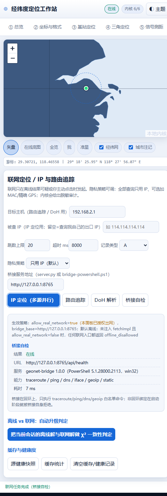

### 2.4 端口、重复启动与换端口

- 默认端口 8765。被占用就 `python server.py --port 9000` /
  `powershell -File bridge-powershell.ps1 -Port 9000`（仍只绑回环）。
- 用 `http://127.0.0.1:9000/` 打开页面时，⑧ 面板自动连同一个端口，不用手填；
  只有直接双击 `index.html`（`file://`）才需要把「桥接服务地址」填成那个端口。
- **同一个端口上不会跑起两个桥。** Windows 的 `SO_REUSEADDR` 允许第二个进程绑到**正在监听**的端口
  （POSIX 会直接 `EADDRINUSE`），两个桥并存时连接被随机分走——改了代码重启，页面行为却来自上一个
  还没退的旧进程，看起来像「我的修改没生效」。所以 `create_server()` / PowerShell 的启动段在绑定之前
  先对目标端口发一次回环 connect：已经有人监听就直接退出并打印换端口的命令。
  启动器不受影响：它等的是 `/api/health`，旧服务健康就照常打开页面。
- 自检：`python server.py --selftest` / `... bridge-powershell.ps1 -SelfTest`
  都**不监听端口、不起子进程、不外联**（只做一次回环 connect 探测）。

### 2.5 托管 https 页面怎么连上你本机的桥接

托管页给的是 `https://iammezsh.github.io/…`，桥接是 `http://127.0.0.1:8765`：跨协议、跨站点、
还要打进回环。两道浏览器策略都得过，本仓库两头都做了：

- **CORS**：`/api/*` 一律带 `Access-Control-Allow-Origin: *`。为什么是 `*` 而不是回显 Origin——
  本服务没有任何鉴权与 Cookie（也没有 `Access-Control-Allow-Credentials`），
  而 `file://` 页面发来的 `Origin` 是 `null`，只有 `*` 覆盖得到。静态文件**不给** CORS 头，
  所以别的站点读不到你的项目文件。
- **私有网络访问（PNA）**：Chrome/Edge 从公网 https 页面请求 `127.0.0.1` 前，
  会先发一条带 `Access-Control-Request-Private-Network: true` 的预检，只有回显同名头才放行。
  `do_OPTIONS`（两份桥同逻辑）**按调用方是否提出这个头来决定回显**，不是无脑广播。
- **默认地址**：`GEONET.defaultBridgeBase()` 在页面本身由桥接提供时跟随同源端口；
  其余来源（`file://`、托管 https）一律退回 `http://127.0.0.1:8765`。所以托管页**不需要**你手填地址。
- 实测记录（含预检响应头原文）在第 9 节「托管 https 页面 → 本机回环桥接」。
  浏览器拦不拦 PNA 由**浏览器版本与开关**决定，不是本仓库能承诺的：真被拦下时界面落到
  `bridge_unavailable`，并把桥接正文里的中文原因原样显示出来；改用 `http://127.0.0.1:8765/`
  打开同源页面即可绕过这一层。

### 2.6 逐请求的来源地址守卫（PowerShell 桥额外要做的一层）

`HttpListener` 的前缀是**按 Host 头分派**的，而内核态的 `http.sys` 会把监听端口开在所有网卡上——
也就是说局域网里别的机器发一个 `Host: localhost:8765` 就可能把请求送到你的桥。
所以 PowerShell 桥除了拒绝非回环绑定，还**对每个请求再校验 `RemoteEndPoint`**：
来源不是 `127.x` / `::1` 就返回 `403 not_loopback`，拿不到来源地址时按拒绝处理（fail-closed）。
这条排在方法判断与坐标校验之前，不是挂在某个端点上；闸门里有专门的四项
（回环来源放行 / 局域网来源被拒 / 拿不到来源也拒 / 不依赖 .NET Core 才有的 `IsLoopback` 属性——
它在 PS 5.1 上是空的）。`server.py` 那侧由绑定地址本身保证，行为一致。

### 2.7 iPhone / iPad 上跑桥接（iSH）

`启动-iSH.sh` 在 iSH（Alpine Linux 虚拟机 App）里按顺序做五件事，每一步都把「成了/没成」打印出来：

```sh
apk add python3                     # 只需一次
cd 项目目录                          # 或 apk add git && git clone https://github.com/IAMMEZSH/geo-position-workstation
sh 启动-iSH.sh                      # 可加端口：sh 启动-iSH.sh 9000
```

查 `python3` → 查 `server.py` 在不在（不在就给 `git clone` 与「文件」App 放进 `/mnt/pub` 两条补齐办法）
→ 跑 `python3 server.py --selftest`（101 项，不联网）→ 起桥接并最多轮询 12 秒 `/api/health`
→ 检查 `traceroute` / `ping` 齐不齐（缺就提示 `apk add iputils traceroute`）→ 打印该在 Safari 打开的地址。

**如实说明**：iSH 用自己的用户态网络栈，Safari 能不能连上它监听的 `127.0.0.1` 取决于 iSH 版本，
作者**没有在 iOS 实机上验证过这一步**。所以脚本在连不上时直接打印日志尾部，并给出两条出路：
用托管地址（功能差别只有 ⑧ 的逐跳追踪），或换 A-Shell / Pyto / Texta 这类能本机起 HTTP 的 App
跑同一份 `server.py`。

### 2.8 不跑桥接会失去什么

只失去 ⑧ 的**逐跳路由追踪**与**桥接侧 ping/DNS**：面板会明确报 `bridge_unavailable` 并说明原因。
其余十个面板、六个内核、地图、离线数据、⑪ 自检全部照常；⑧ 自己的 IP 定位与 DoH 也能走浏览器直连。

---

## 3. 十一个面板逐个说明

下面每个面板都写了「吃什么 / 给什么 / 今天实测」。标 **2026-11-02 实测** 的数字都是当天在这台机器上
点真实按钮跑出来的（本机 Windows，PowerShell 桥在跑，页面 `http://127.0.0.1:8765/`），
不是设计值；换一台机器、换一个时刻，小数位会变，量级与结论不会。

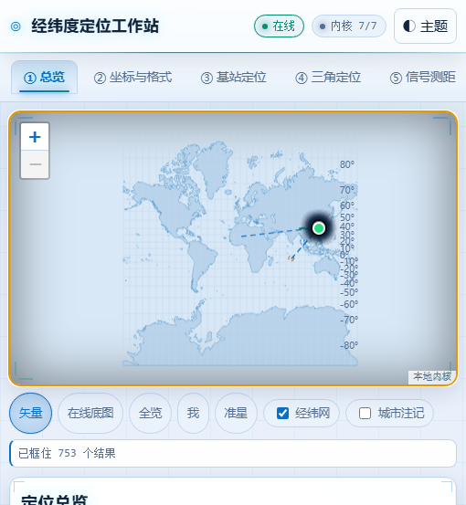

### ① 定位总览

- **用浏览器定位我在这里**：取浏览器给的坐标，先在离线数据里反查（最近城市、国家、陆域/水域），
  再显示精度圈。被拒绝时界面写「你拒绝了定位授权（code=1）」，**不会**改用 IP 结果冒充。
- **粘贴坐标 / 解析**：任意写法都能吃——`31.2304,121.4737`、`31°13'49"N 121°28'25"E`、
  `50R LM 23456 12345`（MGRS）、`ww8p4kj`（Geohash）、`8R3C66Q2+66`（Plus Code）、
  合并数字 `31.2304 121.4737`、地图 URL。内核按置信度挑读法，读不出来会说明为什么。
- **当前会话的全部解**：本次会话里每个面板算出的位置都累加在这张表（来源、纬度、经度、精度、依据），
  可互相比较、可图上对照。
- **两点量测**：正算（给起点+方位+距离求终点）与反算（给两点求距离/正反方位），可选椭球与算法。
  **2026-11-02 实测**：上海→洛杉矶大地线 `1065846.489 m`（= 1065.846 km / 662.286 mi / 575.511 nmi），
  起始方位 `335.9309°`，反算再正算的往返闭合差 `0.000000 m`。
- **准星**（地图下方工具条第 5 个 chip：`矢量 · 在线底图 · 全览 · 我 · 准星 · 经纬网 · 城市注记`）：
  钉在地图容器正中的十字 + 圆环，是 DOM 叠层（`pointer-events:none`）而不是地图 marker，
  所以永远严格等于地图中心、不随缩放漂移。开启后**点地图任意处**就把那点平移到正中（缩放不变），
  平移一停，读数条立刻给出中心点的
  `DD(6 位小数) ｜ DMS ｜ UTM 带号+经纬距 ｜ MGRS ｜ Plus Code ｜ Geohash ｜ 最近城市与距离 ｜ 缩放`，
  并排还显示游标位置，方便确认「我要的是正中，不是鼠标碰到的地方」。再点一次「准星」恢复只看游标。
  **2026-11-02 实测**（中心 31.239811, 121.480637，缩放 10）：

  ```
  准星：31.239811, 121.480637 ｜ 31° 14' 23.32" N 121° 28' 50.29" E ｜ UTM 51N E355308.7 N3457174.6
      ｜ MGRS 51R VQ 55308 57174 ｜ Plus Code 8Q336FQJ+W77 ｜ Geohash wtw3sr590 ｜ 最近城市 黄浦 0.3 km ｜ 缩放 10
  ```

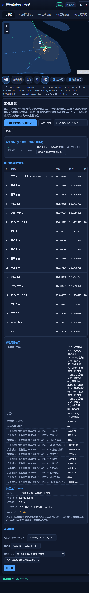

### ② 坐标与格式

投影与编码（UTM / UPS / MGRS / Geohash / Plus Code / WebMercator / 地图 URL）、
中国坐标偏移（WGS84 ↔ GCJ-02 ↔ BD-09，含偏移量与是否落在官方偏转区）、
基准与椭球（含布尔莎 7 参数转换与高程改正）、精度与有效位。

**2026-11-02 实测**：
- `31°13'49.44"N 121°28'25.32"E` → 十进制度 `31.2304, 121.4737`，候选读法置信 `0.93`；
- 4 位小数 → 地面量级 `11.09 m`（面板里那张「小数位→地面量级」对照表就是干这个的）；
- WGS84→GCJ-02 偏移量级 `435.5 m`；迭代反算回 WGS84 与原值差 `0.0000 m`。

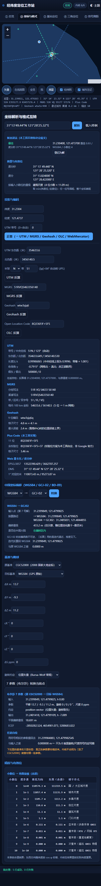

### ③ 基站（蜂窝）定位

吃 JSON 或 CSV，字段认 MCC/MNC/TAC(LAC)/CI/ARFCN/PCI/RSSI/RSRP/TA/RAT/经纬度/方位角/波束宽。

- 距离来源优先级：显式 `range_m` → 定时提前 TA（GSM 554.69 m/格、LTE/NR 78.17 m/格）→ RSSI/RSRP 传播模型。
- 手工补充基站坐标：网优库里缺站址时，把已知站址贴进来即可参与交会并画扇区。
- 结果给：位置、参与/剔除站数、残差 RMS、误差椭圆、GDOP、每站估距依据。
- 三个「样例」按钮是内置的自洽数据（LTE / GSM / NR 各一套）。
- 估距与站址彼此不自洽（残差远大于单站 σ）时，面板会直说「解出的位置不可用」，
  而不是给一个几千公里置信半径的伪解。

**2026-11-02 实测**（喂 `示例数据/基站观测示例.json`，3 站 LTE）：
`31.240108, 121.480783`，残差 RMS `21.5 m`，不确定半径 `102.2 m`，GDOP `1.20`；
TA 逐格换算 `16→1251 m`、`29→2267 m`、`3→1664 m` 都写在依据列里；解距内置待定点 Q 差 `75.5 m`。

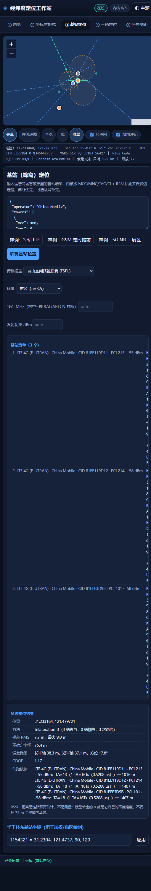

### ④ 三角定位 / 交会

A 方位角交会（2 条可交会，第 3 条做多余观测检核）、B 距离交会（圆相交，双解时用其余圆挑支）、
C 未知点→参考点反算（把待定点到各参考点的距离与方位算出来，正好填回 A/B 做闭合检核）。

**2026-11-02 实测**：3 条方位交会 → `31.239985, 121.479983`，角残差等效 `0.5 m`，
不确定半径 `52.3 m`，GDOP `1.19`；距离交会 → `31.239988, 121.480015`，RMS `2.9 m`、半径 `25.1 m`。

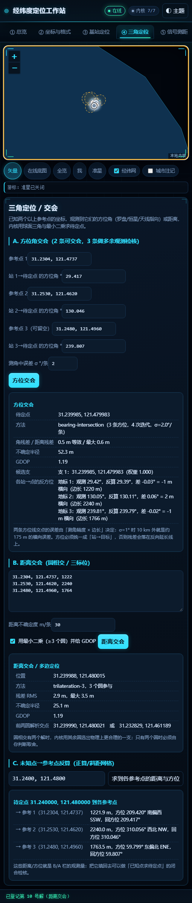

### ⑤ 信号测距

- A RSSI ↔ 距离：自由空间损耗 + 对数距离路径损耗指数 n，环境预设
  dense_urban/urban/suburban/rural/outdoor/indoor，可给发射功率与 1 m 参考损耗走链路预算；
  反方向「由距离预测 RSSI」用于校核。
- B Wi-Fi/蓝牙指纹匹配：指纹库 + 现场扫描，方法含 cosine / euclidean 等，可设 K；
  置信来自匹配点之间的实际间距，与 RSSI 精度无关。
- C TDOA 到达时间差：参考站 + 各站时差（ns 或 tdoa_s），符号约定
  `tdoa = (本站距离 − 参考站距离)/c`，正=更远；至少 2 条时差观测量（加参考站共 3 站）才有唯一解，
  且需要站间时钟同步（ns 级误差 ≈ 0.3 m/ns）。

**2026-11-02 实测**：indoor 环境 FSPL 反推距离 `3098.1 m`，模型自带 σ `2853.4 m`
（这个 σ 就是「别把 3098 m 当成精度承诺」的写法），RSSI→距离→RSSI 往返差 `0.000000 dB`。
逐条都会给出模型假设与量级，不给「精确到米」的错觉。

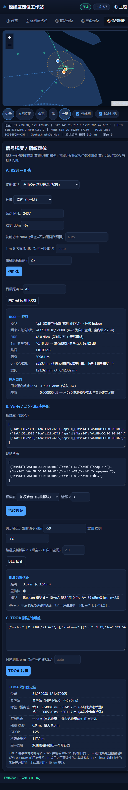

### ⑥ GNSS 卫星

A NMEA 解码（GGA/RMC/GSA/GST/GSV/VTG，含校验和逐字节复算；严格模式可开）；
B 星历 + 伪距单点定位（开普勒轨道传播、加权最小二乘、真值已知可加噪看收敛）；
C 天空图与几何（DOP、卫星轨迹）；D 相对定位/差分（ENU 基线）；
E 对流层（Saastamoinen / Hopfield，含映射函数）与电离层（单层壳层 VTEC 斜延迟 + 双频无电离层组合）；
F 精密服务电文（L6/CLAS 帧头、PPP-B2b 比特解码）。
内核算不出的字段一律返回 `null` 并在界面上写明原因，不做插值。

**2026-11-02 实测**（喂 `示例数据/NMEA语句示例.log` + 星历场景）：
10 行语句校验和全部 ✓；最小二乘解 `31.3099935, 121.3900514, 12.18 m`，
与场景真值差 **`4.94 m`（水平）/ 4.95 m（三维）**——这条差是独立检核，不依赖内核自报的 σ；
RAIM/FDE 自动剔除注入粗差的 PRN 16；后验 RMS `3.194 m`、单位权 σ₀ `0.305 m`、
χ² = 0.37 / dof 4 / p = 9.85e-1；HDOP `1.753`、CEP68 `9.36 m`。

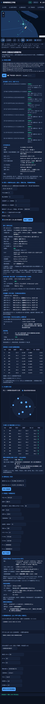

### ⑦ 天象定位

太阳/月亮/恒星的视位置（含折射、视半径、地心→站心视差）、日出日落与晨昏蒙影、
子太阳点/子月点（画到地图上，含晨昏线）、北极星罗经（精确反解 + 双解）、由过中天高度反推纬度。
每块都附一行**独立检核**：用另一条算术路线复算同一个量并给出差值。

**2026-11-02 实测**（观测点 31.2304, 121.4737；本地 2026-11-02 14:30 / UT 06:30）：
- 太阳：几何高度 `28.1518°`、视高度（含折射）`28.1832°`、方位（真北顺时针）`228.5054°`；
  日下点 `-14.76726, 78.39762`（在回归线内，赤纬上界 23.4358°）；GMST `139.050253°`；
- 高度独立检核：`球面大圆高度 28.1518° vs 内核地平解 28.1518°，差 -0.0000°（0.0′）；
  方位差 0.0000°` → 两条路在 `0.0200°` 内一致。同一行还写出
  「走椭球大地线得中心角 61.6497°，与球面差 -0.1985°（**扁率固有，不参与判定**）」——
  这句话是修出来的：以前拿椭球那个数去比球面解，中纬度天天报「不符」，而那是模型固有差（第 11 节第 8 条）；
- 月亮：地心高度 `-16.5322°` → 站心 `-16.3310°`，视差改正 `0.2012°`（地平视差 3545.6″），
  月下点 `17.34154, -1.07129`（距 370649.8 km）；检核同样 `-0.0000°`；
- 昼长：数值积分 `10.8992 h` vs 解析 cosH₀ 式 `10.8960 h`，差 `0.19 min`（自洽）。

时间尺度限制直接写在结果里：假定 UT1=UTC（|UT1−UTC|≤0.9 s → GMST 误差 ≤13.5″ ≈ ±410 m 经度）、
未加 ΔT(TT−UT)、未建模闰秒；月位是 Meeus 第 47 章截断主项，黄经累积截断 ≤0.4°（小于月视直径 0.5°），
未与外部历表核对，月下点可能有 ~40 km 偏差，不用于月掩星或月龄精算。

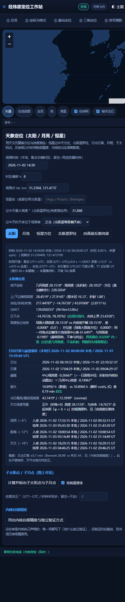

### ⑧ 联网定位 / IP 与路由追踪

- **隐私策略三档**：`只用 IP（默认）` / `IP + 精确 GPS` / `禁用联网`。默认不发送任何坐标。
- **IP 定位（多源并行）**：前端内置 6 家来源（ipapi_com / ipinfo_io / ipapi_co / ipwho_is / freeipapi /
  opencagedata），其中 opencagedata 需要 `api_key`，不填就跳过它；两份桥的来源表是另外 5 家
  （不含需要 key 的那家）。并行查询后做 χ² 一致性融合，给融合点、用源数、MAD 剔群依据。
  留空「被查 IP」= 查自己的出口 IP。
  **2026-11-02 实测**：6 源扫描 → 2 源可用（ipinfo_io `30.0500,121.1494 ±50.0*` Yuyao/CN 2465 ms；
  ipwho_is `29.8782,121.5494 ±100.0*` Ningbo 890 ms），ipapi_com 超时 8000 ms、ipapi_co 403、
  freeipapi 307、opencagedata 缺 key 跳过，逐条写明原因 → 融合 `30.015638, 121.229409`，
  报告精度 `50.0 km`（BLUE σ 44.72 km 与加权 75% 分位取大者），χ²=0.148 / dof 2 / p=9.29e-1（α=0.0010）
  → 判「不矛盾」；MAD 中位偏差 21.51 km、σ̂ 31.89 km、k=3.5、地板 50 km。
  表里带 `*` 的精度是**内核自报的保守兜底量级**，不是该源的实测精度（第 5 节）。
- **路由追踪 / ping**：走本机桥接调系统 `traceroute`/`tracert`/`ping`。结果表含通道、每跳
  IP/主机名/RTT/状态、「伪造跳数：否」，以及一行**目标归属**（`内网/本机` + 原因，或 `公网`）。
  **2026-11-02 实测**：`github.com` → 通道 `bridge`、5 跳（未在 20 跳内到达）、其中 2 跳如实标
  「无响应（*）」、耗时 8017 ms、目标归属 `公网`；本机网关 `192.168.2.1` → 1 跳、到达目标、39 ms、
  目标归属「内网/本机（私有网段 192.168/16）」。
- **DoH 解析**：A/AAAA/CNAME/TXT/MX/NS。
- **桥接自检**：探「桥接服务地址」框里那台的 `/api/health`，报告版本、能力、耗时。该框留空即自动
  （同源页面跟页面端口走，`file://` 与托管页固定用 `127.0.0.1:8765`）。
  **2026-11-02 实测**：PowerShell 桥 `7 ms` 返回在线，运行时一行是
  `geonet-bridge 1.0.0（PowerShell 5.1.28000.2113，win32）`。
- **升级判定**：把本次会话的离线解与联网解做 χ² 一致性检验，明确告诉你联网证据是否足以推翻离线结论
  （α、HDOP/RMS/星数阈值都可查）。
- 缓存与健康度：源健康快照、缓存统计、一键清空。

红线（只绑回环、拒收坐标、argv 不经 shell、不做 SSRF 中继、内网目标允许但标注归属）写在第 7 节。

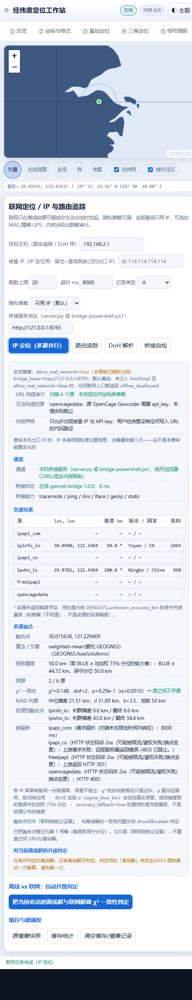

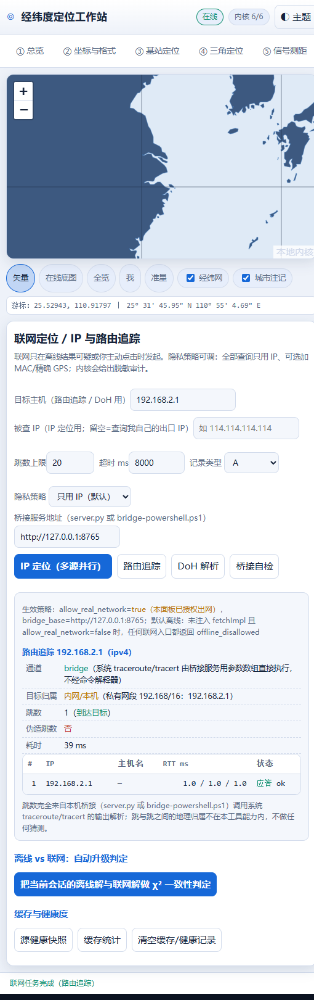

### ⑨ 批量坐标处理与导出

粘贴 CSV/文本，或直接粘贴/选择 GPX、KML、GeoJSON 文件（同一套提取逻辑，两个入口等价）。
一次完成解析、格式转换、量测（折线长度、面积、外包框、质心、凸包）；
导出 CSV / GeoJSON / GPX / KML / 凸包边界 WKT，可复制或存文件；
另有分享链接与二维码（本机生成，不上传，深链只带经纬度与缩放）。

**2026-11-02 实测**（喂 `示例数据/坐标批处理示例.csv`）：14 行全部成功、0 行失败；
折线长度 `78418.543 km`（13 段），「分段求和」独立复算差 `0.000000000 m`；
凸包 6 顶点 / `113813720.935 km²`，凸包 − 多边形 > 0 时明写「点序构成凹形」；
球面面积 vs 平面面积差 99.972 % 直接标出来（跨经度大时平面面积没意义）；
球面质心 `40.171827, 110.046169` vs 算术平均 `29.383841, 81.878131` 差 `2826247.2 m`，
并解释「跨经度大或靠近 180° 时直接平均经度会翻到地球另一边」。
解析失败的行**原样回显**你贴进去的内容（含引号与 `&`），不转义成 `&quot;`（第 11 节第 7 条修的双转义）。

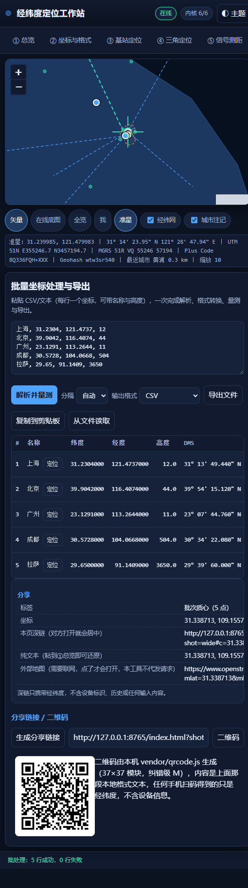

### ⑩ 历史记录与收藏

全部写本机 `localStorage`，不联网、不上传。可自动记录每次解算，可一键清空。

### ⑪ 内核自检

六个内核各跑一遍 `selfTest()`，加一张「运行环境」表（内核齐不齐 / Leaflet / vendor /
离线数据 / 矢量陆域挂图块数 / localStorage / 协议 / 界面缺失 id / 画面标记源码）。
构成、判据与怎么复核写在第 8 节。

**2026-11-02 实测**：515 门 / 0 失败 / 0.69 s（同一次会话另跑一遍是 0.78 s——耗时随机器波动，
门数与失败数不波动）；陆域 1374 块已挂图；界面缺失 id 0 个；画面标记源码 0 处。

---

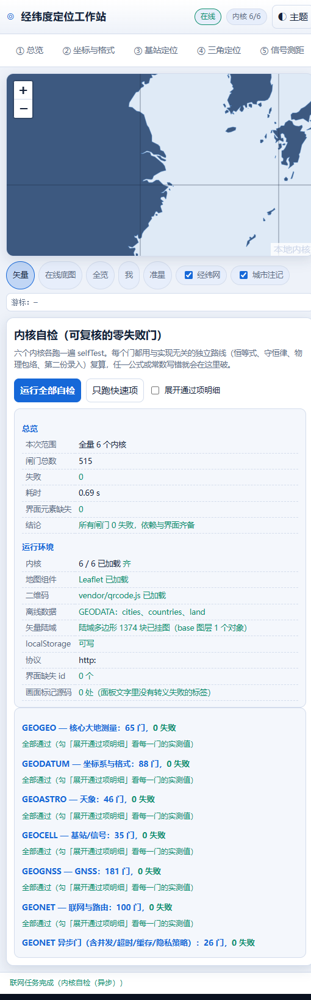

## 4. 示例数据：一份能互相闭合的数据集

`示例数据/` 里 10 个文件不是随便凑的样例，它们共享同一个**待定点 Q = 31.2400, 121.4800**，
所有观测量都由内核自己从 Q 反推生成（TA、RSSI、距离、方位、时差），因此跨面板可互相验证：

| 文件 | 喂给哪个面板 | 应该得到什么 |
|---|---|---|
| `坐标批处理示例.csv` | ⑨ | 14 个点全部解析，含度分秒/度分/MGRS/Geohash/Plus Code/合并数字/南半球/高纬各写法 |
| `航迹示例.gpx` | ⑨（粘贴或选文件） | 提取 6 个点（1 个 wpt + 5 个 trkpt） |
| `基站观测示例.json` | ③ | 31.240108, 121.480783，残差 RMS 21.5 m，不确定半径 102.2 m（距 Q 75.5 m） |
| `基站观测示例.csv` | ③ | 与 JSON 逐字相同的结果；空 rsrp 列不会让后面的列左移 |
| `三角交会示例.txt` | ④B 距离交会 | 31.239990, 121.480020，RMS 2.6 m |
| `三角交会示例.txt` | ④A 方位交会 | 三条方位（29.417° / 130.046° / 239.807°）交会回 Q |
| `TDOA时差示例.txt` | ⑤C | 31.239966, 121.479973（距 Q 约 12 m） |
| `指纹库示例.json` + `现场扫描示例.json` | ⑤B | 加权 KNN 落在库点之间，置信≈点间距量级 |
| `NMEA语句示例.log` | ⑥A | 10 行、校验和全部通过，位置 31°13.8240'N 121°28.4220'E |
| `L6-PPP-B2b电文示例.txt` | ⑥F | PRN 193 / 消息类型 63（CLAS）；PPP-B2b 类型 3 |

用法建议：先跑 ③ 得到 Q 的估计，再跑 ④、⑤C，三者应落在同一个 100 m 圆里——
这就是「离线证据互相支持」的样子；然后到 ⑧ 点「升级判定」，看联网证据是否与之一致。
⑪ 自检里不少闸门就是拿这些样例做「第二份录入」的独立复算。

---

## 5. 精度与诚实性：这份工具不会替你猜的地方

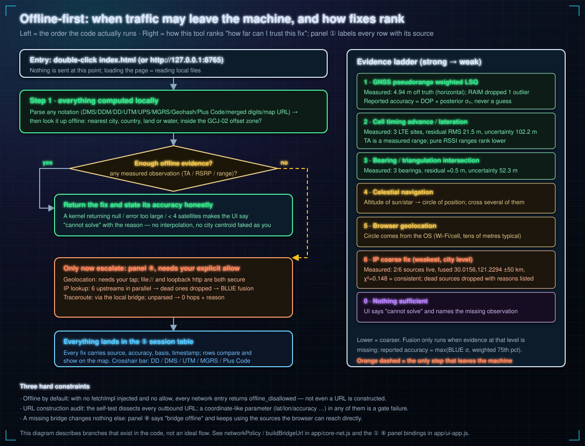

- **小数位就是精度**：`31.2304, 121.4737` 是 4 位小数 ≈ `11 m` 量级；写成 8 位小数不会让它更准。
  ② 面板有一张「小数位 → 地面量级」对照表，超出物理能力的有效位会被标成**伪造精度**。
- **RSSI→距离是估计，不是测量。** 面板打印模型自带的 σ（今天 indoor 反推 3098.1 m 配 σ 2853.4 m），
  并写明「不要把这两千多米当成精度承诺」。
- **估距与站址不自洽时会说破。** 残差 RMS 远大于单站 σ 时，最小二乘照样能吐一个坐标，
  但那不是位置——内核会明确标注不可用。
- **缺坐标的基站不参与交会**，并如实列入「缺少经纬度」；两个圆相交的双解会列出两支，
  只有两站时由你判断取舍。一条方位线定不出一个点：④ 与 ⑦ 都给候选解与残差，不给唯一「正确答案」。
- **TDOA 的符号约定写在结果里**（正=比参考站远）；站间不同步时结果没有意义。
- **GCJ-02 不可逆**：加偏函数没有闭式反解，「反算」是迭代逼近，残差如实显示。
- **天象的时间尺度限制逐条列出**：UT1−UTC 未知 → GMST 误差 ≤13.5″（≈±410 m 经度）；
  未建模闰秒；TT≈UT。检核行只用与实现同假设的那条路（球面），椭球与球面的扁率固有差单独写明。
- **路由追踪零跳就是零跳。** 解析不出来时返回空 hops + 中文说明（权限不足 / ICMP 被拦 / 输出格式未知），
  绝不按期望跳数补点；界面上「伪造跳数」字段恒为「否」。
- **亚毫秒的跳**（中文 Windows `tracert` 印 `<1 毫秒`）记为上界 `<1 ms×3` 而不是编一个数值，
  也不会因此被判成「无响应」。
- **IP 定位是城市/区级**：报告精度取 `BLUE σ` 与加权 75% 分位的**较大者**；源没给精度字段时用
  内核自报的保守兜底量级并在表里标 `*`——那是刻意偏「不知道」，不是该源的实测精度。
- **浏览器定位被拒绝时**，界面写的是「你拒绝了定位授权（code=1）」，不会悄悄改用 IP 结果冒充。
- **有歧义的输入**（如合并数字 `31.2304 121.4737`）会列出多个候选读法与置信度，由你选。
- **能不能拿它做工程测量？** 能算，但别把它当仪器：没有 RTK 数据链、没有权威大地水准面模型、
  没有认证过的坐标系参数。报告精度是「内核能自证的下限」，不是测绘资质。

---

## 6. 架构与实现约定

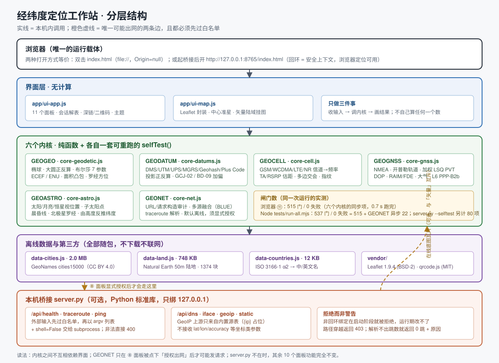

### 6.1 一句话结构

`index.html` 是唯一入口，也是唯一的「装配表」：**15 个本地 `<script>`/`<link>`** 按顺序把数据、
六个内核、地图封装和界面外壳挂到 `globalThis` 上，没有打包器、没有模块加载器、没有运行时依赖。

```
index.html
 ├─ vendor/leaflet.css  app/style.css
 ├─ vendor/leaflet.js   vendor/qrcode.js
 ├─ app/data/data-countries.js  ┐
 ├─ app/data/data-cities.js     ├─ 挂到 globalThis.GEODATA（三个文件各自 Object.assign）
 ├─ app/data/data-land.js       ┘
 ├─ app/core-geodetic.js   → GEOGEO      椭球 / 正反算 / ECEF·ENU / 面积凸包
 ├─ app/core-datums.js     → GEODATUM    投影 / UTM·MGRS·Geohash·OLC / GCJ-02·BD-09 / parseAny
 ├─ app/core-cell.js       → GEOCELL     信道→频率 / TA·RSRP 估距 / 交会 / 指纹 / TDOA
 ├─ app/core-gnss.js       → GEOGNSS     NMEA / 轨道 / 加权 LSQ PVT / DOP / RAIM / 大气 / PPP
 ├─ app/core-astro.js      → GEOASTRO    太阳·月亮·恒星 / 子点 / 晨昏线 / 天文定位
 ├─ app/core-net.js        → GEONET      联网策略 / URL 审计 / 多源融合 / 追踪解析
 ├─ app/ui-map.js          → GEOUI_MAP   Leaflet 封装 + 准星 + 矢量陆域
 └─ app/ui-app.js          → GEOUI       11 个面板的外壳与绑定
```

内核之间**不互相 import**；需要跨内核时通过 `globalThis` 上的命名空间取
（例如 ① 面板把 `GEOGNSS.fuseSolutions` 借给 `GEONET` 做融合）。
这样每个文件都能单独在 Node 里加载、单独跑自检——`tests/run-all.mjs` 用的就是同一份文件，
不是「Node 版」副本。

### 6.2 内核的写法约定

- 每个内核是 `(function (G) { 'use strict'; ... })(globalThis)` 的 IIFE，只挂一个命名空间。
- 纯函数优先：不读 DOM、不读 `location`、不发请求。唯一例外是 `GEONET`，它读 `location` 只为了
  推断默认桥接地址（第 6.4 节），且真实出网必须显式注入 `fetchImpl` 或在 ⑧ 面板授权。
- 每个内核导出一个 `selfTest()`，返回 `[{name, pass, detail}, …]`；`detail` 必须是**能拿去对答案的数字**，
  不是 `ok`。判据用与实现无关的第二条路线：恒等式、守恒律、物理包络、第二份独立录入的常数、
  与本工具无关的公开基准值。
- 算不出就返回 `null` + `note`/`error_kind`，**不返回一个看起来合理的数**。界面按原样显示。

### 6.3 地图层（`app/ui-map.js`）

Leaflet 只做「投影 + 平移缩放 + 图层容器」，底图默认**不发网络请求**：

- `base` 图层放离线矢量陆域（`GEODATA.land`）。数据形状是
  `blocks = [块, …]；块 = [外环, 洞环, …]；环 = 扁平数组 [lon,lat,lon,…]（不闭合存储）`，
  所以 `buildLand()` 必须**钻两层**再成对取坐标，并在收尾补闭合点（少钻一层的事故见第 11 节第 1 条）。
- `grid` 经纬网、`cities` 城市注记、`results` 结果点与精度圈、`overlay` 辅助线（晨昏线、天空图、交会射线）。
- **中心准星**：`position:absolute; inset:0; pointer-events:none` 的 DOM 叠层钉在容器正中；
  开启后点地图任意处 → `map.setView(点, 当前缩放)` 把它转到正中，`moveend` 触发读数回调。
- **层叠上下文**：Leaflet 内部控件自带 400~1000 的 z-index。窄屏断点下 `.mapwrap` 会退成
  `position: static`（不再形成层叠上下文），这些 z-index 就跑到整页最前，把吸顶的标题行和标签页盖住——
  表现是「字看得见但点不动」。修法是给 `.mapwrap` 加 `isolation: isolate`（与定位方式无关），
  并把 `.topbar` / `.tabs` 提到 1300 / 1200（第 11 节第 2 条）。

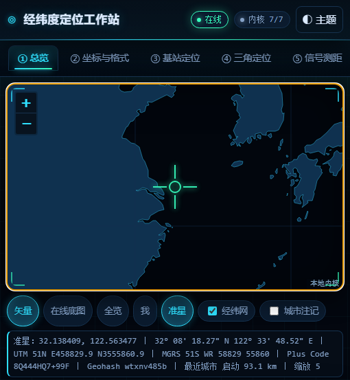

### 6.4 联网层（`app/core-net.js`）

三层防护，缺一不可：

1. **默认离线**：`allow_real_network=false` 且未注入 `fetchImpl` 时，联网入口返回
   `offline_disallowed`，连 URL 都不构造。
2. **URL 构造审计**：自检把每个出站 URL 拆开检查，只允许出现「被查 IP」与「API key」两类占位；
   坐标类参数一旦出现即闸门失败。上游地址来自内置源表，自建上游用 `upstream_url`（必须含 `{ip}`，
   拒绝回环/私有/链路本地与非 http(s)），因此桥接不会变成任意 URL 的中继。
3. **桥接地址同源优先**：`defaultBridgeBase()` 在页面本身就是回环 http(s) 源时返回页面 origin，
   于是 `http://127.0.0.1:9000/` 打开页面时 ⑧ 自动连同一个端口；`file://`、非回环源、`origin=null`
   一律退回默认 `http://127.0.0.1:8765`。显式传参时**绝不回看真实 `location`**，
   否则自检结果会随运行环境漂移。

### 6.5 界面层的转义模型（为什么专门写一节）

`app/ui-app.js` 里的 HTML 助手只有一套规则，混用就会在屏幕上出现字面标签（第 11 节第 7 条）：

| 助手 | 行为 | 传进去的东西 |
|---|---|---|
| `esc(s)` | 转义 | 原始文本 |
| `h4/pre/bad/good/warn` | **内部已经转义** | 原始文本 |
| `kv(rows)` / `note(t)` | 不转义（当作已安全） | 已经拼好的 HTML |

所以 `note(warn(esc(x)))` 是错的（双转义 → 屏幕出现 `&quot;` 或 `<span class="good">`），
`kv([['k', good(x)]])` 是对的。这轮把 67 处调用点的多余 `esc()` 摘掉，
并因为摘除时 `'前缀' + x || ''` 的优先级坑补了 15 处括号；
⑪ 环境表因此新增一行「画面标记源码」闸门，只匹配助手函数的指纹
（`<span class="good|bad|warn|note">`、`</?h4>`、`&lt;/?字母`），命中就计入 `bad`，
并且把报告文字里的 `<>&";` 换成 `·`，避免这条闸门下一次把自己报出来。

### 6.6 桥接层的实现约定

见第 2.3 节（两份实现与三道一致性闸门）、第 2.4 节（端口预探测）、第 2.6 节（逐请求来源守卫）、
第 7 节（红线）。这里只补三条只在代码里看得见的约定：

- **静态 Content-Type 用内置表，不用平台 mime 库**：`mimetypes` 在 iSH / Termux / macOS 上各不相同，
  让 `/etc/mime.types` 决定响应头等于让每台机器给不同的字节；两份桥的表逐键逐值一致（闸门守着）。
- **`.ps1` 的字符串比较一律显式区分大小写**：PowerShell 的 `-eq` 默认不区分，
  上游 `"status":"Success"` 会被判成成功；改成 Ordinal 比较后才和 Python 的 `!=` 同义。
- **`if (...)` 条件里不写 `>`/`<` 裸比较**：PS 括号里的 `>` 是文件重定向，
  `$lab.Length > 63` 会「永远不成立」并悄悄在当前目录写出名为 `63` 的文件。
  闸门里有一条专门正则扫所有 `if/while` 条件，命中就红。

### 6.7 加一个新面板/新内核要做什么

1. 内核文件末尾导出 `selfTest`，闸门至少覆盖：已知答案、恒等式往返、边界值、垃圾输入不抛异常。
2. `index.html` 里按顺序加 `<script>`，并在 `app/ui-app.js` 的依赖清单里登记
   （⑪ 的「界面缺失 id」与 `tests/check-package.py` 的资源齐备检查会替你把关）。
3. 跑 `node tests/run-all.mjs --with-server --with-bridge` + `python tests/check-package.py` +
   `python tests/bridge-parity.py`，再在浏览器 ⑪ 点一次全量，最后**看一眼画面**（第 11 节的教训）。

---

## 7. 联网与隐私红线

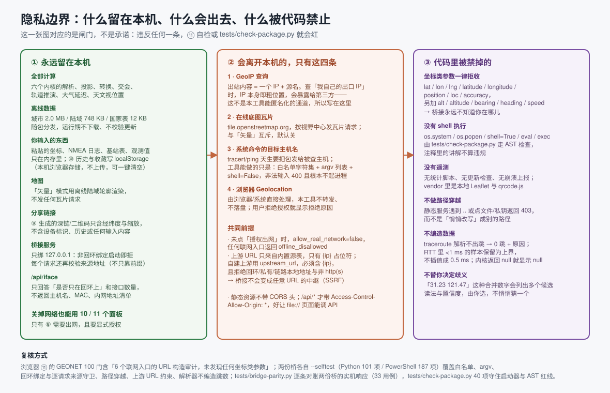

### 7.1 会离开本机的请求，全部列出来就这四类

| # | 请求 | 触发条件 | 出站内容 | 关掉方式 |
|---|---|---|---|---|
| 1 | GeoIP 上游（内置 6 源） | ⑧ 面板 + 显式授权 + 点「IP 定位」 | 一个 IP（查自己出口 IP 时，IP 本身就是粗位置） | 隐私策略选「禁用联网」 |
| 2 | `tile.openstreetmap.org` 瓦片 | 地图工具条点「在线底图」 | 视野范围（按瓦片 XYZ 请求） | 切回「矢量」（默认） |
| 3 | 系统 `tracert` / `ping` 的目标主机 | ⑧ 面板 + 桥接在线 | 目标主机名的 DNS 解析与 ICMP/UDP 探测 | 不点按钮 |
| 4 | 浏览器 Geolocation | 点「用浏览器定位我在这里」+ 你在浏览器里点允许 | 由浏览器/系统决定，本工具不转发也不落盘 | 拒绝授权 |

除此之外没有任何出站请求：没有统计、没有更新检查、没有崩溃上报、没有 CDN
（Leaflet 与 qrcode.js 都在 `vendor/`）。

### 7.2 代码级红线（可复核，不是承诺）

以下每一条都有闸门守着，命令见第 8 节：

1. **只绑回环。** 非回环地址在**启动阶段**直接拒绝并退出（`0.0.0.0` / `::` / 任何网卡地址），
   不是警告后继续跑；运行期无法改成 `0.0.0.0`。PowerShell 桥还**逐请求校验来源地址**（第 2.6 节）。
2. **同一个端口不跑第二个桥。** 绑定前先探测端口，已有监听者就拒绝再起（第 2.4 节）。
3. **只读。** 所有端点都是 GET，POST 一律 405；没有写文件、没有改配置、没有执行任何东西。
4. **参数只进 argv，不进 shell。** 主机名/IP 先过白名单 `[A-Za-z0-9._:-]` 与结构校验，
   再以独立 argv 元素 + `shell=False`（PowerShell 侧 `UseShellExecute = $false`）交给系统命令；
   以 `-` 开头（会被当命令选项）一律拒绝。源码里不存在 `os.system` / `os.popen` / `eval(` / `exec(` /
   `compile(`，`tests/check-package.py` 用 AST 扫 Python、按行扫（先剔注释）PowerShell，
   注释里的讲解不计入违规。
5. **不接收、不转发任何坐标。** `lat / lon / lng / latitude / longitude / position / loc / accuracy /
   alt / altitude / bearing / heading / speed` 共 13 项，出现即 400（`privacy_rejected`）；
   隐私闸排在路由分发之前（先拒坐标，再谈端点）；POST body 根本不进解析。**桥接永远不知道你在哪儿。**
6. **不做 SSRF 中继。** GeoIP 上游 URL 只来自内置来源表，唯一可替换的占位符是 `{ip}`；
   自托管 `upstream_url` 必须含 `{ip}`，且主机名指向回环/私有/链路本地/元数据网段
   （127.0.0.1、::1、192.168.x、169.254.169.254、localhost）或使用非 http(s) 协议时全部 400。
7. **静态服务不越界。** 路径穿越、编码后的 `%2e%2e`、控制字符、点目录（`.git`）、私钥扩展名、
   绝对盘符、UNC、反斜杠分隔符、自家访问日志一律 **403 并给中文原因**，
   而不是悄悄改写成别的路径；`/etc/passwd` 这类「看起来像绝对路径」的 URL 只会落到根目录内
   不存在的文件（404），永远不会服务系统文件。
8. **CORS 只给 `/api/*`**，静态文件不带跨域读权限（第 2.5 节写了为什么是 `*`）。
9. **`/api/iface` 脱敏**：只回答「是否只在回环上」与接口数量，
   不回主机名、MAC、网卡名、内网地址清单；枚举失败时说「取不到」，不给 0 假装这台机器没有网卡。
10. **日志压成单行**，防 CRLF 日志注入；访问日志留在本机且被 `.gitignore` 忽略。
11. **零第三方依赖**：Python 只用标准库（http.server / socket / subprocess / json / urllib / threading），
    PowerShell 只用 .NET 内置类型；`package.json` 的 `dependencies`/`devDependencies` 恒为空。

### 7.3 内网目标：允许，但把归属写在你看得见的地方

⑧ 的 `traceroute` / `ping` **可以**打内网地址（`192.168.1.1`、网关、NAS、`127.0.0.1`）。
这是刻意的：「追踪自家路由器」「ping 一下 NAS」本来就是这台工具的主要用途之一，
加一道默认拒绝的闸门等于让功能残废，而且会留下「忘了加开关」这种坑——
所以启动参数里**根本没有内网开关**（闸门反向断言：既没有拒绝用的闸函数，也没有它的提示函数）。

同时如实说明这一处的边界：

- `/api/*` 用 `Access-Control-Allow-Origin: *`，代价是**任意网页**都能向 `http://127.0.0.1:8765/api/…`
  发请求。桥接只绑回环且逐请求校验来源，能连它的只有这台机器上的程序与浏览器；但浏览器会替任何页面发这个请求。
- 因此两个命令端点是**只读诊断**：没有写操作、没有 POST、目标过白名单与结构校验、
  参数按 argv 分元素交给子进程、墙钟与跳数上限固定、并发到上限先挡回来
  （不把机器变成 `tracert` 发射台）。它能造成的后果是「对某个地址多发几次探测包」，
  而不是「在你机器上执行任何东西」。
- 每次成功响应都带 `target_scope`（`lan` / `public`）与 `target_scope_note`，
  域名还按**解析结果**判定（内网 DNS / rebinding 看得见）；界面单独一行「目标归属」。
  旧版桥没有这两个字段时，界面显示「桥接未标注」而不是猜一个。
- 解析失败时**宁可标错归属也不给正常追踪添堵**：域名解析不出来时不判内网。

要彻底关掉这个口子只有一个办法：**不启动桥接**。没有桥，⑧ 的路由追踪明确报 `bridge_unavailable`
并只做浏览器 DoH 解析，其余十个面板全部照常。

### 7.4 数据留在哪里

- 你输入的一切只在内存；⑩ 历史与收藏写 `localStorage`（本机浏览器存储，不上传，可一键清空）。
- ⑨ 生成的深链与二维码只含经纬度与缩放级别，不含设备标识、历史或任何输入内容。
- 桥接默认不打印请求体（它只处理 GET，参数在 query 里），日志写在项目根目录，已在 `.gitignore` 里。

---

## 8. 自检怎么复核（六层门）

「内核全绿」这件事必须有能被别人重跑的入口，否则不算证据。六层互不替代，任何一层红了都别用：

| 层 | 命令 / 入口 | 实测（2026-11-02） | 管什么 |
|---|---|---|---|
| 浏览器内核门 | ⑪ 面板 → 运行全部自检 | **515 门 / 0 失败**，0.69 s | 在真实 DOM + Leaflet 环境里跑六个内核的同步闸门 |
| Node 内核门 | `node tests/run-all.mjs` | **541 门 / 0 失败**（515 + GEONET 异步 26） | 同一份内核文件在无 DOM 沙箱里重跑，证明结论不依赖界面 |
| Python 桥门 | `python server.py --selftest` | **101 项 / 0 失败**（1 跳过） | 参数白名单、回环绑定、端口预探测、路径穿越、上游 URL 约束、解析器不编造跳数；不监听端口、不外联 |
| PowerShell 桥门 | `powershell -NoProfile -ExecutionPolicy Bypass -File bridge-powershell.ps1 -SelfTest` | **187 项 / 0 失败** | 同上，加 PS 特有的求值/重定向/`-eq` 大小写/来源守卫/并发上限 |
| 实机对账 | `python tests/bridge-parity.py` | **33 用例 / 0 失败** | 两份桥同时拉起，逐条打同一个请求：状态码、键集合、字节数、Content-Type |
| 打包体检 | `python tests/check-package.py` | **40 项 / 0 失败** | 入口 15 个本地资源齐不齐、启动器编码与换行、两份桥的 AST/行扫红线与契约字面量、文档配图断链、`.gitignore` 误吞、零依赖 |

一把跑完：

```bash
node tests/run-all.mjs --with-server --with-bridge   # 内核 541 + Python 101 + PowerShell 187
python tests/bridge-parity.py                        # 两份桥实机对账 33 用例
python tests/check-package.py                        # 打包体检 40 项（只需要 Python）
npm run test:all                                     # 只跑内核 + Python 桥
```

### 8.1 内核门的构成

| 内核 | 门数 | 真实闸门名（从 `selfTest()` 里直接摘的） |
|---|---|---|
| GEOGEO | 65 | 赤道 1° 经度 = a·Δλ（111319.4908 m）；往返距离对称 <1 mm；反向正算精确回到起点；方位角互反（差 180°）；近对跖点收敛；近北极两点过极点 22.32 km；32 罗经点每点都有名称；单次反算耗时（预热后 30 次均值 < 40 ms） |
| GEODATUM | 88 | 子午线弧 1° 与 GEOGEO 反算一致；等角纬度往返闭合；横轴墨卡托满足 C-C 共形方程；收敛角在中央经线上为 0、随南北半球反号；子午线弧 90° = 10 001 965.7 m；UTM/UPS/MGRS/Geohash/OLC 往返；DMS/DDM 解析与格式化；GCJ-02/BD-09 加偏与迭代反算；`parseAny` 多读法置信度；`outOfChina` |
| GEOCELL | 35 | FSPL 基准值 + RSSI↔距离往返 <0.01 dB；七模型往返一致（28 点全部 <0.01 dB）；Okumura-Hata 量级合理；模型域外截断与标记；`cid_hex` 反解 LAC/CI；`parseInput` 多格式混合与 Android dumpsys（GSM/LTE+WCDMA） |
| GEOGNSS | 181 | 非折回的多圈 M 也能解（残差 <1e-11）；二体（J2=0）能量守恒（RK4 半圈与整圈）；正常极点>赤道且 45° ≈ 9.80665；无电离层组合对一阶延迟严格抵消；`NORM.inv` 与 `NORM.cdf` 互逆；RAIM 自动剔除注入粗差的那颗星；两解 χ² 有解析值可对照 d²/(2σ²)；伪距改正按符号累加且可逐项复现 |
| GEOASTRO | 46 | JD 锚点 J2000.0 = 2451545.0；MJD = JD − 2400000.5（三历元）；1900 非闰与 2000 闰年边界；同一时刻不同 UTC 偏移必须给出同一 JD；GMST 微分恒等 1.002737909 转/天；日下点纬度始终在当年回归线内；至点用求根得到且与「黄经=90°」一致 |
| GEONET | 100 + 26 | 未报告精度的源走显式兜底并打 `accuracy_fallback`；无注入且环境无 `localStorage` 时自动用内存 Map；离线 RAIM 报警 → 升级；测距反演与布局真值一致（<0.2 m）；traceroute 载荷解析保留跳序/超时跳/部分时延（不补数）；全部 API 函数 × 垃圾参数不抛异常；6 个联网入口的 URL 构造审计（坐标类参数不得出现）。**异步 26 门（并发/超时/缓存/隐私策略）只在 Node 侧跑，所以浏览器 ⑪ 是 515** |

### 8.2 每条闸门长什么样

```js
push('单次反算耗时（预热后 30 次均值 < 40 ms）', inv_ms < 40, inv_ms.toFixed(2) + ' ms/次');
```

`{name, pass, detail}` 三元组；`detail` 必须是**能拿去对答案的数字**。
⑪ 展开通过项明细时直接把 `detail` 打出来，所以「绿」是可读的，不是黑盒。

### 8.3 Python 桥的 101 项分十组（名字就是 `--selftest` 里的原文）

| 组 | 项数 | 代表闸门 |
|---|---|---|
| 主机白名单 | 6 | 合法域名/IPv4/IPv6 全部放行；注入与畸形输入全部拒绝；每条拒绝都给中文原因；长度上限 253 生效；单个 shell 元字符逐个命中；非字符串输入不抛异常 |
| 坐标类参数 | 2 | 位置类参数名被识别（含大小写混写）；正常参数不误伤（host/count/max_hops/source/ip） |
| 静态服务 | 6 | 合法路径全部解析到根目录内；`/server.py` 确实指向真实文件；目录穿越/UNC/点文件/私钥扩展名全部被拦且是 403 不是改写；`/etc/passwd` 只落到根内不存在的文件；符号链接指向根外被拦住 |
| shell 红线 | 4 | 源码（去 docstring 与注释）里没有「把整条命令交给 shell 解释器」的写法；`subprocess` 参数里确实写了 `shell=False`（正向断言）；只 import 标准库；把命令拼成字符串交给执行层会被拒 |
| argv 构造 | 8 | traceroute/ping 的 argv 是列表、主机名独立成元素且在最后；`max_hops` 越界夹紧；可执行文件不存在时降级为 `command_missing` 且不抛异常；参数元素含分号/管道仍被二次拦下（纵深防御） |
| traceroute/ping 解析 | 20 | 中文 tracert 解析出 5 跳（含目标 IP 头行）；每跳 3 个 RTT 样本逐个保留；「请求超时。」判 `timed_out` 且 `ip=null`（不猜地址）；`<1 毫秒` 保留为上界；同行混有实测值与上界时各归各列；`* * *` 判超时；**完全无法识别的输出返回空 hops（绝不编造跳数）**；100% 丢包解析成「收到 0」而不是「命令失败」；macOS/BSD 的 `0 packets received` 写法也能解析 |
| GeoIP 归一 | 17 | 五个来源的样例响应都归一成同一组键；`ipinfo` 的 `loc` 按「纬度在前」拆分；没有精度字段的来源返回 `accuracy_km=null` + `accuracy_fallback=True`；布尔值不当坐标（`float(True)=1.0`）；经纬度越界判 `field_invalid`；上游给数组/NaN 字面量判 `json_error`；`_finite` 把 NaN/inf 换成 None（绝不让 NaN 进 JSON） |
| 上游 URL | 8 | 来源表里每个 `{ip}` 模板都通过安全校验；留空 ip 时查自己的出口 IP（URL 里不含任何 IP）；`ip` 参数必须是 IP 字面量（给域名也拒绝）；自建上游必须含 `{ip}`；SSRF/非 http 协议的上游全部被拒；所有对外 URL 的参数名里没有任何位置信息 |
| 契约与 health | 11 | CORS 只给 `/api/*`；health 载荷字段与前端对齐、可严格 JSON 序列化、不含任何坐标字段；契约覆盖 6 个端点且已排序无重复；health 的键集合与契约完全相同（与 ps1 同一份清单）；iface 的键与契约一字不差；`ipv4_loopback_present` 是**真测出来的**，不是写死的事实 |
| 内网目标与绑定 | 12 | 内网/回环/链路本地/元数据/CGNAT/组播与本机名全部标 `lan`；公网与空值标 `public`；域名解析到内网时也标注；traceroute 与 ping 的成功响应都带 `target_scope`；**拦截路径已彻底移除**（没有拒绝用的闸函数，也没有启动参数里的内网开关）；非回环绑定地址一律拒绝；`create_server` 对 `0.0.0.0` 直接拒绝且没有创建监听套接字；端口已有监听者时不再起第二个 |
| 杂项与垃圾输入 | 7 | `run_with_timeout` 超时后返回降级说明（`getaddrinfo` 不可中断）；线程里的异常转成错误文本；IP 字面量的 DNS 不发查询；`clamp_int` 不抛；日志压成一行（防 CRLF 注入）；iface 只报数量与回环事实；**全公共函数 × 垃圾参数扫描：无异常逃逸** |

本机不允许创建符号链接时，「符号链接逃逸防护」一项打印 `[跳过]` 并说明原因——这是环境限制，不是失败。

### 8.4 PowerShell 桥的 187 项分十组

同一套纪律（**不联网、不起子进程、不绑端口**），十个分区：
A 主机名白名单、B 坐标类参数一律拒、C 目标归属（允许并标注）、D traceroute/ping 解析器、
E 参数夹取与命令参数串、F GeoIP 上游、F2 GeoIP 归一化（喂固定 JSON，不出网）、
G 静态路径、H `/api` 契约（页面不区分两份实现）、I 只读与安全红线、J 并发上限。
只有这份桥才有的几组值得点名：

- **求值红线**：不做字符串求值（`Invoke-Expression`/`iex`）、不启动命令解释器（`cmd.exe /c`）、
  不用会走 shell 的启动方式（`Start-Process`）、子进程显式 `UseShellExecute = $false`。
- **`if` 条件里没有把重定向符当比较用**（正则扫所有 `if/elseif/while` 的条件文本）。
- **来源守卫**：回环来源放行 / 局域网来源被拒（哪怕 `Host:` 写成 localhost）/
  拿不到来源地址按拒绝处理（fail-closed）/ 非回环给 403 + `not_loopback` 而不是 500 /
  不依赖 .NET Core 才有的 `IsLoopback` 实例属性（PS 5.1 上它是空）/ 守卫排在方法判断与坐标校验之前。
- **health 如实**：没有 `python` 版本号（PowerShell 实现不冒充 Python）；`platform` 由本机算出来不写死；
  能力清单里没有没实现的东西；`limits.shell` 恒为 `false`；`privacy.position_params_accepted` 恒为 `false`。
- **JSON 形状**：`ConvertTo-Json` 深度够用（第三层数组不塌成字符串）；0 跳也如实给空数组、null 字段不乱码；
  跳对象往返后 `rtts_ms` 仍是数组；`iface` 只回白名单里的键、回的 JSON 里不含本机主机名。
- **运行期卫生**：自检不启动子进程、不联网；工作线程枚举名按名字赋（5.1 与 7 的类型名不同）；
  启动段建线程失败就拒绝启动，而不是留下一个没人处理请求的空壳；并发到上限先挡回来。

### 8.5 界面级验证（内核看不见的那一类）

内核全绿不等于界面能用。这个项目已经踩过四次「全绿但画面是坏的」（第 11 节）。所以 ⑪ 的环境表里
有 **矢量陆域**（断言挂图块数与 `base` 图层对象数，正常 1374 块）、**界面缺失 id**、
**画面标记源码**（第 6.5 节）三行界面断言，任何一条命中都计入 `bad`。
排查层叠问题用 `document.elementFromPoint()` 直接问「这个坐标上最上面的元素是谁」，
修完应当是 `HEADER.topbar` / `BUTTON.tab`，而不是 `CANVAS.leaflet-zoom-animated`。
PNA 预检回显那条**故意不进闸门**：它必须由真实浏览器发起才能证明有效，实测记录写在第 9 节。

### 8.6 CI

`.github/workflows/ci.yml` 在 `ubuntu-latest` 与 `windows-latest` 上各跑一遍
`node tests/run-all.mjs --with-server --with-bridge`、`python tests/bridge-parity.py`、
`python tests/check-package.py`。零依赖：不需要 `npm install`，不需要 `pip install`。
`bridge-parity.py` 在 ubuntu 上退出码 3（本机没有 PowerShell），workflow 把它如实转成
`::notice::` 跳过而**不是假装通过**——那份桥本来就只在 Windows 上跑。

---

## 9. 平台矩阵与实测记录（2026-11-02，本机 Windows）

先说结论：**六个内核 + 离线数据 + 地图 + ⑪ 自检，在任何能执行 JavaScript 的浏览器里都完整可用**；
差异只在两处——① 浏览器定位需要「安全上下文」，② ⑧ 面板的逐跳路由追踪需要本机桥接
（Windows 上零安装，其他平台需要 Python）。

### 9.1 一览表

| 平台 | 怎么打开 | 内核/离线数据 | ⑪ 自检 | 浏览器定位 | ⑧ 路由追踪 |
|---|---|---|---|---|---|
| 任意平台 · 不下载不安装 | 浏览器开托管地址 | ✅ | ✅ https 下 515 门实测通过 | ✅ https 是安全上下文 | ⚠️ 需本机另起桥接；跨源已实测打通（9.4） |
| Windows | 双击 `启动-Windows.bat` | ✅ | ✅ | ✅ Chrome/Edge 会弹授权 | ✅ 有 Python 走 `server.py`，没有走 PowerShell 桥（**不装任何东西也全功能**） |
| Windows（不跑 bat） | 双击 `index.html` | ✅ | ✅ | ✅ `file://` 在 Chrome/Edge/Firefox 里算安全上下文 | ⚠️ 桥没起 → ⑧ 显示「桥接不在线」，直连源仍可用 |
| macOS | 双击 `启动-macOS.command`（首次 `chmod +x`） | ✅ | ✅ | ✅ | ✅（需 Python） |
| macOS / Linux | `sh 启动-macOS-Linux.sh` | ✅ | ✅ | ✅ | ✅（需 Python） |
| Linux | 直接开 `index.html` | ✅ | ✅ | ✅ | ⚠️ 需手动 `python3 server.py` |
| Android 手机/平板 | Termux：`pkg install python` → `sh 启动-Android.sh` | ✅ | ✅ | ✅ Chrome 开 `http://127.0.0.1:8765/` 是安全上下文 | ✅ 桥就跑在手机上（只绑回环，别的设备连不到） |
| Android（无 Termux） | 开托管地址 | ✅ | ✅ | ✅ | ❌ 手机上没有 Python → 只有直连 GeoIP 源与 DoH |
| iPhone / iPad | ① 开托管地址（推荐，零安装）；② iSH 跑 `启动-iSH.sh` | ✅ | ✅ | ✅ https/回环都是安全上下文 | ⚠️ 要 iSH（第 2.7 节），否则只有 GeoIP/DoH |
| iPhone / iPad（文件 App 直接开 .html） | ❌ 不要用 | Quick Look 不执行脚本，页面根本跑不起来 | — | — | — |

### 9.2 三条「不给」是设计，不是没做完

1. **桥接不监听局域网。** 非回环绑定在**启动阶段直接拒绝**。所以「电脑起服务、手机连
   `http://192.168.x.x:8765`」这条路走不通，也不该走通——一个能代跑 `tracert`/`ping` 的 HTTP 服务
   暴露到局域网，等于给同网段任何人开了个命令口子。手机要用就在手机上跑（Termux / iSH）。
2. **桥接不接收坐标。** 13 个坐标类参数名全在拒收名单里，校验在构造 argv 之前（第 7.2 节第 5 条）。
3. **非安全上下文不给定位。** 用 `http://` 局域网地址打开页面时浏览器直接拒掉 Geolocation，
   这不是本工具能绕的。六个离线内核不受影响，因为它们只是 JS 计算。

### 9.3 本机逐面板实测（同一份代码、同一天）

| 场景 | 结果 |
|---|---|
| `http://127.0.0.1:8765/index.html`（PowerShell 桥） | 7 个命名空间全部加载，Leaflet 就绪，陆域 1374 块挂图，⑪ **515 门 / 0 失败**（0.69 s），界面缺失 id 0，画面标记源码 0 处 |
| `file://…/index.html`（不跑桥，直接双击） | `isSecureContext = true`，7 个命名空间齐，地图就绪，陆域 1374 块；桥接自检从 `Origin: null` 调 `/api/health` 11 ms 返回在线 |
| ⑧ 桥接自检 | 通道 `bridge`、`bridge_base=http://127.0.0.1:8765`、`geonet-bridge 1.0.0（PowerShell 5.1.28000.2113，win32）`、7 ms |
| ⑧ 路由追踪 `github.com` | 5 跳（2 跳如实标「无响应（*）」）、未在 20 跳内到达、8017 ms、目标归属 `公网`、「伪造跳数：否」 |
| ⑧ 路由追踪 `192.168.2.1`（本机网关） | 1 跳、到达目标、39 ms、目标归属「内网/本机（私有网段 192.168/16）」 |
| ⑧ IP 定位（6 源并行） | 2 源可用 → 融合 `30.015638, 121.229409`，报告精度 `50.0 km`，χ²=0.148/dof=2/p=9.29e-1；超时/403/307/缺 key 的源被剔除并逐条写明原因 |
| ⑥ GNSS 最小二乘 | 解 `31.3099935, 121.3900514, 12.18 m`，与真值差 **4.94 m**（独立检核），RAIM 剔除 PRN 16，HDOP 1.753，σ₀ 0.305 m |
| ③ 基站多边定位 | `31.240108, 121.480783`，残差 RMS 21.5 m，不确定半径 102.2 m，GDOP 1.20 |
| ④ 方位交会 | `31.239985, 121.479983`，角残差等效 0.5 m，半径 52.3 m，GDOP 1.19 |
| ⑦ 太阳 | 几何 28.1518° / 视 28.1832° / 方位 228.5054°；日下点 `-14.76726, 78.39762`；检核差 `-0.0000°` |
| ② WGS84→GCJ-02 | 偏移量级 435.5 m；迭代反算回 WGS84 与原值差 `0.0000 m` |
| ⑨ 批处理 | 14 行全部成功、0 行失败；分段求和与总数差 `0.000000000 m` |
| 准星 | 中心 `31.239811, 121.480637` → DD/DMS/UTM 51N/MGRS 51R VQ/Plus Code/Geohash/最近城市 黄浦 0.3 km/缩放 10 一次给全 |
| 浏览器定位 | 本机的受控测试浏览器被自动化策略直接拒绝授权（`code=1`，1 ms 返回）→ 界面如实显示「你拒绝了定位授权」，**没有**拿 IP 结果或城市中心冒充。这一条只能由你在自己的浏览器里点「允许」来验证 |

### 9.4 托管 https 页面 → 本机回环桥接

在线地址是 `https://iammezsh.github.io/…`，桥接是 `http://127.0.0.1:8765`。跨协议、跨站点、
还要打进回环——CORS 与 PNA 两道都得过，所以两条都当场测：

| 测法 | 结果 |
|---|---|
| 在托管地址上跑 ⑪ 全量自检 | **515 门 / 0 失败**（1.96 s），陆域 1374 块，界面缺失 id 0，环境表「协议」一行是 `https:` |
| 在托管地址上跑 ⑧ `traceroute 192.168.1.1` | 通道 `bridge`、`bridge_base=http://127.0.0.1:8765`（**没有**报 `bridge_unavailable`，说明 PNA 预检被放行）；那一网段不在这台机器的链路上，于是 3 跳全部如实显示「无响应（*）」、25011 ms，界面没有补一个跳数 |
| 同源对照：`http://127.0.0.1:8765/` 上跑 `traceroute 192.168.2.1` | 通道 `bridge`、1 跳、到达目标、24 ms、目标归属「内网/本机（私有网段 192.168.2.1）」 |
| `OPTIONS` 预检（带 `Access-Control-Request-Private-Network: true`，`Origin: https://iammezsh.github.io`） | `204 No Content` + `Access-Control-Allow-Origin: *` + `Access-Control-Allow-Private-Network: true` + `Access-Control-Max-Age: 600` |
| `OPTIONS` 预检（**不带** PNA 头） | 响应里 `Access-Control-Allow-Private-Network` 出现 **0 次**（按需回显，不是无脑广播） |
| 静态文件（`GET /index.html` 带外部 `Origin`） | 响应里 `access-control-*` 头 **0 条**（API 是 4 条）——跨站页面读不到项目文件 |

留一句余地：**PNA 由浏览器版本与开关决定**，不是本仓库能承诺的。真被拦下时界面落到
`bridge_unavailable` 并把桥接正文里的中文原因原样显示；换 `http://127.0.0.1:8765/` 打开同源页面即可。

### 9.5 从 GitHub 拿到之后

| 拿法 | 结果 |
|---|---|
| `git clone --depth 1` | 在 clone 里跑第 8 节那三条命令，门数与本机一致；clone 里的 `启动-macOS.command` / `.sh` / `启动-Android.sh` 均为 **CRLF=0** 且带 `#!/bin/sh`，`启动-Windows.bat` 为纯 ASCII + CRLF，`bridge-powershell.ps1` 为 BOM + CRLF（由 `.gitattributes` 钉住，不靠各人 `core.autocrlf`） |
| clone 后**直接双击 `index.html`**（`file://`，不起桥） | `isSecureContext=true`，11 个标签页齐，地图画布有实际像素，⑪ **515 门 / 0 失败**、陆域 1374 块、界面缺失 id=0、控制台 0 条报错 |
| 桥接从 clone 起（`--port 8799` / `-Port 8799`） | `/api/health` `ok=true`、`bind.loopback_only=true`，`/index.html` 返回的字节与磁盘上的 `index.html` **SHA-256 相同** |
| GitHub「Download ZIP」 | 与仓库逐字节相同；zip 内 `.bat`/`.ps1` 存 CRLF、`.command`/`.sh`/`.js` 存 LF |

一处**没在本机复现、但你会遇到**的：浏览器下载 ZIP 时 Windows 会给文件打「来自网络」标记
（MOTW，用资源管理器解压会传给解出来的文件），双击 `启动-Windows.bat` 可能被 SmartScreen 拦一次——
「Windows 已保护你的电脑 → 更多信息 → 仍要运行」。macOS 的 Gatekeeper 对 `.command` 同理
（右键 → 打开，或 `xattr -d com.apple.quarantine 启动-macOS.command`）。`git clone` 下来的文件不带这个标记。
规避办法很省事：**直接双击 `index.html`**，网页与数据文件不需要执行权限，六个内核全跑，只是 ⑧ 没有路由追踪。

### 9.6 关于「一台设备的定位精度」

浏览器定位给的是系统混合定位（Wi-Fi/蜂窝/IP），几十到几百米是常态；本工具只转述它的精度圈，不美化。
要米级就走 ⑥ GNSS（自己喂 NMEA 或观测），要几十米就走 ③ 基站定时提前。
⑧ 的 IP 定位在城市/省一级，报告精度会刻意取保守值。

---

## 10. 离线数据：从哪来、怎么裁、怎么重建

三个数据文件都是**纯浏览器脚本**（IIFE 挂到 `globalThis.GEODATA`，不含 `import`/`export`/`require`），
所以 `<script>` 与 Node 的 `vm`/`require` 都能加载——这也是 541 门能在 Node 里跑同一份数据的原因。

| 文件 | 大小 | 内容 | 来源 | 许可 |
|---|---|---|---|---|
| `app/data/data-cities.js` | 2.0 MB | 全球城市（名称、国家码、lat/lon 4 位小数、人口） | GeoNames `cities15000.txt` | CC BY 4.0（要求署名） |
| `app/data/data-land.js` | 748 KB | 陆地多边形 **1374 块** | Natural Earth `ne_50m_land` | 公有领域 |
| `app/data/data-countries.js` | 12 KB | ISO 3166-1 α2 → 中/英文名 | ISO 代码表 | 事实数据 |

### 10.1 裁剪参数（`工具/build-data.mjs` 顶部，全是明写的常数）

- `CITY_MIN_POP = 10000` —— 与源文件名 `cities15000` 的量级一致。
- `CN_CITY_MIN_POP = 4000` —— 中国小城市是国内用户的搜索主力，单独放宽（所以中国行密度明显高）。
- `LAND_COORD_DP = 2` —— 陆地坐标保留 2 位小数 ≈ 1.1 km。够做**海陆粗判**和极简底图，不够做导航；
  这是刻意的取舍，换来 748 KB 而不是 40 MB。
- `LAND_MIN_AREA_DEG2 = 0.0025` —— 约 30 km² 的碎块阈值。1.1 km 网格下小于它的多边形会退化成噪声；
  而自检与海陆判断关心的最小陆块（瓦胡岛 ≈ 1545 km²）远大于它。

### 10.2 幂等与脏数据处理

- 输出**只由输入决定**（不含时间戳），同一份输入重跑产生逐字节相同的文件；输入缺失时保留旧文件并以非 0 退出。
- 原始文件路径可用环境变量覆盖：`GEO_RAW_CITIES` / `GEO_RAW_LAND` / `GEO_OUT_DIR`。
- 落盘前递归扫描：`NaN` / `Infinity` / `undefined` / `null` 一律视为脏数据，**宁可构建失败也不落盘**。
- 生成后立刻在 Node 里按浏览器方式执行一遍（靠全局副作用），验证真的能加载。

### 10.3 原始输入的确切出处（2026-11-02 实测）

| 输入 | URL | 字节数 | SHA-256 |
|---|---|---|---|
| GeoNames zip | `https://download.geonames.org/export/dump/cities15000.zip` | 3,365,609 | `c7b7482b115463874798824f76381f84103233c0a9db9d43efe8501719200dc9` |
| 解出的成员 | `cities15000.txt`（zip 内唯一成员） | 8,546,918 | `15c40acb067f02528249715f42c21feb3769192debd79b73d6479a1f980b69ae` |
| Natural Earth | `https://raw.githubusercontent.com/nvkelso/natural-earth-vector/master/geojson/ne_50m_land.geojson` | 1,636,166 | `e874b27a51d146452be360cafb3cc50c86001074a67d534113e6534682f9826b` |

`naturalearthdata.com` 的 `ne_50m_land.zip` 当时返回 HTTP 500，所以上面用的是 Natural Earth 官方
vector 仓库里的 GeoJSON 派生件（同一份数据、同一许可），别改成前者否则构建会卡住。

重建校验结果（用上面这份输入跑 `工具/build-data.mjs` 与随包数据对比）：

- `data-land.js`、`data-countries.js`：**逐字节相同**（763,002 B / 9,395 B，1374 块、195 国不变）。
- `data-cities.js`：差 68 字节 —— GeoNames 的 dump **每天重发布**，这次拉到的是 4 个城市变了
  （Luján de Cuyo 多了 `PPLA2` 类别、Bad Friedrichshall / Umluj / Göködepe 的人口或类别更新），
  不是构建器的不确定性。所以「逐字节可重建」的准确说法是**同一份输入下逐字节相同**。

```bash
# 1. 拉上面表格里两份官方原始数据（zip 要解出 cities15000.txt）
# 2. 指到本地路径；GEO_OUT_DIR 省略就直接写进 app/data/
GEO_RAW_CITIES=/path/cities15000.txt GEO_RAW_LAND=/path/ne_land.geojson \
  node 工具/build-data.mjs
```

### 10.4 数据在内核里的用途

- **最近城市反查**：给定坐标 → 距离排序取前 N（`GEOUI_MAP.nearestCity`）。准星读数条、① 的浏览器定位结果、
  ⑧ 的 IP 融合点都靠它做「这个坐标像不像个地方」。
- **海陆粗判**：点在陆域外 → 明确说水域，不给你一个假城市。
- **国家归属**：`countryName(cc)` 用 ISO 表把国家码翻成中文，界面里不出现裸的两位码。
- **偏转区判断**：配合 `GEODATUM` 决定 GCJ-02 / BD-09 转换是否适用（`outOfChina` 会直接告诉你偏移不适用）。

### 10.5 分发时要保留什么

GeoNames 是 CC BY 4.0，**再分发必须保留署名**——第 13 节和 `LICENSE` 末尾的第三方说明就是为此存在的，别删。
Leaflet 1.9.4（BSD-2-Clause）、qrcode.js（MIT, Kazuhiko Arase）同理。
在线底图瓦片的 © OpenStreetMap contributors（ODbL）只在你打开「在线底图」时才相关，瓦片不属于本包。

---

## 11. 踩过的坑：内核看不见的那一类故障

这一节的存在理由只有一个：**「闸门全绿」和「东西是对的」之间隔着好几道缝**。
每一条都是真踩出来的，并且都已经补了闸门或改法。

1. **离线陆域一个像素都没画。** 数据形状是 `块 = [环, 洞环, …]`，遍历少钻了一层，
   每个「块」被当成扁平数组、`length < 6` 判断直接跳过 → 1374 块全丢、MultiPolygon 为空、画布空白，
   而**所有内核闸门依旧全绿**。防线：⑪ 环境表的「矢量陆域」一行断言挂图块数与图层对象数。
2. **标题行和标签页被地图盖住点不动。** 窄屏断点下 `.mapwrap` 退成 `position: static`，
   Leaflet 的 400~1000 z-index 逃到整页最前 → 字看得见但点不动。防线：`isolation: isolate` +
   `.topbar`/`.tabs` 提层；排查手法是 `document.elementFromPoint()`。
3. **`.gitignore` 静默吞掉交付文件。** 顺手加的一行 `*.log`（本意是桥接日志）把
   `示例数据/NMEA语句示例.log` 也排除了：页面照跑、闸门照绿，只有别人 `git clone` 之后才发现少文件，
   而那时已经看不出少了什么。改法：只忽略根目录那一个（`/桥接服务.log`、`/bridge-powershell.log`），
   并由 `check-package.py` 反向把忽略规则套到交付文件上，任何命中都算失败。
4. **一条 `rm -rf` 删到了父目录。** 想删临时 clone（`_build/clone-test`）写成 `rm -rf _build`，
   把同一棵树里**唯一的**两份离线数据原始输入一起删了。那些路径是 gitignore 的开发期目录，
   仓库里没有、`git status` 里也看不见，所以任何自检和 CI 都不会报错——直到要重跑构建器才发现输入没了。
   已补齐并当场验证（第 10.3 节）。教训：**删目录前先 `ls` 那个目录**；临时产物和不可替代的输入不放同一棵树，
   或者至少——原始输入现在有固定 URL + 校验和，删了也能重建。
5. **同一个端口上跑了两个桥接。** `netstat` 一眼发现 `127.0.0.1:8765` 上有两个进程 LISTENING，
   因为 `HTTPServer.allow_reuse_address = 1` 而 Windows 的 `SO_REUSEADDR` 允许重复绑定
   （POSIX 会直接 `EADDRINUSE`，所以这个坑只在 Windows 出现）。后果不是报错，而是连接被随机分走：
   改了 `server.py` 重启，页面行为却来自上一个还没退的旧进程——看起来像「我的修改没生效」。
   改法：绑定前先探测端口，已有人监听就直接退出并打印换端口的命令。
6. **一条计时闸门被环境抖出来。** `GEOGEO` 原来有一条「单次反算耗时 < 12 ms」，5 次循环、冷启动直接计时，
   而且**判定和展示各跑一遍**。浏览器里一直绿；放进 Node 沙箱第一次就报 `13.00 ms/次` 判失败——
   那不是公式错，是 JIT 冷启动噪声，而且展示的数字跟被测的根本不是同一次。
   改法：预热 30 次 → 测 30 次均值 → 只测一遍、判定与展示同一个数 → 阈值放宽到 40 ms。
   教训：**能被环境抖出来的闸门就不该存在**；这类门的作用是「没把算法写崩」，不是基准测试。
7. **界面把标签印成了正文（双转义）。** `h4()`/`bad()`/`good()` 内部已经转义，调用方又包了一层 `esc()`，
   于是 ⑪ 的标题上屏幕出现字面量 `<span class="good">0 失败</span>`，⑨ 的错误行出现 `&quot;`。
   这轮摘掉 67 处多余 `esc()`，其中 15 处因为 `'前缀' + x || ''` 的优先级坑要补括号。
   防线：⑪ 新增「画面标记源码」一行，只匹配助手函数自己的指纹，且报告文字自己先消毒，不会下次把自己报出来。
8. **⑦ 的检核拿椭球去比球面。** 「高度独立检核」原来用 `GEOGEO.inverse()` 的椭球中心角算天顶距，
   再和内核的球面地平三角比——中纬度一对点本来就差在扁率上（今天实测 0.1985°），
   于是**一个完全正常的解天天报「差异超出…」**。改法：判定只用球面那一路（与内核同假设，
   今天实测差 `-0.0000°`），椭球−球面的差单独写明「扁率固有，不参与判定」；
   月亮那一路明确写「比的是地心高度，地心视差单独列在上面那行」。
9. **PowerShell 的 `>` 在 `if (...)` 里是重定向。** `$lab.Length > 63` 永远不成立，
   还会在当前目录悄悄写出一个名叫 `63` 的文件。闸门里有一条正则专门扫所有 `if/elseif/while` 条件。
10. **PowerShell 的 `-eq` 不区分大小写。** 上游 `"status":"Success"` 被判成失败（Python 侧 `!=` 区分），
    两份桥给不同结论。改成 Ordinal 比较后，两份桥各有一条门（`status 比较区分大小写`）。
11. **`http.sys` 会先把 URL 规范化。** `/app/../server.py` 到 handler 手里时已经变成 `/server.py`，
    于是 PowerShell 桥给 200（根目录内的真文件）、`server.py` 给 403。**两边都没把根目录外的文件交出去**，
    这才是要点——所以 `bridge-parity.py` 的穿越类用例断言的是「拒绝或落在根内」，不是「状态码相同」。
    同理，`HttpListener` 前缀按 Host 头分派、`http.sys` 把端口开在所有网卡上，逼出了第 2.6 节的逐请求来源守卫。
12. **静态 Content-Type 不能回落到平台 mime 库。** `mimetypes` 在 iSH / Termux / macOS 上各不相同，
    回落后同一份文件在不同机器上头不一样；PowerShell 那侧还没有这个库。改成两份都内置同一张表，
    逐键逐值比一遍（40 项门里的一条），并断言 `server.py` 里不再出现 `mimetypes`。
13. **`__pycache__` 会被当成交付文件。** 闸门脚本一旦被当模块 import，`tests/` 下也会长出一份 `.pyc`，
    于是打包体检报「忽略规则误吞交付文件」。改成忽略任意层级的 `__pycache__/` 段，而不是写死前缀。
14. **注释里的「不许用 shell=True」会被 AST 之外的扫描当成违规。** 所以 Python 侧走 AST 并摘掉 docstring，
    PowerShell 侧没有 AST 就按行扫但**先剔注释块**；写反了就会自己抓到自己。

---

## 12. 常见问题

**Q：双击 index.html 能用，为什么还要启动器？**
A：`file://` 下浏览器 GPS 常被拒（Chrome/Edge/Firefox 现在把它算安全上下文，但策略会变），
路由追踪也必须有桥。其余功能两者无差别。不想装 Python 也不想下载：直接用托管地址，
它和仓库是同一份文件，只是 ⑧ 要连本机桥接时你得另外起一份（跨域已打通，见第 2.5 节）。

**Q：我没装 Python，⑧ 还能全功能吗？**
A：能。Windows 上双击 `启动-Windows.bat` 会自动落到 `bridge-powershell.ps1`（系统自带 PowerShell 5.1），
⑪ 之外的 ⑧ 功能与 Python 桥完全一致——两份桥的契约由 3 道闸门对账（第 2.3 节）。
macOS/Linux/Android 上桥需要 Python（`pkg install python` / `apt install python3`）。

**Q：⑧ 面板说「桥接不可用」。**
A：按这个顺序查：① 桥起没起（`python server.py --selftest` 或
`powershell -File bridge-powershell.ps1 -SelfTest` 先确认代码本身没问题）；
② 端口对不对——「桥接服务地址」留空时，同源页面跟页面端口走，`file://` 与托管页固定用 `127.0.0.1:8765`；
③ 被占用就换端口（第 2.4 节：同一端口不会跑起第二个桥，第二个会直接拒绝启动并告诉你原因）；
④ 页面是 https 托管页而浏览器拒绝了 PNA——失败行里会写 `bridge_unavailable`，
改用 `http://127.0.0.1:8765/` 打开同源页面即可，功能完全一致。

**Q：地图是空白的？**
A：默认就是离线矢量陆域（只有陆块轮廓），不是空白。真的一点轮廓都没有时看 ⑪ 的「矢量陆域」一行：
它数的是真正挂到地图上的块数（正常 1374）。要街道图请点「在线底图」，那会向 OSM 发请求。

**Q：标题行/标签页点不动？**
A：已在 v1.0.0 修好（窄屏下 Leaflet 的 z-index 逃出层叠上下文，第 11 节第 2 条）。
如果你看到的是旧版本，`Ctrl+F5` 强刷 `app/style.css`。

**Q：③ 里我贴的 CSV 全是「缺少经纬度」。**
A：多半是表头列名不在识别表里。参照 `示例数据/基站观测示例.csv` 的表头，
或先用「手工补充基站坐标」贴站址。

**Q：解出来的位置差得远。**
A：先看残差 RMS 与不确定半径。RMS 远大于单站 σ 时内核已经判定「位置不可用」，
此时该核对站址，而不是缩小 σ。

**Q：想让结果更准，是不是多填几位小数？**
A：不是。② 的「精度与有效位」会告诉你哪一位已经超出物理能力。

**Q：准星到底在哪里？会不会被别的东西盖住？**
A：地图正中央那个十字，配一条紧贴地图下方的读数条。它是 DOM 叠层（`pointer-events:none`），
所以永远严格等于地图中心，不随缩放漂移。窄屏下地图吸顶，顶栏与标签条的层级高于地图；
⑪ 的「界面缺失 id」一行会把准星按钮和读数条一起查一遍。要验证画面真的画出来了，
看 ⑪ 报告里的「矢量陆域 1374 块」：数据挂上图了，叠层才有东西可盖。

**Q：手机 / 平板 / 苹果设备能用吗？**
A：最省事的一条对所有平台都一样：**Safari/Chrome 直接打开托管地址**，六个内核、地图、离线数据、
⑪ 自检全跑，不需要装任何东西。桌面四平台想要「连本机桥接一起拉起」就走启动器。
iPhone / iPad 上 ⑧ 的逐跳追踪需要本机 `python3 server.py`，可行做法是装 iSH 跑 `启动-iSH.sh`
（第 2.7 节；作者未在 iOS 实机验证 Safari 能不能连上 iSH 的端口，脚本自己会把成没成打印出来）；
没有 iSH 时 ⑧ 仍可做 IP 定位与 DoH，只是拿不到跳数。逐平台逐面板矩阵在第 9.1 节。

**Q：在线地址和下载下来的文件夹是同一个东西吗？**
A：是同一份文件。GitHub Pages 直接把仓库根目录当静态站点发布，`index.html` 与 `app/`、`vendor/`、
`app/data/` 逐字节就是仓库里的那份；页面里没有任何指向「服务器」的调用，除了 ⑧ 主动去连你本机的
`127.0.0.1:8765`。所以在线版同样离线可用：打开之后断网，十个面板照算（地图本来就是矢量陆域，不发瓦片）。

**Q：为什么 ⑧ 允许我追踪 192.168.x.x，不怕被别的网页拿去当内网探针吗？**
A：允许是刻意的——「追踪自家路由器」就是这功能的主要用途，默认拒绝会让它当场残废，
还会留下「忘了加开关」的坑（所以启动参数里根本没有这个开关）。
边界在第 7.3 节：端点只读、参数过白名单、argv 不经 shell、跳数与墙钟有上限、并发有闸，
能造成的后果只有「对某个地址多发几次探测包」；每次响应都带 `target_scope`，
界面把「目标归属」显示出来，所以你看得见包打在局域网里还是公网上。要彻底关掉就别启动桥接。

**Q：别人从 GitHub 拿到这份代码，真的能直接用吗？**
A：`git clone` 与 `Download ZIP` 两条路都在当天当场跑过，数字在第 9.5 节。
唯一要提醒的是浏览器下载会带「来自网络」标记：Windows 上可能被 SmartScreen 拦一次
（更多信息 → 仍要运行），macOS 上 `.command` 首次要右键→打开；
嫌麻烦就**直接双击 `index.html`**，网页文件不需要执行权限。

**Q：我怎么确认我手上这份没被改坏？**
A：跑第 8 节那六层门（三条命令），全部退出码 0 才算干净；CI 里同样三条在 Ubuntu 和 Windows 上各跑一次。

**Q：数据能更新吗？**
A：`app/data/` 下三个文件由 `工具/build-data.mjs` 从 GeoNames cities15000 + Natural Earth ne_50m_land 重建，
**同一份输入**重跑产生逐字节相同的文件（原始输入的 URL / 字节数 / SHA-256 在第 10.3 节）。
注意 GeoNames 每天重发布 dump：隔天拉的新版可能让个别城市字段变化（实测差 4 个城市、68 字节），
这不是构建器的不确定性。日常使用不需要动它。

**Q：能不能拿它做工程测量？**
A：见第 5 节最后一条——能算，但别把它当仪器。

---

## 13. 数据来源与许可

MIT（见仓库根 `LICENSE`）。

| 组件 | 来源 | 许可 |
|---|---|---|
| `app/data/data-cities.js` | GeoNames `cities15000.txt`（人口≥1 万，中国城市放宽到≥4000；经纬度 4 位小数） | CC BY 4.0（GeoNames） |
| `app/data/data-land.js` | Natural Earth `ne_50m_land`（坐标 2 位小数≈1.1 km，碎块阈值≈30 km²） | 公有领域 |
| `app/data/data-countries.js` | ISO 3166-1 _alpha-2 码 → 中/英文名 | 代码表为事实数据 |
| `vendor/leaflet.js` `vendor/leaflet.css` | Leaflet 1.9.4 | BSD-2-Clause |
| `vendor/qrcode.js` | qrcode.js（Kazuhiko Arase） | MIT |
| `server.py` `bridge-powershell.ps1` | 本工具自带（Python 标准库 / Windows 自带 PowerShell 5.1） | MIT（随本工具） |
| 六个内核 + 界面 + 文档 | 本工具自研 | MIT |

`LICENSE` 里除了 MIT 正文还有一段署名提醒：MIT 只覆盖本项目自研的代码与文档，
GeoNames（CC BY 4.0）、Natural Earth（公有领域）、Leaflet（BSD-2）、qrcode.js（MIT）
各自的条款在 MIT 之外；**再分发时必须一并保留上面这张表**（GeoNames 的 CC BY 4.0 要求署名）。

在线底图（地图工具条上的「在线底图」开关，与「矢量」互斥）走 OpenStreetMap 公共瓦片
`tile.openstreetmap.org`，瓦片版权为 © OpenStreetMap contributors（ODbL）；
这一步会向外部服务器发请求，属可选增强，不是本包的一部分。切回「矢量」时地图用离线陆域轮廓渲染，功能不受影响。
